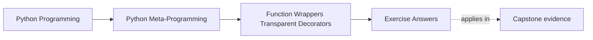

# Exercise Answers


<!-- page-maps:start -->
## Page Maps




<!-- page-maps:end -->

Use this page after attempting the exercises yourself. The goal is not to match every
example literally. The goal is to compare your reasoning against answers that distinguish
mechanics, transparency, and policy honestly.

Use every answer here as a model for three habits:

- state the runtime claim directly
- show the evidence that justifies the claim
- name the boundary that still remains weak or limited

If your own answer only shows code and outcome, it is still missing the teaching layer.

## Answer 1: Build one wrapper skeleton by hand

Example answer:

```python
def log_calls(func):
    def wrapper(*args, **kwargs):
        print(f"calling {func.__name__}")
        return func(*args, **kwargs)
    return wrapper


def greet(name):
    return f"Hello, {name}"


greet_wrapped = log_calls(greet)
```

Strong explanation:

- `wrapper` closes over the original `greet` function through `func`
- the manual rebinding step makes the mechanics explicit before `@` syntax hides it

Good conclusion:

The decorator is just a higher-order function that returns a nested wrapper carrying the
original callable in its closure.

Reasoning checkpoint:

- the closure explains where the original callable is stored
- the rebinding step explains when the function name changed
- nothing here yet proves signature transparency or semantic thinness

## Answer 2: Desugar one stacked decorator example

Example answer:

```python
@d2
@d1
def f():
    pass
```

desugars to:

```python
def f():
    pass

f = d1(f)
f = d2(f)
```

Strong explanation:

- definition-time application is bottom-up
- call-time execution starts at the outermost wrapper and flows inward

Good conclusion:

Stacked decorators are never only formatting. Their order changes composition and
therefore changes behavior.

Reasoning checkpoint:

- `d1` is applied first because it sits closest to the function definition
- `d2` becomes the outer wrapper because it receives the already-wrapped result
- definition-time order and call-time order are linked, but they are not described in the same language

## Answer 3: Implement one thin practical wrapper

Example answer:

```python
import functools
import time


def timer(func):
    @functools.wraps(func)
    def wrapper(*args, **kwargs):
        start = time.perf_counter()
        try:
            return func(*args, **kwargs)
        finally:
            print("elapsed:", time.perf_counter() - start)
    return wrapper
```

Strong explanation:

- the wrapper adds one narrow behavior: timing
- it still returns the original result
- it still lets exceptions propagate, while reporting timing in `finally`

Good conclusion:

This is a thin wrapper because the added concern is narrow and does not take ownership of
cross-call policy or hidden state.

Reasoning checkpoint:

- the proof route is behavioral: same return value, same exception propagation
- `finally` is what keeps the timing report from hiding failure
- adding retry, fallback, or caching would move this answer out of the thin-wrapper category

## Answer 4: Show semantic drift in a stateful wrapper

Example answer:

```python
import functools


def once(func):
    @functools.wraps(func)
    def wrapper(*args, **kwargs):
        if not hasattr(wrapper, "_once_result"):
            wrapper._once_result = func(*args, **kwargs)
        return wrapper._once_result
    return wrapper
```

Strong explanation:

- the wrapper stores `_once_result` on itself
- later calls return the first cached result even if new arguments are supplied

Good conclusion:

This is a policy surface, not only a thin wrapper, because the wrapper now controls
behavior across calls through stored state.

Reasoning checkpoint:

- the governing rule is "first result wins later calls"
- the state trace matters more than the code length
- a reviewer should now ask for reset, inspection, argument policy, and concurrency limits

## Answer 5: Preserve wrapped identity honestly

Example answer:

```python
import functools
import inspect


def bare(func):
    def wrapper(*args, **kwargs):
        return func(*args, **kwargs)
    return wrapper


def preserved(func):
    @functools.wraps(func)
    def wrapper(*args, **kwargs):
        return func(*args, **kwargs)
    return wrapper
```

Strong evidence:

- the bare version often reports `__name__ == "wrapper"`
- the preserved version reports the original name and docstring
- the preserved version has `__wrapped__`
- `inspect.signature` is much more likely to reflect the logical callable correctly

Good conclusion:

`functools.wraps` is part of correctness because it preserves the inspection and review
surface that later tools depend on.

Reasoning checkpoint:

- this proof route is about metadata transparency, not semantic transparency
- `__wrapped__` matters because tools can follow it back to the logical callable
- `wraps` still does not repair changed retry, cache, or fallback behavior

## Answer 6: Review a small cache or retry decorator

Example answer:

Suppose the decorator stores cached results on wrapper attributes and exposes
`cache_clear()`.

Strong assessment:

- the wrapper owns state across calls
- reset behavior must be explicit
- limitations such as hashability or concurrency need to be documented

Good conclusion:

Once a decorator starts caching or retrying, it has moved beyond a thin wrapper and should
be reviewed as a small policy system rather than as harmless sugar.

Reasoning checkpoint:

- the strongest evidence here is the state and control surface, not the decorator syntax
- explicit reset is part of the contract once callers are affected by prior calls
- documented limitations are proof of honest scope, not admissions of failure

## Answer 7: Compare two wrapper compositions honestly

Example answer:

Suppose one function is wrapped in these two orders:

- `timed = timer(retry(work))`
- `retried = retry(timer(work))`

Strong evidence:

- the first order times the whole retrying policy
- the second order times each individual attempt
- the logs, exception flow, and measured numbers can differ even when the same two decorators are present

Good conclusion:

Decorator order is a behavior decision. The stack is part of the program design, not
just a surface-level formatting choice.

Reasoning checkpoint:

- ask which wrapper now sees raw calls and which sees already-modified calls
- order decides who owns timing boundaries, retry boundaries, and log boundaries
- if the answer cannot name one observable trace difference, it is still too vague

## Answer 8: Add one explicit operational control

Example answer:

Suppose a cache decorator stores results in `wrapper._cache` and exposes:

- `wrapper.cache_clear()`
- `wrapper.cache_snapshot()`

Strong assessment:

- the wrapper owns cross-call state
- explicit controls let operators and reviewers inspect or reset that state intentionally
- a hidden cache is weaker because it changes behavior without a clear stewardship surface

Good conclusion:

Once a decorator owns state, it should also expose a deliberate control or observation
surface so maintenance does not depend on private knowledge.

Reasoning checkpoint:

- hidden state is not only harder to test; it is harder to steward safely
- inspection and reset routes lower the maintenance cost of policy-owning wrappers
- a missing control surface usually becomes a support problem before it becomes a theory problem

## Answer 9: Separate thin instrumentation from policy ownership

A strong answer might review a timing decorator and a retry decorator side by side.

Thin instrumentation evidence:

- the timing wrapper adds reporting but preserves results and exception flow
- it does not own state across calls

Policy-ownership evidence:

- the retry wrapper decides whether to repeat calls after failure
- it may change latency, logs, failure surfaces, and external side effects

Good conclusion:

The rewrite rule is simple: if the decorator decides behavior across attempts or across
calls, teach and document it as policy. If it only observes one call without reshaping
control flow, it is much closer to a thin wrapper.

Reasoning checkpoint:

- thin versus policy-owning is proved by behavior traces, not by decorator popularity
- metadata evidence helps only when the dispute is about inspectability
- state traces and control-flow traces matter more once semantics are in question

## Answer 10: Produce a wrapper-governance packet

The packet is strong when another learner can answer:

- what rebinding happened at definition time
- what changed at call time
- whether metadata preservation supports the transparency claim
- which operational controls make stateful wrapper behavior reviewable

A stronger packet also states:

- the governing rule of the most powerful wrapper in the packet
- the strongest remaining limitation that a reviewer should not miss
- whether the transparency claim is about metadata, semantics, or both

## Repair table for weak answer keys

Use this when an answer looks complete but still leaves the reader guessing:

| Weak answer move | Why it is weak | Better replacement |
| --- | --- | --- |
| only restating the code | code alone does not explain timing, proof, or policy | add a runtime claim and one explicit evidence route |
| calling a wrapper transparent without qualification | transparency has multiple surfaces | separate metadata transparency from semantic transparency |
| saying a cache or retry decorator is "just a helper" | hides governing rules across calls or attempts | name the exact policy rule the wrapper now owns |
| treating `wraps` as full proof of safety | preserved identity is narrower than preserved behavior | state what `wraps` repairs and what it leaves untouched |
| leaving order differences abstract | readers cannot review abstractions without traces | name one concrete behavior that differs between both compositions |

## What strong Module 04 answers have in common

Across the whole set, strong answers share the same habits:

- they separate definition-time rebinding from call-time behavior
- they distinguish thin wrappers from stateful policy
- they preserve callable identity when transparency is claimed
- they name limits instead of hiding them behind decorator syntax
- they treat decorator order as an explicit design choice
- they leave behind a packet another learner can review without guessing

If an answer still sounds like "decorators just add behavior," revise it until you can say
what changed, when it changed, and what still remains visible to tools and reviewers.

## Continue through Module 04

- Previous: [Exercises](exercises.md)
- Return: [Overview](index.md)
- Next module: [Module 05](../module-05-decorator-design-policies-typing/index.md)
- Terms: [Glossary](glossary.md)
