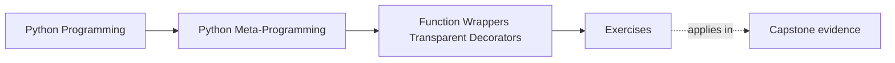

# Exercises

<!-- page-maps:start -->
## Page Maps

<!-- page-maps:end -->

Use these after reading the five core lessons and the worked example. The goal is not to
collect more decorator tricks. The goal is to make wrapper mechanics, transparency, and
stateful policy visible.

Each exercise asks for three things:

- the wrapper behavior you are trying to describe or justify
- the runtime timing or state boundary that matters
- the evidence that proves the wrapper is transparent enough or not

Treat the ten exercises as one full lab day on wrappers and decorator design.

Do them in order:

- Exercises 1-3 establish rebinding mechanics and thin wrapper discipline
- Exercises 4-6 expose stateful policy, metadata preservation, and wrapper review
- Exercises 7-8 extend that discipline into composition order and explicit operational controls
- Exercises 9-10 package the whole module into a reviewable wrapper-governance packet

Keep one wrapper-review table while you work:

| Wrapper or decorator | Definition-time change | Call-time change | Transparency claim | Evidence and boundary judgment |
| --- | --- | --- | --- | --- |

## Exercise 1: Build one wrapper skeleton by hand

Write a decorator without `@` syntax first and apply it manually.

What to hand in:

- the decorator definition
- the manual rebinding step `wrapped = decorator(original)`
- one explanation of what the wrapper closes over

## Exercise 2: Desugar one stacked decorator example

Take a function with at least two decorators and rewrite it in step-by-step rebinding form.

What to hand in:

- the original `@decorator` version
- the explicit `f = d2(d1(f))` form
- one explanation of definition-time order versus call-time order

## Exercise 3: Implement one thin practical wrapper

Write one narrow wrapper such as timing or deprecation.

What to hand in:

- the decorator implementation
- one proof that result and exception behavior remain transparent
- one sentence explaining why the wrapper is still thin

## Exercise 4: Show semantic drift in a stateful wrapper

Implement a small stateful decorator such as `@once`.

What to hand in:

- the state storage location
- one example showing how later calls behave differently because of prior calls
- one explanation of why this is now a policy surface and not just a thin wrapper

## Exercise 5: Preserve wrapped identity honestly

Compare one bare wrapper with one `functools.wraps`-based wrapper.

What to hand in:

- the visible `__name__`, `__doc__`, or `inspect.signature` difference
- one proof that `__wrapped__` exists on the preserved version
- one explanation of why metadata preservation matters to review and tooling

## Exercise 6: Review a small cache or retry decorator

Use the worked example pattern on a stateful decorator.

What to hand in:

- the state it owns
- one reset or inspection surface it should expose
- one limitation that must be documented instead of hidden

## Midday self-check

Before moving into the final four exercises, make sure you can already answer these
questions clearly:

- what changed at definition time and what changed only later at call time
- why a stateful decorator stopped being a thin wrapper
- which identity surfaces `functools.wraps` preserves for tools and review
- what operational control a cache, retry, or once-only decorator should expose

If you cannot answer those four questions in plain language, return to Exercises 1-6 and
make the timing boundary, state boundary, and transparency claim more explicit before
continuing.

## Exercise 7: Compare two wrapper compositions honestly

Take one function wrapped in two different decorator orders and compare the resulting
behavior.

What to hand in:

- the two composition orders
- one observable difference in logging, caching, retrying, timing, or exception flow
- one explanation of why decorator order is a design decision rather than a formatting choice

## Exercise 8: Add one explicit operational control

Choose one stateful decorator and make its operational boundary visible to reviewers or
users.

What to hand in:

- the stateful decorator
- one explicit reset, inspection, or configuration surface
- one sentence explaining why hidden state is weaker than state that can be reviewed or cleared deliberately

## Exercise 9: Separate thin instrumentation from policy ownership

Choose one decorator and explain how you would teach the difference between a thin
instrumentation wrapper and a policy-owning wrapper.

What to hand in:

- the decorator under review
- one evidence path showing it is thin or policy-owning
- one rewrite or documentation rule that would make the classification clearer

## Exercise 10: Produce a wrapper-governance packet

Assemble:

- one wrapper-review table
- one definition-time versus call-time trace
- one metadata-preservation comparison
- one stateful decorator control rule

The packet is strong when another learner can use it to answer:

- what the wrapper changed and when it changed
- whether the wrapper is still thin or now owns policy
- what evidence supports any claim of transparency

## Mastery standard for this exercise set

Across all six answers, the module wants the same habits:

- you separate definition-time rebinding from call-time behavior
- you distinguish thin wrappers from stateful policy-carrying wrappers
- you preserve callable identity when the wrapper claims transparency
- you name when a decorator has grown beyond a simple function transformation

Across all ten answers, add two more habits:

- you treat decorator order as an explicit design decision with observable consequences
- you leave behind a wrapper-governance packet another learner could review without guessing

If an answer still sounds like "it just decorates the function," keep going.

## Continue through Module 04

- Previous: [Worked Example: Building a Bounded Cache Decorator](worked-example-building-a-bounded-cache-decorator.md)
- Next: [Exercise Answers](exercise-answers.md)
- Return: [Overview](index.md)
- Terms: [Glossary](glossary.md)
