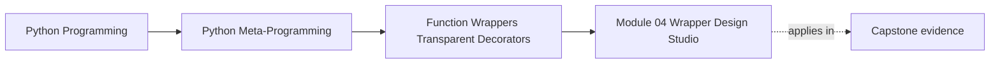
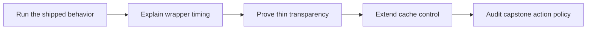

# Module 04 Wrapper Design Studio

<!-- page-maps:start -->
## Page Maps




<!-- page-maps:end -->

This studio is the assessed learning product for Module 04. You will investigate the two
shipped course programs, extend the bounded cache with one operational control, and then
review the incident-plugin `@action` decorator as a larger policy-owning wrapper.

The studio is complete when another developer can reconstruct:

- which work happened during decorator-expression evaluation
- which work happened during decorator application
- which work repeats on every call
- which transparency claims concern metadata versus behavior
- which stateful rule your extension owns
- how focused tests prove the rule

## Establish the baseline

From `programs/python-programming/python-meta-programming`, run:

```console
make wrapper-lab
make wrapper-lab-test
make wrapper-cache
make wrapper-cache-test
make capstone-action-wrapper
```

Save review notes under the repository `artifacts/` directory. Start one ledger:

| Claim | Direct evidence | Boundary |
| --- | --- | --- |
| decorator expressions evaluate top-to-bottom | lifecycle definition events | expression evaluation is not decorator application |
| decorators apply bottom-up | lifecycle definition events | applies only to returned decorator callables |
| calls enter outer-to-inner | lifecycle call events | return flow unwinds in reverse |
| thin observation preserves result and failure identity | identity booleans and outcome events | observation still adds cost and a frame |
| `wraps` preserves logical contract recovery | metadata packet | shell implementation remains different |
| cache calls can skip execution | results versus underlying executions | wrapper now owns policy |
| action wrapper audit is observational | capstone audit plus event-recording test | invocation behavior needs separate proof |

Add exact values from your run. Do not write "the decorator runs first"; name the
specific operation and order.

## Studio 1: reconstruct the wrapper lifecycle

Without running the program again, write the expected event order for:

```python
@tracing_decorator("outer", events)
@tracing_decorator("inner", events)
def render_status(...):
    ...
```

Separate your answer into:

1. decorator-expression evaluation
2. decorator application
3. call entry
4. return unwinding

Then compare against the lifecycle packet.

### Investigation

Reverse the two decorator lines in a local edit. Predict every event before running
`make wrapper-lab`. Explain:

- why factory order changes
- why application order changes
- which callable the outer wrapper closes over
- why final return value alone is insufficient evidence

Restore the published order and run `make wrapper-lab-test`.

### Deliverable

Provide an object graph from the rebound public name through both `__wrapped__` edges to
the raw function. Annotate each function with its closure nonlocals and execution order.

## Studio 2: qualify a transparency claim

Use the `thin_wrapper` and `metadata` packets.

### Work

Build a two-axis review:

| Surface | Bare wrapper | Preserved observer | What this proves |
| --- | --- | --- | --- |
| result object identity | | | |
| exception object identity | | | |
| name and docstring | | | |
| logical signature | | | |
| shell signature | | | |
| unwrap path | | | |

Answer these questions:

1. Why is equality weaker than identity for the result and exception checks?
2. Why does `follow_wrapped=False` report `(*args, **kwargs) -> 'str'` for the preserved
   shell?
3. Which metadata did `wraps` copy even though the shell parameter names differ?
4. What behavior would make the observer policy-owning?

### Failure experiment

Temporarily suppress `DemonstrationFailure` by returning `None`. Record the failing test
and explain the new hidden return contract. Restore bare re-raising and rerun
`make wrapper-lab-test`.

## Studio 3: add one cache invalidation control

Extend `CachedCallable` and `bounded_cache` with:

```python
def cache_invalidate(*args, **kwargs) -> bool:
    ...
```

The method must:

- build keys with the same `_call_key` function as normal calls
- remove exactly one matching entry
- return `True` when an entry existed
- return `False` when no entry existed
- leave hit and miss counters unchanged
- preserve the relative LRU order of all other entries
- reject unhashable arguments before changing state

Do not reach into the closure from tests. The new method is the public operational
surface.

### Write proof before implementation

Add focused tests for:

1. invalidating a cached key forces the next call to execute
2. invalidating a missing key returns `False`
3. another entry retains its LRU position
4. counters do not change during invalidation
5. unhashable invalidation leaves state unchanged
6. the existing eight cache tests remain green

Then implement the control and expose it on the wrapper alongside `cache_clear`,
`cache_info`, and `cache_snapshot`.

### Design review

Explain:

- why invalidation is policy rather than instrumentation
- why `cache_clear()` was insufficient for the use case
- why reusing `_call_key` prevents lookup and invalidation from disagreeing
- why this still does not make the cache production-ready

## Studio 4: transfer the model to `@action`

Run:

```console
make capstone-action-wrapper
make capstone-bind-action
make capstone-trace
```

Trace these three routes:

- wrapper audit: structure only
- binding preflight: call matching without construction
- trace: construction, invocation, and successful history

Complete:

| Question | Wrapper audit | Binding preflight | Trace |
| --- | --- | --- | --- |
| constructs plugin? | | | |
| invokes action? | | | |
| follows `__wrapped__`? | | | |
| reads `ActionSpec`? | | | |
| binds proposed arguments? | | | |
| records history? | | | |

Then inspect the failure-policy test in `capstone/tests/test_runtime.py`. Explain why a
failed action preserves the original exception but creates no history entry. Decide
whether "records invocations" is an honest summary, or whether "records successful
invocations" is required.

## Final wrapper review

Your final artifact should contain:

- the lifecycle trace and object graph
- the two-axis transparency table
- the cache invalidation design and focused test output
- the capstone route comparison
- one sentence stating the most powerful governing rule in each wrapper
- one limitation that remains in the course cache
- one reason the capstone `@action` wrapper is inspectable but not semantically thin

## Assessment rubric

| Dimension | Developing | Proficient | Strong |
| --- | --- | --- | --- |
| Timing model | says "definition time" generally | separates evaluation, application, and call | reconstructs exact order and closure ownership |
| Transparency | treats `wraps` as complete proof | separates metadata and behavior | compares logical contract, shell, identity, and unwrap evidence |
| Stateful policy | adds a method that changes entries | implements bounded invalidation with tests | preserves counters, LRU order, and failure atomicity |
| Failure reasoning | checks only successful calls | proves exception propagation and cache failure behavior | identifies hidden contracts created by suppression or partial mutation |
| Capstone transfer | points at `actions.py` | compares audit, binding, and trace routes | explains explicit signature ownership and success-only history |

You are ready for Module 05 when you can explain exactly what the wrapper owns without
using source length, decorator syntax, or preserved metadata as a substitute for runtime
evidence.

## Continue through Module 04

- Previous: [Worked Example: Building a Bounded Cache Decorator](worked-example-building-a-bounded-cache-decorator.md)
- Next: [Studio Review](exercise-answers.md)
- Return: [Overview](index.md)
- Terms: [Glossary](glossary.md)
