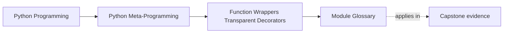

# Module Glossary

<!-- page-maps:start -->
## Page Maps

<!-- page-maps:end -->

This glossary belongs to **Module 04: Function Wrappers and Transparent Decorators** in
**Python Metaprogramming**. It keeps the language of this directory stable so the same
ideas keep the same names across lessons, practice, and capstone discussion.

## How to use this glossary

Use the glossary when a wrapper discussion starts to blur together thin transformation,
stateful policy, definition-time rebinding, and call-time behavior. Module 04 is meant to
keep those boundaries explicit.

When a sentence sounds plausible but slippery, stop and check which term is missing. Most
weak wrapper explanations fail because they never distinguish identity preservation from
behavior preservation, or one-time rebinding from repeated runtime policy.

## Terms in this directory

| Term | Meaning in this directory |
| --- | --- |
| Call-time behavior | Logic that runs on every invocation of the wrapped callable. |
| Closure-held state | State captured by a wrapper from an outer scope, often mutated with `nonlocal`. |
| Decoratee | The original function being wrapped by a decorator. |
| Decoration time | The one-time moment when the decorator expression is applied and the function name is rebound. |
| Decorator | A callable that takes a function and returns another callable. |
| Decorator factory | A callable that returns a decorator, usually used as `@factory(config)`. |
| Definition-time rebinding | The fact that `@decorator` syntax rewrites a function name to the wrapper returned by the decorator. |
| Governing rule | The exact behavioral rule a wrapper now owns, such as "first result wins" or "failed calls retry three times". |
| Inspection surface | The visible metadata or unwrapping route that tools and reviewers rely on, such as `__name__`, `inspect.signature`, or `__wrapped__`. |
| Metadata transparency | Preserving callable identity surfaces so tooling can still see the logical callable honestly. |
| Operational control surface | An explicit reset, snapshot, clear, or configuration route that lets humans steward wrapper-owned state deliberately. |
| Policy-owning wrapper | A wrapper that decides behavior across calls or attempts and therefore deserves stronger review than thin instrumentation. |
| Review packet | The combination of timing trace, metadata evidence, state trace, and limitations that lets another learner audit the wrapper honestly. |
| Semantic drift | The point where a decorator stops being a thin transformation and starts changing semantics across calls through state or policy. |
| Semantic transparency | Preserving the original callable's behavior closely enough that the wrapper does not silently own new policy. |
| Stateful wrapper | A wrapper that owns cross-call state such as counters, cached results, or retry policy. |
| Thin wrapper | A wrapper that adds one narrow concern while preserving the original callable's result and error behavior as much as possible. |
| Transparency | The property of keeping wrapped callables inspectable and reviewable after transformation. |
| Wrapper skeleton | The basic nested-function pattern that takes a function and returns a delegating wrapper. |
| `__wrapped__` | The attribute that points from a wrapper back to the original callable for unwrapping and inspection. |
| `functools.wraps` | The standard helper for preserving callable metadata and `__wrapped__` on a wrapper. |
| `nonlocal` | The keyword used to mutate a captured outer-scope variable from inside a wrapper. |

## Boundary reminders for confusing pairs

Use these quick comparisons when two terms start collapsing into each other:

| If you are mixing up... | Separate them this way |
| --- | --- |
| metadata transparency and semantic transparency | metadata asks what tools can still see; semantics asks what runtime behavior actually changed |
| definition time and call time | definition time happens once when the function name is rebound; call time happens on every later invocation |
| thin wrapper and policy-owning wrapper | thin wrappers observe or label one call; policy-owning wrappers decide behavior across calls or attempts |
| closure-held state and operational control surface | one explains where state lives; the other explains how humans can inspect or reset it |
| decorator syntax and wrapper mechanics | `@decorator` is surface syntax; wrapper mechanics are the actual rebinding and forwarding structure underneath |

## Repair prompts for weak wrapper language

When a learner writes an answer that sounds polished but unclear, these prompts usually
repair it:

- "What is the governing rule in one sentence?"
- "What changed once at definition time?"
- "What repeats at every call?"
- "What can tools still see after wrapping?"
- "What state or control surface would a reviewer ask for next?"
- "Is your transparency claim about metadata, semantics, or both?"

## Keep the module connected

- Return to [Module 04 Overview](index.md) for the full learning route.
- Use [Exercises](exercises.md) and [Exercise Answers](exercise-answers.md) to pressure-test the wrapper vocabulary.
- Revisit the [Worked Example](worked-example-building-a-bounded-cache-decorator.md) when a decorator starts to drift from transparent transformation into policy.
