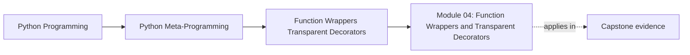

# Module 04: Function Wrappers and Transparent Decorators

<!-- page-maps:start -->
## Page Maps

<!-- page-maps:end -->

Module 04 is the first place where the course starts changing behavior instead of only
observing it. That shift makes wrapper discipline matter immediately: a decorator can add
useful behavior, but it can also erase signatures, hide tracebacks, and smuggle policy
behind friendly syntax.

For many learners, this is the point where Python meta-programming stops feeling like
inspection and starts feeling risky. That reaction is reasonable. A decorator can be one
of the smallest useful Python tools you write, or it can become an unreviewed behavior
engine that changes timing, retries, caching, observability, and failure surfaces without
making that power obvious.

This module now uses the same ten-file learning surface as the deep-dive series so the
overview, five cores, worked example, practice set, answers, and glossary each have one
clear job.

Treat this module as one full review day on callable-boundary honesty. The goal is not to
collect decorator tricks. The goal is to leave with a stable way to answer:

- what changed when the wrapper was defined
- what changes again on every later call
- what still remains visible to tools, reviewers, and the next maintainer
- when a wrapper has quietly turned into policy

## What this module is for

By the end of Module 04, you should be able to explain five things clearly:

- how nested functions and closures mechanically produce wrappers
- what happens once at decoration time and what repeats at call time
- when a thin practical wrapper stays transparent
- how stateful decorators start changing semantics and review cost
- why `functools.wraps` is a correctness tool rather than a style flourish

You should also be able to reject weak explanations such as:

- "it just decorates the function"
- "the order does not matter much"
- "the wrapper is still transparent because it is short"
- "we can add `wraps` later if tools complain"

## Keep these pages open

- [Mid-Course Map](../module-00-orientation/mid-course-map.md)
- [Pressure Routes](../guides/pressure-routes.md)
- [Capstone Map](../capstone/capstone-map.md)
- [Proof Matrix](../guides/proof-matrix.md)

## The ten files in this module

1. Overview (`index.md`)
2. [Nested Functions and Wrapper Skeletons](nested-functions-and-wrapper-skeletons.md)
3. [Decorator Syntax and Definition-Time Rebinding](decorator-syntax-and-definition-time-rebinding.md)
4. [Thin Practical Wrappers at Call Time](thin-practical-wrappers-at-call-time.md)
5. [Stateful Wrappers and Semantic Drift](stateful-wrappers-and-semantic-drift.md)
6. [Wraps and Signature Transparency](wraps-and-signature-transparency.md)
7. [Worked Example: Building a Bounded Cache Decorator](worked-example-building-a-bounded-cache-decorator.md)
8. [Exercises](exercises.md)
9. [Exercise Answers](exercise-answers.md)
10. [Glossary](glossary.md)

## How to use the file set

| If you need to... | Start here |
| --- | --- |
| understand the mechanical shape of a wrapper before `@` syntax enters | [Nested Functions and Wrapper Skeletons](nested-functions-and-wrapper-skeletons.md) |
| explain what decoration does once at definition time and how stacked wrappers compose | [Decorator Syntax and Definition-Time Rebinding](decorator-syntax-and-definition-time-rebinding.md) |
| study thin practical wrappers such as timing and deprecation without hiding call-time costs | [Thin Practical Wrappers at Call Time](thin-practical-wrappers-at-call-time.md) |
| judge when wrapper state turns a thin decorator into hidden policy | [Stateful Wrappers and Semantic Drift](stateful-wrappers-and-semantic-drift.md) |
| preserve names, docs, signatures, and unwrapping routes honestly | [Wraps and Signature Transparency](wraps-and-signature-transparency.md) |
| stress-test transparency and state inside one deliberately limited cache wrapper | [Worked Example: Building a Bounded Cache Decorator](worked-example-building-a-bounded-cache-decorator.md) |
| test your understanding before moving into heavier decorator policy | [Exercises](exercises.md) |
| compare your reasoning against a reference answer | [Exercise Answers](exercise-answers.md) |
| stabilize the wrapper vocabulary | [Glossary](glossary.md) |

## The review route through the module

Use this route if you want one stable teaching sequence instead of ten disconnected files:

| Review question | Why it comes now | Page |
| --- | --- | --- |
| what object does the wrapper actually close over? | the rest of the module fails if the skeleton still feels magical | [Nested Functions and Wrapper Skeletons](nested-functions-and-wrapper-skeletons.md) |
| when did this behavior get attached to the function name? | decorator timing confusion makes later policy review messy | [Decorator Syntax and Definition-Time Rebinding](decorator-syntax-and-definition-time-rebinding.md) |
| what small call-time behavior is still narrow enough to trust? | learners need a lower-power comparison before state arrives | [Thin Practical Wrappers at Call Time](thin-practical-wrappers-at-call-time.md) |
| what semantic rule now depends on prior calls? | state is the boundary where wrappers stop being "just small helpers" | [Stateful Wrappers and Semantic Drift](stateful-wrappers-and-semantic-drift.md) |
| what will tools and reviewers still see after wrapping? | transparency claims are empty if metadata and unwrapping surfaces disappear | [Wraps and Signature Transparency](wraps-and-signature-transparency.md) |

## The running question

Carry this question through every page:

> What changed at the callable boundary, and what must still remain visible for tools and reviewers to trust that change?

Strong Module 04 answers usually mention one or more of these:

- closure-based wrapper structure
- one-time decoration versus per-call behavior
- transparent versus stateful wrapper semantics
- metadata preservation through `functools.wraps`
- a lower-power comparison before the design grows into policy or framework behavior

Strong answers also say what the wrapper does **not** prove or preserve automatically:

- `*args, **kwargs` forwarding does not prove signature transparency
- short code does not prove thin semantics
- preserved metadata does not erase policy complexity
- a friendly `@decorator` surface does not erase import-time or definition-time behavior

## Learning outcomes

By the end of this module, you should be able to:

- trace decorator behavior from raw function to wrapped callable without folklore
- explain wrapper behavior at both definition time and call time
- preserve callable identity and introspection surfaces when a wrapper stays thin
- name when stateful decoration changes semantics enough to deserve stronger review

## Mid-module warning signs

Slow down and review more carefully if any wrapper in this module does one or more of
these:

- stores state that affects later calls
- catches exceptions and changes failure policy
- chooses retry, cache, fallback, or throttling behavior
- exposes a nicer surface than the underlying behavior is honest about
- claims transparency without preserving `__wrapped__` or other identity surfaces

These are not reasons to ban the wrapper. They are reasons to stop calling it "simple"
without stronger proof.

## Evidence packet to build while you learn

By the time you finish the worked example and exercises, you should have a small packet
that another learner can inspect:

- one wrapper skeleton with the closed-over callable named explicitly
- one hand-desugared decorator example showing definition-time rebinding
- one thin wrapper with a proof that return values and exceptions still stay honest
- one stateful wrapper with a named policy rule and a reset or inspection surface
- one metadata comparison showing what `functools.wraps` repaired and what it did not

## Exit standard

Do not move on until all of these are true:

- you can explain how a wrapper is built from a nested function and closure
- you can show the exact desugaring of `@decorator` and stacked decorators
- you can distinguish thin wrappers from stateful policy-carrying wrappers
- you can explain why `functools.wraps` and `__wrapped__` preservation are review requirements

Do not move on if you still need phrases like "basically," "sort of," or "it kind of
wraps things" to explain decorator behavior. Module 04 is only complete when you can
state the rebinding step, the call-time step, the transparency claim, and the policy
boundary in plain language.

When those feel ordinary, Module 04 has done its job and the next decorator module can
focus on policy, typing, and sharper design boundaries.
