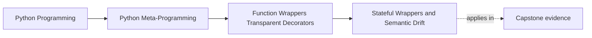

# Stateful Wrappers and Semantic Drift


<!-- page-maps:start -->
## Page Maps




<!-- page-maps:end -->

Module 04 needs one explicit warning boundary:

> the moment a decorator starts keeping state across calls, it stops being "just a thin
> wrapper" and starts owning policy.

That does not make stateful decorators forbidden. It makes them more expensive to review,
test, and reason about.

For self-study, this is the moment to stop treating "still small" as a serious safety
argument. A short decorator that controls retries, caches results, or suppresses later
work is already governing runtime behavior across time.

## The sentence to keep

When a wrapper stores state, ask:

> what semantic rule does this state now own across calls?

That is the right review question because state changes behavior over time, not only at
one call boundary.

If a learner can name the stored value but not the semantic rule it controls, the review
is still too shallow.

## `@once` is the simplest stateful example

```python
import functools


def once(func):
    @functools.wraps(func)
    def wrapper(*args, **kwargs):
        if not hasattr(wrapper, "_once_result"):
            wrapper._once_result = func(*args, **kwargs)
        return wrapper._once_result

    return wrapper
```

This looks small, but the semantics are no longer thin:

- the first successful call determines future results
- later arguments are ignored
- wrapper state changes what the function now means

That is a policy surface, even though the syntax is still tiny.

The important teaching move here is to say the rule out loud:

- first successful call wins
- later arguments no longer control the outcome
- wrapper history now participates in the result

## State changes the review cost

A stateful wrapper raises new questions that thin wrappers often avoid:

- where is the state stored?
- when is it initialized?
- when is it reset?
- what happens if the first call raises?
- what happens under concurrency?

These are not side questions. They are part of the wrapper's real semantics.

Use this review table whenever a wrapper starts carrying memory across calls:

| Policy question | Why it matters |
| --- | --- |
| what exact rule does the state enforce? | you cannot review behavior honestly without naming the rule |
| when is the state created and reset? | tests, long-running processes, and debugging all depend on this |
| what happens on failure paths? | partial state or failed first calls may change later behavior |
| what happens under concurrency? | state can become incorrect even when the idea seems simple |

## Executable escalation: a cache controls whether work runs

Run the worked program before reading its implementation:

```console
$ make wrapper-cache
{
  "cache_info": {
    "current_size": 2,
    "hits": 1,
    "maxsize": 2,
    "misses": 4
  },
  "results": [
    "INC-41:warning",
    "INC-41:warning",
    "INC-42:critical",
    "INC-43:warning",
    "INC-41:warning"
  ],
  "underlying_executions": [
    "INC-41:warning",
    "INC-42:critical",
    "INC-43:warning",
    "INC-41:warning"
  ],
  ...
}
```

Five calls produce four executions. The second call is a hit, so the wrapper decides not
to run the body. Later, inserting `INC-42` and `INC-43` evicts the least-recently-used
`INC-41` entry; the final `INC-41` call executes again.

Trace the state transition:

| Call | Decision | LRU state after call | Executions so far |
| --- | --- | --- | --- |
| `INC-41` | miss | `INC-41` | 1 |
| `INC-41` | hit, promote | `INC-41` | 1 |
| `INC-42` | miss | `INC-41`, `INC-42` | 2 |
| `INC-43` | miss, evict `INC-41` | `INC-42`, `INC-43` | 3 |
| `INC-41` | miss, evict `INC-42` | `INC-43`, `INC-41` | 4 |

This is the semantic boundary in executable form. The wrapper owns:

- whether the function body runs
- which prior result is returned
- which entry is evicted
- how hits and misses are counted
- when state is cleared

Calling that behavior "transparent caching" would be misleading. Metadata can remain
transparent while execution semantics do not.

### Failure and control surfaces

The focused proof establishes policies the output sample alone cannot:

- exceptions count as misses but failed calls are not cached
- unhashable arguments fail before the wrapped body executes
- `maxsize=0` disables storage but still records misses
- `cache_clear()` removes entries and resets statistics
- `cache_snapshot()` reports least-to-most-recent keys

Run:

```console
make wrapper-cache-test
```

These surfaces are part of the decorator's public operating contract. Without them,
tests and maintainers would have to infer policy from private closure contents.

## Order sensitivity becomes more important with state

Stacked stateful decorators are especially sensitive to order.

For example:

- `@once @timer` means the timer only matters on the first successful call
- `@timer @once` means timing logic still runs on every outer call, even if the inner once-wrapper returns a cached result

That is why decorator order is never just formatting.

It also means you should never summarize stacked stateful decorators as "same pieces,
different order." Order changes the governing policy.

## One picture of semantic drift

```text
Thin wrapper:
  same call -> same semantics, plus narrow observation or signaling

Stateful wrapper:
  same call -> behavior may now depend on prior calls, cached values, counters, or history
```

That difference is the whole reason this page exists.

For a missed-class learner, this is the most important sentence to keep:

> once earlier calls can change later outcomes, the wrapper is no longer only
> instrumentation. It is now policy.

## State can live in a closure or on the wrapper object

Two common storage patterns are:

- closure-held state with `nonlocal`
- wrapper attributes such as `wrapper._once_result`

Both are real runtime state. The right question is not which one looks cleaner. It is:

> which one makes the behavior, reset path, and inspection story clearer?

State stored on the wrapper object is often easier to inspect and reset deliberately,
which matters a lot in tests and long-running processes.

That does not automatically make wrapper attributes superior. It means the right storage
question is:

> which storage choice leaves the rule, reset path, and debugging story easiest to see?

## Failure behavior is part of the policy

A stateful decorator must make failure semantics explicit.

For `@once`, a serious review question is:

- if the first call raises, is the failed result cached or not?

A small implementation detail can change this completely.

That is why stateful decorators deserve slower, more honest review than thin wrappers.

Failure handling is not a footnote here. It is part of the design contract.

## Concurrency is not an afterthought

The moment wrapper state can be touched by multiple threads or tasks, the design cost goes
up again.

Even a tiny stateful decorator can become wrong under concurrency if it assumes a
single-threaded world.

This module does not need to solve every concurrency case. It does need to name the
boundary clearly:

- stateful wrappers are more than syntactic sugar
- they are small runtime systems

That framing helps keep the educational bar honest. You do not need to solve locking on
this page, but you do need to stop pretending concurrency is irrelevant once shared state
exists.

The course implementation labels `thread_safe: false` in its output. That limitation is
not a placeholder promise. Concurrent use is outside the example's contract; a production
need should normally select `functools.lru_cache` or an explicitly synchronized cache
owned by a service object.

## Stateful wrappers may deserve explicit reset hooks

If a wrapper owns meaningful state, the design may need an explicit hook such as:

- `cache_clear()`
- reset methods for tests
- visible attributes for debugging

That is one reason the worked example uses a bounded cache with explicit state surfaces
instead of hiding everything behind one opaque closure.

The shipped `bounded_cache` exposes `cache_info()`, `cache_snapshot()`, and
`cache_clear()`. Inspectability does not make its policy thin; it makes the policy
possible to review and control.

## Stateful-wrapper repair routes

When a wrapper has already crossed into policy, these repairs usually matter more than
surface cleanup:

| Weak stateful design | Stronger repair |
| --- | --- |
| hidden cache or counter with no reset route | expose a deliberate reset or inspection surface |
| state meaning described vaguely | write the governing rule in one exact sentence |
| first-failure behavior left implicit | document and test the failure path explicitly |
| concurrency ignored entirely | state the single-threaded assumption or add real synchronization |

## Review rules for stateful wrappers

When reviewing a stateful decorator, keep these questions close:

- what semantic rule does the state now control across calls?
- where does the state live, and how visible is it to tests and debugging?
- what happens on the first failure or partial success?
- how does decorator order change the resulting semantics?
- is this still the smallest honest tool, or has the decorator become a small framework?

## Exit check for this page

Before moving on, make sure you can do all of these:

- name the exact rule the stored state controls across calls
- explain one way decorator order changes stateful behavior
- say where the state lives and how a reviewer could reset or inspect it
- describe one failure or concurrency question that the design must answer explicitly

## What to practice from this page

Try these before moving on:

1. Implement `@once` and explain exactly what later calls do with new arguments.
2. Stack `@once` with a thin timing decorator in both orders and compare the behavior.
3. Write down one stateful decorator idea that should probably become an explicit object instead of another wrapper.

If those feel ordinary, the next step is to keep wrapped callables honest to tools and
reviewers with `functools.wraps`.

## Continue through Module 04

- Previous: [Thin Practical Wrappers at Call Time](thin-practical-wrappers-at-call-time.md)
- Next: [Wraps and Signature Transparency](wraps-and-signature-transparency.md)
- Practice: [Exercises](exercises.md)
- Terms: [Glossary](glossary.md)
