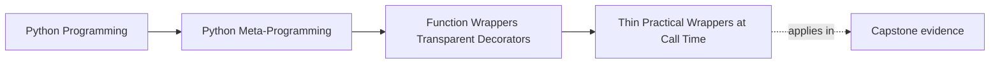

# Thin Practical Wrappers at Call Time


<!-- page-maps:start -->
## Page Maps




<!-- page-maps:end -->

Once the definition-time mechanics are clear, the next question is practical:

> what kinds of wrapper behavior are still thin enough to stay transparent?

This page uses small real decorators to answer that question. The common pattern is:

- do a small amount of pre- or post-call work
- delegate to the original function
- preserve return values and exception behavior unless the wrapper explicitly says otherwise

That last clause is where most weak explanations fail. A wrapper is not thin because the
source file is short. It is thin because the added behavior stays narrow enough that a
reviewer can still describe the unchanged parts of the callable honestly.

## The sentence to keep

When reviewing a thin wrapper, ask:

> what small call-time behavior was added, and what parts of the original callable still
> remain unchanged?

If that answer stays short and explicit, the wrapper is often still thin.

If the explanation starts expanding into retry rules, cached state, throttling, fallback
paths, or failure rewriting, the wrapper is already drifting into the next page's
territory even if the implementation still looks compact.

## Thin wrappers change behavior without owning policy-heavy state

A thin wrapper may:

- record timing
- emit a warning
- log a call

What keeps it thin is not zero behavior change. It is that the wrapper's concern stays
narrow and does not quietly take ownership of larger runtime policy.

Use this quick classification table while reading or designing wrappers:

| Behavior added | Usually still thin? | Why |
| --- | --- | --- |
| timing one call | often yes | it observes one call without owning future behavior |
| logging one call | often yes | it records, but does not usually redirect or repeat work |
| deprecation warning | often yes | it signals lifecycle state while leaving the underlying call intact |
| retry, cache, or fallback | usually no | it decides behavior beyond simple observation |

## A timing wrapper is a good first example

```python
import functools
import time


def timer(func):
    @functools.wraps(func)
    def wrapper(*args, **kwargs):
        start = time.perf_counter()
        try:
            return func(*args, **kwargs)
        finally:
            elapsed = time.perf_counter() - start
            print(f"{func.__name__} took {elapsed:.4f}s")

    return wrapper
```

This wrapper adds one narrow behavior:

- measure duration around the call

It still:

- delegates to the original function
- returns the original result
- lets exceptions propagate after reporting timing

That is a good example of thin behavior with a clear cost model.

The phrase "clear cost model" matters here. A learner should be able to say:

- one extra wrapper call exists
- one timer is started and stopped
- the original result and failure path still remain intact

## A deprecation wrapper is another thin pattern

```python
import functools
import warnings


def deprecated(func):
    @functools.wraps(func)
    def wrapper(*args, **kwargs):
        warnings.warn(
            f"{func.__name__} is deprecated; use an alternative.",
            DeprecationWarning,
            stacklevel=2,
        )
        return func(*args, **kwargs)

    return wrapper
```

This wrapper changes the call boundary too, but in a still-reviewable way:

- it signals lifecycle status
- it delegates the real behavior unchanged

That is thin enough when the warning behavior is explicit and the wrapper does not start
rewriting semantics underneath the caller.

That makes deprecation wrappers a good teaching example: they visibly change the call
boundary, but the change is still reviewable in one sentence.

## Call-time behavior should be easy to name

Thin wrappers are easier to trust when the call-time effect can be summarized in one
sentence:

- "times the call"
- "logs the call"
- "warns once per use"

The moment the explanation becomes much longer, the design may already be moving beyond a
thin wrapper and toward policy.

## Thin-wrapper proof routes

If a wrapper claims to stay thin, try to prove it with these questions:

| Proof question | What a strong answer sounds like |
| --- | --- |
| what behavior was added? | one narrow sentence such as "measure duration" or "emit a warning" |
| what still stays unchanged? | return values, exception behavior, and call ownership still belong to the wrapped function |
| what would make this no longer thin? | state across calls, altered failure policy, retries, caching, throttling, or hidden fallback behavior |

## Executable proof: preserve object identity across the boundary

Run:

```console
$ make wrapper-lab |
  python3 -c 'import json, sys; print(json.load(sys.stdin)["thin_wrapper"])'
{'events': ['start:succeed', 'success:object', 'start:fail', 'failure:DemonstrationFailure'], 'failure_type': 'DemonstrationFailure', 'same_exception_object': True, 'same_result_object': True}
```

The identity checks are stronger than comparing equal values:

- `same_result_object` proves the wrapper returned the exact object produced by the
  wrapped function
- `same_exception_object` proves observation re-raised the exact exception instance
- the event list proves success and failure were both observed once

This is a deliberately narrow transparency claim. The wrapper still adds a stack frame,
event writes, and runtime cost. It preserves result and failure identity; it does not
make the call indistinguishable from an unwrapped call.

Read `observing_decorator` and `thin_wrapper_evidence` in
`labs/wrapper_runtime/evidence.py`. The wrapper has two explicit branches:

```text
call -> start event -> wrapped function -> success event -> same result object
                              |
                              +-> failure event -> same exception object re-raised
```

The test asserts both branches. A happy-path-only test would not justify the claim that
exception behavior remains transparent.

### Failure route: convert failure into a value

Replace bare `raise` with `return None` in a local experiment. Three contracts change:

- callers no longer receive `DemonstrationFailure`
- the return type now includes a hidden sentinel
- downstream code may continue after an operation that actually failed

That is failure policy, not thin observation. Restore bare re-raising and run
`make wrapper-lab-test`.

### Before-and-after review

| Design | Added behavior | Preserved behavior | Classification |
| --- | --- | --- | --- |
| direct call | none | original result and exception | unwrapped |
| observing wrapper | records start and outcome | exact result and exception objects | thin instrumentation |
| wrapper returning `None` on failure | records and suppresses failure | neither exception identity nor original return contract | policy-owning |

Use this table instead of classifying by line count.

## `try/finally` often matters for transparency

For wrappers like timers, the right control-flow shape is important:

```python
def timer(func):
    @functools.wraps(func)
    def wrapper(*args, **kwargs):
        start = time.perf_counter()
        try:
            return func(*args, **kwargs)
        finally:
            print("timing recorded")
```

Without `finally`, exceptions can skip the post-call behavior and make the wrapper's
behavior less honest or less useful.

That is a good example of quality in wrapper design: small details change whether the
wrapper tells the truth about what it does.

For self-study, this is one of the cleanest examples of "small control-flow choice,
material teaching consequence." If the timing wrapper says it measures calls but quietly
stops measuring failed calls, its explanation is already weaker than its surface suggests.

## Exception transparency is part of being thin

Thin wrappers should usually preserve the original exception model:

- they may observe the failure
- they may record timing or emit a warning
- they should not silently swallow or rewrite exceptions unless that change is the entire documented purpose

This keeps the wrapped callable legible to both callers and reviewers.

That is the boundary to name explicitly:

- observing failure can stay thin
- changing failure outcomes is already policy

## Thin does not mean free

Even narrow wrappers still add:

- call overhead
- stack frames
- trace and debugging complexity
- potential tooling impact if metadata preservation is sloppy

That list matters because "thin" is not a synonym for "free" or "harmless." It only
means the change is still narrow enough to inspect directly.

The point of calling them thin is not to pretend they are free. It is to say the added
behavior is still narrow, inspectable, and reviewable.

The shipped evidence makes that claim reviewable: it names the extra events and proves
which identities cross the wrapper unchanged.

## Thin wrappers are the lower-power decorator case

This matters for the course's power ladder:

- if the concern is narrow and per-call, a thin decorator is often a reasonable choice
- if the concern starts collecting state, retries, caching, or cross-cutting policy, the review burden goes up quickly

That boundary is the reason the next page exists.

## Thin-wrapper warning signs

Slow down if a supposed thin wrapper starts to do any of these:

- catches and suppresses exceptions
- remembers results or counters across calls
- changes whether the wrapped callable runs at all
- rewrites arguments or return values in a way the caller cannot easily predict
- combines multiple concerns instead of one narrow responsibility

## Review rules for thin practical wrappers

When reviewing thin wrappers, keep these questions close:

- can the added call-time behavior be named in one short sentence?
- does the wrapper still delegate result and exception behavior honestly?
- is `try/finally` used when post-call behavior should still happen on failure?
- is the wrapper doing narrow observation or signaling, rather than taking ownership of larger policy?
- does the wrapper already feel like a small framework disguised as a decorator?

## Exit check for this page

Before leaving this page, make sure you can do all of these:

- defend a thin-wrapper claim with concrete evidence rather than code length
- explain why `finally` matters for timing or cleanup honesty
- distinguish observing a failure from owning failure policy
- point to the first feature that would move a thin wrapper into policy territory

## What to practice from this page

Try these before moving on:

1. Implement a timing decorator that still reports duration when the wrapped function raises.
2. Implement a deprecation decorator with `stacklevel=2` and explain why the caller frame matters.
3. Write down one example of a thin wrapper and one example that already feels too stateful to stay on this page.

If those feel ordinary, the next step is to study the stateful boundary directly.

## Continue through Module 04

- Previous: [Decorator Syntax and Definition-Time Rebinding](decorator-syntax-and-definition-time-rebinding.md)
- Next: [Stateful Wrappers and Semantic Drift](stateful-wrappers-and-semantic-drift.md)
- Practice: [Exercises](exercises.md)
- Terms: [Glossary](glossary.md)
