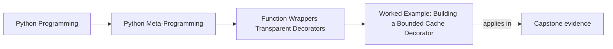

# Worked Example: Building a Bounded Cache Decorator


<!-- page-maps:start -->
## Page Maps




<!-- page-maps:end -->

The five core lessons in Module 04 become much easier to trust when they all show up in
one wrapper that is useful, tempting, and clearly not production-ready.

A small cache decorator is perfect for that job because it sits right on the boundary
between:

- thin wrapper mechanics
- stateful semantic drift
- metadata preservation
- explicit policy and reset needs

That makes it the right worked example for this module.

It is also the right example for a missed-class learner because cache decorators are
where many teams overclaim. They start with "just a small speed-up wrapper" and end up
owning policy about repeated work, hashability, eviction, reset, inspection, and caller
expectations.

## The incident

Assume a team wants a bounded cache decorator for small demos and local experiments.

The decorator should:

- cache results by arguments
- expose visible state for inspection and reset
- preserve function identity for tools
- stay honest about its limitations

That last goal matters most. This is where many wrappers go wrong: they look tiny and end
up behaving like unreviewed framework features.

This worked example is maintained course software, not a recipe to paste from the page.
The implementation lives in `labs/wrapper_runtime/bounded_cache.py`, the executable
scenario in `labs/wrapper_runtime/cache_demo.py`, and focused proof in
`tests/test_bounded_cache_lab.py`.

Treat the worked example as a review packet. The page explains the public policy and
guides the trace; the source and tests are the authority for executable behavior.

## The design boundary

This worked example is deliberately bounded, not production-grade.

That means the design will:

- preserve metadata with `functools.wraps`
- expose `cache_clear()` for explicit reset
- expose `cache_info()` and `cache_snapshot()` for inspection
- use least-recently-used eviction rather than insertion-only eviction
- remain single-threaded and intentionally limited

Those choices are not accidental. They make the wrapper more inspectable and easier to
review as a small policy surface.

They also let the learner practice a stronger habit:

- name the non-goals early
- expose the controls that a reviewer will need later
- keep the wrapper small enough that the limits can still be inspected directly

## Run the policy before reading the implementation

```console
$ make wrapper-cache
```

Predict these facts before comparing the JSON:

- five wrapper calls produce four underlying executions
- the second `INC-41` call is the only hit
- accessing a cached entry promotes it to most-recently-used
- after two evictions, the retained keys are `INC-43` and `INC-41`
- the visible signature still contains `incident_id` and keyword-only `severity`

Then run:

```console
$ make wrapper-cache-test
```

The eight focused tests are part of the worked example. They cover the happy path, but
they also cover the policy questions a copied snippet usually leaves unanswered:

| Test pressure | Contract proved |
| --- | --- |
| repeated call | cached result preserves object identity and skips execution |
| recent hit before insertion | eviction is least-recently-used, not first-in-first-out |
| keyword order and call style | keyword order is canonical; positional/keyword equivalence is deliberately not normalized |
| repeated failure | failed results never enter storage |
| unhashable argument | key rejection happens before wrapped execution |
| zero capacity and clear | disabled storage and reset statistics are explicit |
| metadata inspection | logical name, docstring, signature, and unwrap path survive |
| demo packet | learner-visible output stays aligned with the implementation |

## Step 1: make the decorator factory timing explicit

The cache uses a factory so configuration happens once at definition time:

```python
@cache(maxsize=3)
def fib(n):
    ...
```

This means:

1. `cache(maxsize=3)` runs once
2. it returns the real decorator
3. that decorator wraps `fib`

That definition-time sequence matters because `maxsize` is configuration, not per-call
input.

It also means configuration mistakes or factory-side effects appear before the wrapped
function is ever called. That is part of the design, not a surprising edge case.

## Step 2: admit that caching is stateful policy

Caching is not a thin wrapper. It changes semantics across calls:

- later calls may skip execution
- result meaning now depends on wrapper state
- argument keying rules affect correctness
- reset behavior matters to tests and long-running processes

That is why this worked example belongs after the stateful-wrapper core, not inside the
thin-wrapper page.

Say the governing rule out loud before you inspect the code:

- repeated hashable calls may return earlier results without running the function body
- cache order now influences later eviction behavior
- visible state and reset routes are part of the review story

## Step 3: preserve metadata and expose state deliberately

The wrapper should keep the original function inspectable:

- use `functools.wraps`
- store state on explicit wrapper attributes
- expose a `cache_clear()` hook

That combination gives both transparency and testability.

Use this quick design table while reading the implementation:

| Review surface | Why it exists in this example |
| --- | --- |
| `functools.wraps` | keeps the logical callable visible to tools |
| `cache_info()` | exposes counters, capacity, and current size without private access |
| `cache_snapshot()` | exposes current LRU order for review and teaching |
| `cache_clear()` | gives tests and operators an explicit reset route |
| explicit hashability failure | refuses to pretend all arguments are safely cacheable |

## The maintained implementation

```python
def _call_key(args, kwargs):
    key = (args, tuple(sorted(kwargs.items())))
    try:
        hash(key)
    except TypeError as error:
        raise TypeError("bounded_cache requires hashable arguments") from error
    return key


def bounded_cache(maxsize=128):
    if maxsize is not None and maxsize < 0:
        raise ValueError("maxsize must be non-negative or None")

    def decorate(function):
        entries = OrderedDict()
        hits = 0
        misses = 0

        @wraps(function)
        def wrapped(*args, **kwargs):
            nonlocal hits, misses
            key = _call_key(tuple(args), dict(kwargs))
            if key in entries:
                hits += 1
                result = entries.pop(key)
                entries[key] = result
                return result

            misses += 1
            result = function(*args, **kwargs)
            if maxsize == 0:
                return result
            if maxsize is not None and len(entries) >= maxsize:
                entries.popitem(last=False)
            entries[key] = result
            return result

        # The maintained source attaches cache_clear, cache_info, and
        # cache_snapshot here.
        return wrapped

    return decorate
```

This excerpt keeps the decision path visible. Read the maintained source for the typed
`CachedCallable` protocol, immutable `CacheInfo`, and attached control functions.

### Trace one miss and one hit

Miss:

```text
build key -> not present -> increment misses -> execute function
          -> evict LRU if full -> store result as most recent -> return result
```

Hit:

```text
build key -> present -> increment hits -> remove existing entry
          -> reinsert as most recent -> return stored result
```

Failure exits after `misses += 1` and before insertion. Zero capacity exits after
execution and before insertion. These positions define the failure and disabled-cache
contracts; moving either line changes observable policy.

## Why this version is useful for review

This cache is intentionally not pretending to be perfect.

It is useful because it makes the right tradeoffs visible:

- `wraps` keeps the callable inspectable
- `cache_info()` and `cache_snapshot()` make state observable
- `cache_clear()` makes reset behavior explicit
- the hashability rule is named rather than hidden
- capacity and eviction behavior are reviewable in code

That transparency is more important here than raw cleverness.

The educational win is not "here is a clever cache." The win is:

- the state is visible
- the policy rule is nameable
- the failure path is not hidden
- the implementation is bounded enough that a learner can still audit it

## The limitations are part of the lesson

This decorator is bounded because it leaves real limitations visible:

- it is not concurrency-safe
- it requires hashable arguments in its canonical key form
- it treats positional and keyword spellings of an equivalent call as distinct keys
- it does not provide per-key invalidation or expiration
- it is not a substitute for `functools.lru_cache`

Those limitations are not embarrassing leftovers. They are the proof that the wrapper is
scoped honestly.

## Non-goals worth stating explicitly

This decorator is **not** trying to be:

- a concurrency-safe cache
- a drop-in replacement for `functools.lru_cache`
- a generalized key-normalization framework
- a time-to-live or invalidation service
- a silent optimization that reviewers never need to think about

## Order and policy still matter

If you stack this cache with other decorators, semantics change:

- logging outside the cache logs every call attempt
- logging inside the cache logs only cache misses
- timing outside the cache times both hits and misses
- timing inside the cache mostly times uncached work

That reinforces the module's central point: stacked decorator order is semantic, not
ornamental.

It also gives you a clean review question for later modules:

> which layer owns the policy, and which layer only observes it?

## What this example makes clear about Module 04

This worked example ties the module together:

- nested wrappers and rebinding mechanics still underlie the design
- definition-time factory behavior stays separate from call-time cache behavior
- stateful wrappers deserve policy-level review
- `functools.wraps` and explicit state surfaces keep the wrapper inspectable

It also shows one of the most important boundaries in the course so far:

- metadata preservation helps the wrapper stay legible
- explicit state surfaces help the policy stay reviewable
- neither of those excuses an overbroad cache design

That is the durable takeaway. The cache is not here as a production recommendation. It is
here as a clear specimen of where transparency starts to give way to policy.

## The review loop to keep

When you inherit or design a stateful decorator, run this loop:

1. identify the state and the semantic rule it now owns
2. make reset and inspection surfaces explicit
3. preserve metadata so tooling can still see the logical callable
4. document limitations instead of letting the wrapper pretend to be more general than it is
5. test failure, disabled-state, and eviction behavior—not only cache hits

## Exit check for this worked example

Before leaving this page, make sure you can do all of these:

- name the exact cache rule this wrapper now owns across calls
- point to the surface a tester would use to reset state
- explain one reason this wrapper is more honest than a hidden closure-only cache
- state one limitation that proves the example is bounded rather than pretending to be production-grade
- explain why the same logical call written positionally and by keyword can occupy two
  entries in this deliberately simple key model

If you can do that here, Module 04 has done its job and the next decorator module can take
on heavier policy and typing concerns with less ambiguity.

## Continue through Module 04

- Previous: [Wraps and Signature Transparency](wraps-and-signature-transparency.md)
- Next: [Exercises](exercises.md)
- Reference: [Exercise Answers](exercise-answers.md)
- Terms: [Glossary](glossary.md)
