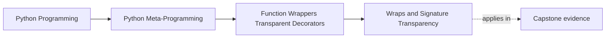

# Wraps and Signature Transparency


<!-- page-maps:start -->
## Page Maps




<!-- page-maps:end -->

By the time Module 04 reaches this page, one rule should feel non-negotiable:

> if a decorator is meant to stay transparent, it must preserve callable identity and
> inspection surfaces honestly.

That is why `functools.wraps` is not a style flourish. It is part of correctness.

This page needs one boundary stated early: `wraps` preserves important identity and
inspection surfaces, but it does not erase semantic drift. A stateful or policy-owning
wrapper can still be non-transparent even when its metadata is preserved well.

That distinction is one of the easiest places for learners to overclaim. They see a good
`__name__`, a recovered signature, and a `__wrapped__` chain, then conclude the wrapper
is "transparent now." Sometimes that is only half true.

## The sentence to keep

When reviewing a decorator, ask:

> after wrapping, what will tools and reviewers now see when they inspect this callable?

If the answer is "just `wrapper(*args, **kwargs)` and a lost docstring," the decorator has
already damaged transparency.

If the answer is "the metadata looks fine, but the wrapper still changes retries,
execution, or caching policy," then the wrapper has preserved identity better than it has
preserved semantics. That distinction matters.

Use this page to keep those two claims separate:

- "tools can still see the logical callable"
- "callers still experience almost the same behavior"

The first claim is about metadata transparency. The second is about semantic
transparency. `wraps` helps the first claim directly. It does not prove the second.

## What bare wrappers lose

Without preservation, a wrapped callable often exposes the wrapper's identity instead of
the original callable's identity:

- `__name__` becomes `"wrapper"`
- `__doc__` may disappear
- annotations may disappear
- signature reporting may degrade to `(*args, **kwargs)`
- unwrapping tools lose the original function path

That is real breakage for:

- `inspect.signature`
- documentation tooling
- debuggers
- stack traces
- reviewers trying to understand what was wrapped

Use this as a quick repair prompt: if a wrapper claims to stay transparent, ask first what
tools now see, then ask what runtime behavior has still changed despite that preserved
view.

That two-part check is stronger than asking only "did you use `wraps`?"

## `functools.wraps` restores the important metadata

`functools.wraps(wrapped)` is the standard way to preserve the original callable's visible
identity on the wrapper.

In practice, it copies or updates metadata such as:

- `__module__`
- `__name__`
- `__qualname__`
- `__doc__`
- `__annotations__`
- `__dict__`

and, importantly, sets:

- `__wrapped__`

That `__wrapped__` chain is what lets inspection tools recover the logical callable under
the wrapper.

For learners who completed Module 03 first, this is the bridge back to signature
evidence: a preserved `__wrapped__` path gives inspection tools a better chance to recover
the logical callable contract instead of stopping at a generic forwarding shell.

## Bare versus preserved wrapping

```python
import functools
import inspect


def bare_decorator(func):
    def wrapper(*args, **kwargs):
        return func(*args, **kwargs)
    return wrapper


def preserved_decorator(func):
    @functools.wraps(func)
    def wrapper(*args, **kwargs):
        return func(*args, **kwargs)
    return wrapper


@bare_decorator
def bare_func(x):
    """Bare doc."""
    return x


@preserved_decorator
def preserved_func(x):
    """Preserved doc."""
    return x


print(bare_func.__name__)
print(preserved_func.__name__)
print(inspect.signature(bare_func))
print(inspect.signature(preserved_func))
```

That contrast is the entire lesson:

- the bare wrapper changes what tools see
- the preserved wrapper keeps the original callable legible

## Executable audit: logical contract versus wrapper shell

Run:

```console
$ make wrapper-lab |
  python3 -c 'import json, sys; print(json.load(sys.stdin)["metadata"])'
{'bare': {'doc': None, 'has_wrapped': False, 'implementation_signature': "(*args: 'Any', **kwargs: 'Any') -> 'ResultT'", 'name': 'wrapped', 'signature': "(*args: 'Any', **kwargs: 'Any') -> 'ResultT'"}, 'preserved': {'doc': 'Render one incident.', 'has_wrapped': True, 'implementation_signature': "(*args, **kwargs) -> 'str'", 'name': 'preserved_handler', 'signature': "(incident_id: 'str', *, severity: 'str' = 'warning') -> 'str'", 'unwrap_is_original': True}}
```

The preserved record contains two different, simultaneously true signatures:

- `signature` is the logical callable contract recovered when `inspect.signature`
  follows `__wrapped__`
- `implementation_signature` is the forwarding shell reported by
  `inspect.signature(..., follow_wrapped=False)`

`functools.wraps` does not rewrite the nested function's code parameters. It gives tools
an honest route back to the logical callable. It also copies the original annotations;
because those annotations name `incident_id` and `severity` rather than the shell's
`args` and `kwargs`, the shell view retains the copied return annotation but shows
unannotated variadic parameters. That slightly odd mixed view is another reason to use
the normal unwrapping route for the logical public contract.

The correct claim is:

> the wrapper preserves recoverability of the original contract

not:

> the wrapper itself now has the original code shape

The bare wrapper exposes only the shell because it has no `__wrapped__` edge to follow.
Its name and docstring are lost for the same reason: no preservation step copied them.

### Inspect both layers yourself

Use this sequence on `preserved_handler` inside a local experiment:

```python
inspect.signature(preserved_handler)
inspect.signature(preserved_handler, follow_wrapped=False)
inspect.unwrap(preserved_handler)
preserved_handler.__wrapped__
```

Then answer:

1. Which object receives the call first?
2. Which object owns the logical contract?
3. Which edge lets tools move between them?
4. Which result would documentation tooling normally want?

This separates execution ownership from contract ownership. The wrapper executes first,
while the original callable remains the source of the logical signature.

### Failure route: copy labels without preserving the edge

Manually assign `__name__` and `__doc__` in the bare decorator but do not set
`__wrapped__`. The surface looks slightly better, yet signature recovery and
`inspect.unwrap` still stop at the forwarding shell.

Restore `functools.wraps` and run `make wrapper-lab-test`. The focused proof checks the
name, docstring, logical signature, shell signature, `__wrapped__`, and unwrapping result
together. No single metadata field is sufficient evidence.

It is useful to separate what `wraps` usually repairs from what it does not:

| Surface or concern | `wraps` usually helps? | Why |
| --- | --- | --- |
| name, docstring, annotations, module, qualname | yes | metadata is copied or updated onto the wrapper |
| `__wrapped__` path for unwrapping tools | yes | the wrapper gets an explicit pointer to the logical original callable |
| signature recovery through unwrapping | often yes | tools can follow `__wrapped__` instead of stopping at `*args, **kwargs` |
| wrapper shell's code parameters | no | `follow_wrapped=False` still reveals the forwarding implementation |
| hidden cache, retry, or fallback policy | no | metadata preservation does not undo semantic changes |
| altered return-value or exception behavior | no | transparent labels cannot cancel non-transparent runtime behavior |

## Metadata transparency versus semantic transparency

Keep this comparison nearby whenever review language starts to blur:

| Question | Metadata transparency | Semantic transparency |
| --- | --- | --- |
| What are you checking? | what tools and readers can still inspect honestly | what runtime behavior still matches the original callable closely |
| Common evidence | `__name__`, `__doc__`, `__annotations__`, `__wrapped__`, `inspect.signature` | result behavior, exception flow, retry rules, cache rules, side effects |
| What `wraps` helps directly | strongly | not directly |
| Typical false conclusion | "the signature looks right, so the wrapper is safe" | "the behavior is narrow, so metadata does not matter" |

The course needs both columns because production reviews need both columns.

## One picture of preserved transparency

```text
Without wraps:
  wrapped function -> visible as generic wrapper

With wraps:
  wrapped function -> visible as original name/doc/annotations
  plus __wrapped__ -> original callable for unwrapping and signature recovery
```

This is why `wraps` belongs in the definition-time part of the decorator, not as an
optional cleanup later.

That is also why "we can add `wraps` later" is weak review language. If the wrapper's
public surface is already misleading during development or testing, the damage is already
happening where tools and readers rely on it.

It also explains why a late-added `wraps` call can repair some inspection damage without
repairing the earlier design mistake that turned the wrapper into hidden policy.

## `__wrapped__` is especially important

The copied name and docstring are helpful. The `__wrapped__` chain is what keeps later
inspection honest.

It supports tools that need to:

- recover signatures
- unwrap stacked decorators
- document the original callable
- reason about what was transformed

That makes `__wrapped__` a practical inspection surface, not an obscure implementation
detail.

When a decorator stack grows, `__wrapped__` is often the difference between:

- a review that can still trace logical ownership
- a review that gets stuck at anonymous forwarding layers

That is why `__wrapped__` belongs in your evidence packet whenever the wrapper claims to
stay reviewable.

## Custom preservation is possible, but the standard tool should be the default

You can write your own metadata-preservation helper. In rare cases, you may need custom
control.

But the right default is still:

```python
@functools.wraps(func)
def wrapper(*args, **kwargs):
    ...
```

That default is simple, well understood, and aligned with Python's introspection tools.

If a custom helper is used, the review burden goes up because the team now has to verify
that the custom preservation is truly equivalent where it matters.

That makes the default rule simple:

- use `functools.wraps` unless a concrete requirement forces something else
- if something else is used, prove which surfaces it preserves and why the standard tool was insufficient

Add one more rule to that default:

- if the wrapper still owns policy, say so explicitly instead of letting preserved metadata imply harmlessness

## Signature transparency matters to later modules

This page also closes the loop with Module 03:

- signatures are strong runtime evidence
- decorators can damage that evidence
- `wraps` helps preserve the evidence path by keeping `__wrapped__` intact

That is why the course teaches `functools.wraps` before heavier decorator policy. If
transparency is weak here, everything built on inspection later becomes less trustworthy.

Module 03 supplied strong signature evidence. This core shows how a wrapper can preserve
the route to that evidence while still introducing a different executable shell. Module
05 can then discuss typed decorator interfaces without pretending runtime metadata alone
solves static typing.

## Transparency claims that still need caution

Even after `wraps`, a reviewer should still ask:

| Claim | Why caution is still needed |
| --- | --- |
| "the wrapper is transparent" | preserved metadata does not prove preserved semantics |
| "the signature looks right" | the visible contract may still hide changed retries, caching, or fallback behavior |
| "tools can unwrap it" | unwrapping helps inspection, but it does not remove runtime side effects or state |

## Review ladder for transparency claims

When someone says "the decorator is transparent," walk up this ladder instead of accepting
the sentence at face value:

1. did the wrapper preserve callable identity surfaces?
2. can tools still unwrap to the logical callable?
3. did return-value and exception behavior remain close to the original call?
4. did the wrapper introduce cross-call state or control-flow policy anyway?

If the answer reaches step 4, the wrapper may still be inspectable but no longer deserves
an unqualified transparency claim.

## Common overclaims to reject

Reject these sentences when you hear them in review:

| Overclaim | What to say instead |
| --- | --- |
| "we used wraps, so it is transparent" | "we preserved metadata; now we still need to review behavior" |
| "the signature looks right, so callers are safe" | "the visible contract is better, but runtime policy may still have changed" |
| "only tools care about `__wrapped__`" | "reviewers and debugging workflows depend on it too" |
| "the wrapper is still small" | "size does not answer whether retries, caching, or fallback semantics changed" |

## Review rules for transparency preservation

When reviewing a decorator, keep these questions close:

- does the wrapper use `functools.wraps` by default?
- what metadata will callers and tools see after wrapping?
- is `__wrapped__` preserved so unwrapping and signature recovery still work?
- has the decorator changed the callable contract in ways `wraps` alone cannot repair?
- if a custom preservation helper exists, is there a real reason not to use the standard tool?
- does the transparency claim apply to metadata only, or to semantics too?

## Exit check for this page

Before moving on, make sure you can do all of these:

- name at least two inspection surfaces that `wraps` preserves directly
- explain one important thing `wraps` does **not** fix
- describe why `__wrapped__` matters to `inspect`-based tooling
- reject the claim that preserved metadata automatically means thin semantics

## What to practice from this page

Try these before moving on:

1. Compare a bare wrapper with a `functools.wraps`-based wrapper using `__name__`, `__doc__`, and `inspect.signature`.
2. Use `inspect.unwrap` or `__wrapped__` to trace one decorated function back to its original callable.
3. Write down one reason `functools.wraps` is part of correctness and not only style.
4. Write down one reason a metadata-transparent wrapper can still be semantically non-transparent.

If those feel ordinary, the worked example can stress-test transparency and state together
inside a deliberately limited cache decorator.

## Continue through Module 04

- Previous: [Stateful Wrappers and Semantic Drift](stateful-wrappers-and-semantic-drift.md)
- Next: [Worked Example: Building a Bounded Cache Decorator](worked-example-building-a-bounded-cache-decorator.md)
- Practice: [Exercises](exercises.md)
- Terms: [Glossary](glossary.md)
