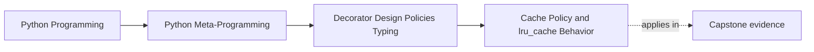

# Cache Policy and lru_cache Behavior


<!-- page-maps:start -->
## Page Maps




<!-- page-maps:end -->

Caching is one of the clearest examples of a decorator crossing from thin transformation
into operational policy.

The wrapper no longer only changes what happens around a call. It changes whether the
original function runs at all, how memory is used over time, and what operational hooks
the system needs.

That means cache decorators are a reliability and review topic before they are a speed
topic. A cache can erase repeated work, but it can also erase the point at which a caller
expected fresh execution.

## The sentence to keep

When reviewing a cache decorator, ask:

> what keying rule, eviction policy, and reset surface does this wrapper now own?

That question keeps caching tied to observable semantics instead of treating it like a
performance flourish.

Add one more question beside it:

> what exact calls does this wrapper consider the same, and who can inspect or reset that decision later?

## Cache policy is about more than a dictionary

The important cache questions are not only implementation details:

- how are keys constructed?
- what inputs are allowed?
- when are entries evicted?
- how can the cache be inspected or cleared?
- what happens under concurrency?

Those are policy decisions. A decorator that answers them is carrying real runtime
ownership.

Put differently: the cache is deciding when "same request" means "same stored answer."
That is a correctness boundary, not only an optimization trick.

## `functools.lru_cache` is the reference point

For this module, the standard-library cache matters for three main reasons:

1. it defines a clear keying story
2. it defines a clear least-recently-used eviction story
3. it exposes operational hooks such as `cache_info()` and `cache_clear()`

That last point is especially important. A serious cache should not hide its own state
completely from tuning, debugging, or tests.

It also gives learners a better comparison standard. A custom cache decorator should be
judged against this explicit hook surface, not only against whether it "seems to work."

## One picture of cache behavior

```text
call -> make key -> cache hit? -> return cached value
                    cache miss -> call original -> store according to policy -> return value
```

That loop looks simple, but every box in it carries design choices.

Use this review table when the loop starts feeling too casual:

| Step in the loop | What can go wrong if the policy is weak |
| --- | --- |
| make key | distinct calls may collapse together or equivalent calls may fragment |
| cache hit | callers may receive stale or history-dependent results unexpectedly |
| store according to policy | memory and eviction behavior may stop matching the intended owner story |
| reset or inspect | tests and operators may lose the ability to reason about state |

## Key construction is part of correctness

If the keying rule is wrong, the cache is wrong.

That is why Module 05 keeps saying:

- key construction is not a mere optimization detail
- it is part of the meaning of the wrapper

For `lru_cache`, the key path is carefully defined for hashable arguments, with optional
`typed=True` behavior that keeps `1` and `1.0` separate when desired.

That is much stronger than an ad hoc stringification trick hidden in a custom decorator.

Use `typed=True` as a teaching pressure point, not just a parameter name:

| Setting | Review meaning |
| --- | --- |
| `typed=False` | some numerically similar values may share cached meaning |
| `typed=True` | type distinctions become part of the cache key contract |

If a learner cannot explain that distinction in plain language, they are still treating
cache policy as background magic.

## Eviction policy should be explicit

With `lru_cache`, capacity limits and least-recently-used eviction are part of the public
shape of the decorator.

That matters because eviction changes semantics over time:

- old calls may stop being cached
- hit and miss behavior depends on usage history
- memory growth is bounded only when capacity policy exists

So a cache wrapper is never only "speed." It is state plus history plus policy.

It is also reuse plus forgetting. Eviction decides what past work still counts and what
must be recomputed. That is why the policy deserves visible language instead of only a
benchmark.

## Operational hooks make cache state reviewable

One of the strongest parts of the standard-library design is the explicit hook surface:

- `cache_info()` for hits, misses, maxsize, current size
- `cache_clear()` for reset

That is a great example of honest decorator design:

- the wrapper owns policy
- the wrapper also exposes the controls needed to observe and reset that policy

That is exactly the opposite of hidden statefulness.

These hooks also teach a durable rule for later modules:

- if a wrapper owns meaningful state, it should expose a deliberate review or reset route
- if it refuses to expose one, the design burden rises sharply

## The bounded comparison matters

Module 04 used a bounded cache to make state visible. This module uses `lru_cache` as
the production-grade reference point.

That comparison makes two important habits explicit:

- simple educational wrappers are useful when they reveal the design space
- production wrappers should not be reimplemented casually when the standard library
  already carries the hard-won semantics

That is another form of honesty: knowing when not to build your own abstraction.

## Common cache overclaims to reject

Reject these sentences when they appear in teaching or review:

| Overclaim | Better replacement |
| --- | --- |
| "it only changes performance" | "it changes execution reuse, state history, and reset expectations" |
| "the keying rule is an implementation detail" | "the keying rule is part of the wrapper's public meaning" |
| "a tiny custom cache is close enough to `lru_cache`" | "bounded educational caches and production cache semantics are different commitments" |
| "the hook surface is optional" | "stateful cache policy needs inspection and reset routes to stay reviewable" |

## Concurrency pushes cache policy further

Even a well-designed cache becomes more expensive under concurrency:

- shared state now needs coordination
- hit and eviction logic must remain consistent
- operational hooks still need to stay safe and meaningful

The built-in `lru_cache` already handles more of this than the bounded examples earlier
in the course. That is part of why it is the right reference point here.

That is also why a hand-rolled cache decorator should stay visibly narrow unless there is
a named requirement the standard tool cannot meet.

## Failure modes for cache decorators

These are the mistakes to catch before approving the design:

| Failure mode | Why it weakens the wrapper | Repair move |
| --- | --- | --- |
| casual key construction | the cache may answer the wrong question consistently | state the key contract explicitly or use the standard tool |
| no reset or inspection surface | operators and tests cannot steward state deliberately | expose hooks or move the owner elsewhere |
| pretending eviction is invisible | history-dependent behavior becomes harder to explain | document the eviction rule as part of semantics |
| rebuilding a weaker version of `lru_cache` without a concrete reason | the wrapper inherits production burden without production guarantees | prefer the standard tool unless a named requirement forces otherwise |

## Review rules for cache decorators

When reviewing a cache wrapper, keep these questions close:

- what exactly counts as the cache key?
- how does eviction work, and is it documented clearly enough?
- what hooks exist to inspect and reset cache state?
- is the wrapper reimplementing production cache behavior casually when `lru_cache` would be clearer?
- has the cache policy become significant enough that the decorator needs explicit operational surfaces?
- can another reviewer explain the key contract and eviction rule without guessing from the code?

## Exit check for this page

Before moving on, make sure you can do all of these:

- explain why cache key construction is part of correctness
- state what `typed=True` changes in review language, not only in API language
- name one reason `cache_info()` and `cache_clear()` are teaching tools as well as operational hooks
- reject one hand-rolled cache design that should have used `lru_cache` instead

## What to practice from this page

Try these before moving on:

1. Use `functools.lru_cache` and inspect `cache_info()` and `cache_clear()`.
2. Compare `typed=False` with `typed=True` on inputs such as `1` and `1.0`.
3. Explain one reason a hand-rolled cache decorator should stay bounded unless there is a very specific need not met by the standard tool.

If those feel ordinary, the final core can focus on the bigger design judgment: when a
wrapper should stop growing and hand policy off elsewhere.

## Continue through Module 05

- Previous: [Annotation-Aware Runtime Contracts](annotation-aware-runtime-contracts.md)
- Next: [Wrapper Policy Boundaries](wrapper-policy-boundaries.md)
- Practice: [Exercises](exercises.md)
- Terms: [Glossary](glossary.md)
