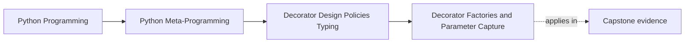
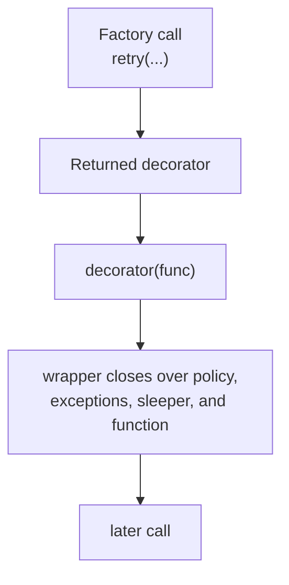

# Decorator Factories and Parameter Capture


<!-- page-maps:start -->
## Page Maps




<!-- page-maps:end -->

Module 05 begins where Module 04 left off: with wrappers that are no longer fixed and
generic, but configurable.

The key sentence is:

> a decorator factory runs once at definition time, captures configuration, and returns the
> real decorator that will wrap the function.

That sentence matters because it keeps configuration timing and wrapper timing separate.
It also keeps a common mistake visible: policy can become expensive or misleading before
the first real call ever happens.

## The sentence to keep

When you see `@decorator_name(config, ...)`, ask:

> what configuration is being captured now, and what wrapper behavior will use it later at
> call time?

That question keeps parameterized decorators grounded in ordinary rebinding instead of
turning them into framework mystique.

Add one more review question beside it:

> if this configuration were wrong, when would I notice and who would have to fix it?

## Read the shipped factory before writing another

Open `labs/decorator_policy/retry.py` and locate `retry`. It has three distinct
execution moments:

| Moment | Code that runs | Object or state produced |
| --- | --- | --- |
| factory call | validates `exceptions`, `max_attempts`, and `backoff_seconds` | an immutable `RetryPolicy` plus `decorate` |
| decorator application | receives `function` | `wrapped`, which closes over the function, policy, exception tuple, and sleeper |
| ordinary call | enters the finite loop | a result or the final retryable exception |

Run `make decorator-policy-lab` and inspect `retry.captured_policy`. That policy is
available before `deliver("INC-42")` runs. The output therefore proves capture timing
without relying on a print statement hidden in the factory.

Now change `max_attempts` to `4` without adding a third delay. The factory raises
`ValueError` before it receives a function. That is a deliberate definition-time
failure: an incoherent policy never becomes a callable.

## A decorator factory has three layers

The standard shape is:

1. factory
2. decorator
3. wrapper

The factory captures configuration. The decorator captures the function. The wrapper runs
on each call with both available through closures.

```python
factory = retry(
    exceptions=(TransientDeliveryError,),
    max_attempts=3,
    backoff_seconds=(0.1, 0.2),
    sleep=record_sleep,
)
decorated = factory(deliver)
result = decorated("INC-42")
```

That is the full structure. Nothing else is hidden.

The teaching value of this three-layer picture is not only structural. It forces you to
name where each responsibility lives:

- the factory owns configuration capture
- the decorator owns rebinding
- the wrapper owns repeated runtime behavior

## Trace the captured owners



Caption: policy is validated and captured once; the finite call loop consumes it later.

## `@factory(arg)` is just another desugaring

This:

```python
@retry(
    exceptions=(TransientDeliveryError,),
    max_attempts=3,
    backoff_seconds=(0.1, 0.2),
)
def deliver(incident_id: str) -> str:
    ...
```

means:

```python
decorator = retry(
    exceptions=(TransientDeliveryError,),
    max_attempts=3,
    backoff_seconds=(0.1, 0.2),
)

def deliver(incident_id: str) -> str:
    ...

deliver = decorator(deliver)
```

So the timing is:

- `retry(...)` validates and captures its policy once
- the resulting decorator wraps `deliver` once
- later calls run the wrapper many times

That separation becomes important when configuration work is heavy or when the decorator
captures policy that should be visible to review.

It also becomes important when factory code has side effects. Logging, registry writes,
environment reads, or expensive setup at factory time all happen before ordinary business
calls begin.

## Definition-time surprises to catch early

The phrase "it only runs once" is not enough. One-time work can still be expensive or
surprising.

Use this table during review:

| Factory behavior | Why it matters |
| --- | --- |
| reads environment or process state | the captured policy may differ across import contexts |
| performs heavy setup | the cost appears at definition or import time, not first call |
| mutates a registry or global surface | the wrapper now has a broader ownership story than local configuration |
| validates configuration aggressively | failures appear before the wrapped callable is ever invoked |

## Different applications get independent configuration

Apply `retry` twice: once for `(ConnectionError,)` with two attempts, and once for
`(TimeoutError,)` with four. Each wrapped callable exposes its own
`__retry_policy__`. The policies are immutable values, not one mutable global settings
dictionary.

That is one of the big benefits of this pattern: per-use configuration without global
state.

It is also one of the first places where learners should ask whether "per-use" is still
the right owner. Some configuration is local and healthy. Some is the beginning of policy
fragmentation across call sites.

## Factories are already policy surfaces

This is where Module 05 starts raising the review bar.

A decorator factory does not only capture a prefix or logging level. It can also capture:

- retry counts
- timeout durations
- rate limits
- cache sizes
- validation modes

That means the factory boundary is often where a wrapper stops being generic and starts
owning policy.

So the review question is not only "does this work?" It is also:

> should this policy really live in a decorator closure?

That is the first design judgment Module 05 wants you to practice. A captured retry
budget, timeout duration, validation mode, or cache size is not harmless only because the
code still fits in one screen.

## Factories still need wrapper transparency

Even with configuration involved, the usual wrapper rules remain:

- forward `*args, **kwargs` unless the design has a reason not to
- preserve metadata with `functools.wraps`
- keep definition-time and call-time work distinct

If a factory captures complex policy but loses the callable's public identity, the design
is already harder to trust.

Transparency also includes policy visibility. A well-preserved `__name__` does not rescue
a wrapper whose captured settings are too broad or too hidden to review cleanly.

## Over-parameterization is a warning sign

Factories can grow unwieldy fast:

- too many boolean flags
- too many interacting knobs
- too much policy branching hidden in wrapper code

When that happens, the decorator may be competing with a small explicit object or service
configuration API. Module 05 will come back to that boundary directly in the final core.

Use this quick comparison when the parameter list starts growing:

| If the captured knobs mostly... | Better default owner |
| --- | --- |
| label one call boundary narrowly | decorator factory may still be the right fit |
| coordinate retries, limits, or validation modes across many call sites | explicit object or service becomes stronger |
| need shared operational inspection | explicit owner is usually clearer |
| interact in ways reviewers must test combinatorially | decorator closure is becoming too hidden |

## Common factory failure modes

These are the mistakes to catch before the module moves into heavier policy:

| Failure mode | Why it weakens the design | Repair move |
| --- | --- | --- |
| treating factory timing like call timing | hides when configuration work or failure really happens | desugar the decorator and name the once-only steps |
| capturing too many booleans and modes | policy becomes hard to inspect from call sites | replace the flag bundle with an explicit owner or configuration object |
| allowing configuration to imply stronger guarantees than the wrapper delivers | readers overtrust the surface | state the exact supported behavior and non-goals |
| preserving metadata but hiding captured policy | tooling can inspect the callable but humans still cannot inspect the ownership story | document or externalize the policy surface |

## Prove the timing claim

Run:

```bash
python -m unittest \
  tests.test_decorator_policy_evidence.DecoratorPolicyEvidenceTests.test_retry_factory_rejects_incoherent_policy_before_decoration \
  tests.test_decorator_policy_evidence.DecoratorPolicyEvidenceTests.test_retry_wrapper_exposes_policy_and_preserves_callable_evidence
```

The first test proves configuration is rejected at factory time. The second proves the
captured policy remains inspectable while `functools.wraps` preserves the original
callable surface. Neither test proves retry is safe for non-idempotent work; that
judgment belongs to the next core.

## Review rules for decorator factories

When reviewing a decorator factory, keep these questions close:

- what configuration is captured once at definition time?
- what later wrapper behavior depends on that configuration?
- does each application get independent captured state as intended?
- is the wrapper still transparent enough for tools and reviewers?
- have the parameters grown large enough that an explicit object would be clearer?
- what would break first if the captured configuration were wrong or inconsistent across call sites?

## Exit check for this page

Before moving on, make sure you can do all of these:

- name the responsibility of the factory, the decorator, and the wrapper separately
- explain one concrete effect that can happen at definition time before any business call
- state when per-use configuration stays healthy and when it starts fragmenting policy
- reject one decorator factory whose captured parameter surface should become an explicit owner instead

## What to practice from this page

Try these before moving on:

1. Desugar the shipped `retry(...)` application by hand.
2. Add one invalid policy case to the focused tests and explain why failure belongs at
   factory time.
3. Apply two different policies and prove they do not share configuration.
2. Apply the same factory twice with different arguments and explain why the captured configuration stays independent.
3. Write down one parameterized decorator idea that still feels honest and one that already feels like too much policy for a wrapper.

If those feel ordinary, the next step is to study policy-heavy wrappers that change
control flow and error behavior directly.

## Continue through Module 05

- Previous: [Overview](index.md)
- Next: [Resilience and Control-Flow Wrappers](resilience-and-control-flow-wrappers.md)
- Practice: [Exercises](exercises.md)
- Terms: [Glossary](glossary.md)
