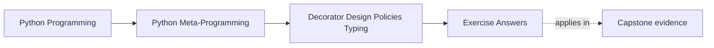

# Exercise Answers


<!-- page-maps:start -->
## Page Maps




<!-- page-maps:end -->

Use this page after attempting the exercises yourself. The point is not to match every
example literally. The point is to compare your reasoning against answers that keep
wrapper power, policy scope, and typing limits honest.

Treat each answer as a review calibration, not as a single correct final form. A strong
answer names ownership, limits, and operational consequences in plain language. A weak
answer may still sound technically clever while hiding who actually owns the policy.

## Answer 1: Build one decorator factory with real configuration

Example answer:

```python
import functools


def repeat(times):
    def decorator(func):
        @functools.wraps(func)
        def wrapper(*args, **kwargs):
            return [func(*args, **kwargs) for _ in range(times)]
        return wrapper
    return decorator
```

Strong explanation:

- `repeat(times)` runs once at definition time
- the returned decorator captures `times`
- the wrapper uses that captured value on each call

Good conclusion:

This is an honest factory because the configuration is explicit and the captured policy is
still narrow and visible.

Reasoning checkpoint:

- can you point to the exact captured value?
- can you say what would make this factory too policy-heavy to stay honest?

## Answer 2: Review one resilience wrapper

Example answer:

A retry decorator that retries `ConnectionError` up to three times changes semantics in at
least three ways:

- it may call the underlying function more than once
- it waits between attempts
- it changes when failure becomes final

Good conclusion:

That is already control-flow policy, not a thin wrapper, because the decorator now governs
execution timing and error handling.

Reasoning checkpoint:

- can you name the stopping rule exactly?
- can you explain which side effects might happen more than once?

## Answer 3: Validate one narrow hint subset

Example answer:

Support:

- plain runtime classes
- `Union`
- `Optional`
- `Any`

Reject:

- parameterized generics such as `list[int]`

Good conclusion:

This is an honest partial validator because it names its supported surface clearly and
refuses unsupported hints instead of pretending to understand them.

Reasoning checkpoint:

- can you name the first unsupported hint a real caller might hit?
- can you explain why silently skipping that hint would be misleading?

## Answer 4: Inspect cache policy instead of only cache speed

Example answer:

```python
import functools


@functools.lru_cache(maxsize=2, typed=True)
def add(x, y):
    return x + y
```

Strong explanation:

- `typed=True` distinguishes calls such as `add(1, 2)` and `add(1.0, 2)`
- `cache_info()` exposes hits, misses, and current size
- `cache_clear()` provides deterministic reset

Good conclusion:

The cache is not just a speed trick. It owns keying, eviction, and operational state, and
those choices are part of the wrapper's public meaning.

Reasoning checkpoint:

- can you say which calls count as the same cached request?
- can you name the reset or inspection hook an operator would use first?

## Answer 5: Reject one decorator that grew too large

Example answer:

Suppose one decorator tries to combine:

- retries
- timeouts
- logging
- validation
- cache invalidation

Strong redesign:

- keep a thin boundary decorator if needed
- move retry policy to a retry object or client wrapper
- move validation to a validator component
- move cache ownership to an explicit cache service or standard-library wrapper

Good conclusion:

Once policy becomes this broad, a single decorator hides too much state and coordination to
stay reviewable.

Reasoning checkpoint:

- can you name the first responsibility that should move out of the decorator?
- can you describe the clearer owner in one sentence?

## Answer 6: Review a partial validator honestly

Example answer:

A partial `@validated` decorator can honestly claim:

- it checks a narrow supported hint subset at one runtime boundary
- it binds arguments before validating
- it may raise or warn on mismatch

It cannot honestly claim:

- full typing support
- safety in warning mode
- enforcement of every advanced typing feature

Good conclusion:

Warning mode is not safety mode because the wrapped function may still fail internally even
after the validator chooses not to raise.

Reasoning checkpoint:

- can you state the strongest honest claim this validator can make?
- can you name the first threshold where it should become an explicit validator component?

## Answer 7: Separate local convenience from durable policy

Example answer:

Suppose a project starts with a decorator that:

- retries failures
- emits logs
- converts exceptions into sentinel values
- caches successful results

Strong assessment:

- the decorator may feel convenient in one notebook or one service file
- over time it silently becomes the owner of execution policy, observability policy, and cache policy
- learners can no longer tell which behavior belongs to the business function and which belongs to the wrapper

Good conclusion:

This is the kind of convenience that ages badly. A clearer owner teaches better because it
forces each policy to become visible instead of bundling them under one callable boundary.

Reasoning checkpoint:

- can you say who would debug this policy six months later?
- can you point to the hidden owner the decorator was avoiding?

## Answer 8: Design one explicit policy owner

Example answer:

Suppose a broad `@validated_retrying_cached` decorator is replaced with:

- a validator component
- a retry policy object
- a cache object or `lru_cache` boundary
- a small orchestration helper that wires them together

Strong review advantage:

- each policy surface can now be tested and reviewed independently

Strong learning advantage:

- learners can see which owner validates input, which one retries, and which one caches

Good conclusion:

An explicit owner is better when the main teaching goal is boundary clarity rather than
surface-level compactness.

Reasoning checkpoint:

- can you separate what still belongs at the call boundary from what moved away?
- can you explain why that split teaches more honestly?

## Answer 9: Compare safe claims with overstated claims

Example answer:

Honest description:

- "This decorator validates a small supported subset of hints at call time and rejects unsupported typing features."

Overstated description:

- "This decorator makes the function type-safe."

Good conclusion:

The second version is misleading because words such as "makes" and "type-safe" imply a
much stronger guarantee than partial runtime checking can provide. Honest language keeps
the supported surface and the unsolved space visible.

Reasoning checkpoint:

- can you rewrite the honest claim without losing usefulness?
- can you point to the exact inflated words in the bad claim?

## Answer 10: Produce a decorator-governance packet

The packet is strong when another learner can answer:

- what policy the decorator owns directly
- what explicit control or reset surface exists for stateful behavior
- which runtime typing claims are supported and which are intentionally refused
- when the wrapper should be replaced by a clearer service or object boundary

Add one more packet test:

- could a reviewer identify the policy owner without reading your implementation twice?

## Repair moves for weak answer keys

If your answer key still feels shallow, use these repair moves:

| Weak answer habit | Repair move |
| --- | --- |
| describing only the implementation shape | add the owner story and the refusal boundary |
| praising simplicity without naming tradeoffs | state what complexity was hidden and who now owns it |
| saying "it validates types" | list supported hints, refused hints, and one overclaim you reject |
| treating warnings as harmless | explain what can still fail after the warning |
| treating caches as performance magic | name key equivalence, eviction, and reset surfaces |

## What strong Module 05 answers have in common

Across the whole set, strong answers share the same habits:

- they distinguish thin wrappers from policy-carrying wrappers
- they keep runtime typing claims narrow and explicit
- they expose reset, inspection, or control hooks when stateful policy exists
- they move overloaded decorator behavior into explicit owners when the wrapper boundary is no longer the clearest fit
- they distinguish local convenience from durable policy design
- they leave behind a packet another learner can review without guessing

If an answer still sounds like "the decorator can just handle it," revise it until you can
say what policy it owns, what it refuses to own, and why that boundary is honest.

## Exit check for the answer key

Before leaving this page, make sure you can do all of these:

- identify the policy owner in every answer
- name one refused claim in every typing-aware answer
- name one operational surface in every resilience or cache answer
- explain one case where an explicit owner teaches better than another decorator layer

## Continue through Module 05

- Previous: [Exercises](exercises.md)
- Return: [Overview](index.md)
- Next module: [Module 06](../module-06-class-customization-pre-metaclasses/index.md)
- Terms: [Glossary](glossary.md)
