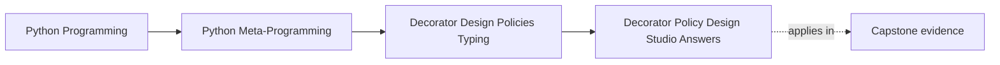
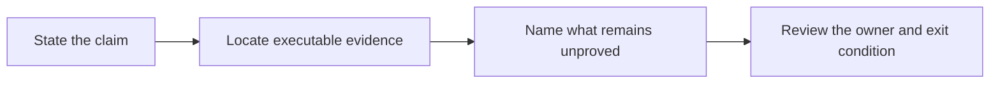

# Exercise Answers: Decorator Policy Design Studio

<!-- page-maps:start -->
## Page Maps




<!-- page-maps:end -->

Use these answers after attempting the studio. Exact prose may differ, but your evidence,
timing, and ownership conclusions should be equally precise.

## Answer 1: change a finite retry policy

For two total attempts, the predicted trace is:

```text
attempt:1
sleep:0.1
attempt:2
```

The captured policy must become:

```python
{
    "exceptions": ["TransientDeliveryError"],
    "max_attempts": 2,
    "backoff_seconds": [0.1],
}
```

The scenario's success condition also changes from `attempts < 3` to `attempts < 2`.
Changing only the expectation would hide a contradiction between implementation and
proof.

Reasoning:

- one caller request can still execute the operation twice
- one injected sleep proves the wrapper owns waiting between attempts
- `functools.wraps` and `__retry_policy__` must remain unchanged because policy growth
  does not cancel Module 04's transparency contract

Common wrong turn: changing the generic loop to special-case the scenario. The scenario
owns example data; `retry` owns reusable semantics.

This proves an exact finite trace. It does not prove that the underlying delivery is
idempotent, that 0.1 seconds is an appropriate operational delay, or that concurrent
callers coordinate safely.

## Answer 2: prove selective failure handling

A defensible test uses one stable `ValueError` object:

```python
failure = ValueError("bad payload")
attempts = 0

@retry(
    exceptions=(ConnectionError,),
    max_attempts=3,
    backoff_seconds=(0.0, 0.0),
    sleep=lambda _: None,
)
def deliver() -> None:
    nonlocal attempts
    attempts += 1
    if attempts == 1:
        raise ConnectionError("transient")
    raise failure

with self.assertRaises(ValueError) as caught:
    deliver()

self.assertIs(caught.exception, failure)
self.assertEqual(attempts, 2)
```

The first failure earns another attempt. The second is outside the configured exception
tuple, so it exits immediately. If the wrapper catches `Exception`, the count becomes
three and the proof fails.

Common wrong turn: asserting only `ValueError` by type. Identity is stronger evidence
that the wrapper did not translate the non-retryable failure.

This proves selective handling and immediate propagation. It does not prove the first
attempt had no irreversible side effect.

## Answer 3: extend or refuse one annotation

### Route A

Adding `float` to the union remains within the existing supported mechanism. The
annotation is approved during decoration because every union member is a runtime class.
A `2.5` value then matches during invocation.

The strongest honest claim remains:

> the decorator checks values against a small supported runtime hint subset at calls
> that actually execute.

It still cannot prove that every call site in the program is valid before execution.

### Route B

`dict[str, int]` is refused during decoration. `get_origin` finds `dict`, which is
neither `Union` nor `types.UnionType`; `_validate_supported_hint` raises
`UnsupportedHintError`. The function body never becomes reachable through a wrapper.

Common wrong turn: treating `isinstance(value, dict)` as support for `dict[str, int]`.
That checks only the outer container and silently ignores the declared element contract.

The refusal proves boundary honesty. It does not prove the annotation is invalid or
useless; static tooling can still reason about it.

## Answer 4: audit warning and return timing

Warning mismatch:

```text
bind -> compare argument -> warn -> append to calls -> return value
```

Strict return mismatch:

```text
bind -> compare arguments -> increment calls -> return 42 -> compare return -> raise
```

Answers to the review questions:

1. Warning mode is observation because delegation continues after the warning.
2. Return checking happens after the function produced a value, so prior side effects
   cannot be prevented or undone by this wrapper.
3. A money transfer, destructive write, or external page without an idempotency boundary
   is too risky for warning-only validation.
4. Rollback needs an explicit transaction or unit-of-work owner, not another branch in
   the decorator.

Useful assertions include exact call lists and exact counters after the mismatch. They
make control flow visible without asking a reader to infer it from warning capture.

This proves local event order. It does not prove transactional safety.

## Answer 5: review cache equivalence and lifecycle

The teaching cache constructs a key from:

```python
(args, tuple(sorted(kwargs.items())))
```

Sorting makes the two keyword orders equal. A positional call puts values in `args`
instead, so it creates a different key even though signature binding would describe the
same logical arguments.

Comparison:

| Surface | Teaching cache | `lru_cache` reference |
| --- | --- | --- |
| key equivalence | direct `args` plus sorted `kwargs`; equivalent call styles can fragment | standard-library private key construction with documented public behavior |
| eviction | visible least-recently-used order | bounded least-recently-used policy |
| failed calls | tested as misses and not stored | exceptions are not cached |
| inspection | `cache_info()` and teaching-only `cache_snapshot()` | `cache_info()` and `cache_parameters()` |
| reset | `cache_clear()` resets entries and counters | `cache_clear()` resets state |
| thread safety | explicitly unsupported | internal cache structure remains coherent, without guaranteeing one execution per racing key |

Common wrong turn: saying `typed=False` always merges equal values of different types.
The public documentation is more qualified. Use `typed=True` when the type distinction
must be part of the declared policy, and test the exact calls your application depends
on.

Choosing `lru_cache` is defensible when its keying, bounded state, concurrency contract,
and hooks meet the requirement. A custom wrapper needs a named requirement that the
standard tool cannot satisfy.

The comparison proves exact local histories. It is not a benchmark or a freshness proof.

## Answer 6: transfer the boundary into the capstone

`bind-action` and `check-action` are intentionally separate:

- `bind_action_arguments` delegates parameter matching to `inspect.Signature.bind`
- `check_action_arguments` starts with that bound mapping, then checks only the supported
  annotation subset
- `inspect_action_wrapper` reports transformation ownership without validating or
  invoking

Boundary record for `@action`:

```text
Policy: bind calls, record successful action history, preserve callable evidence
Current owner: action wrapper
Evidence surface: ActionSpec, __wrapped__, __signature__, action-wrapper command
Why this owner still fits: behavior is local to one successful action call
Exit condition: action policy begins retrying, coercing, or interpreting rich schemas
```

Boundary record for `check_action_arguments`:

```text
Policy: check Any, runtime classes, Union, and Optional for bound action arguments
Current owner: explicit framework preflight function plus helpers in actions.py
Evidence surface: check-action JSON and focused runtime/CLI tests
Why this owner still fits: checking is opt-in, non-executing, and separate from action invocation
Exit condition: validation needs nested schemas, coercion, cross-field rules, or reusable rich errors
```

The capstone does not put this check inside `@action` because that would change every
action invocation, broaden the wrapper's owner story, and entangle registration with a
partial runtime type system. The explicit route lets a caller request preflight and see
refusals without changing ordinary action semantics.

The complete console report proves that three bound string values match their resolved
`str` hints without plugin construction or execution. The partial-contract test proves
that a mismatch, unsupported `list[str]`, and unannotated parameter stay distinct. It
does not prove return types, nested containers, static call-site correctness, or business
validity.

## Final packet review

A strong packet lets a reviewer answer:

- Which code runs at factory, decoration, and call time?
- Which failures earn another attempt?
- Which hint forms are supported, refused, or absent?
- Which calls share cache state?
- Which state can be inspected and reset?
- Which capstone route binds shape, checks values, or inspects wrapper ownership?
- What event would force each decorator policy into an explicit owner?

Reject the packet if it says only "tests pass." Tests are evidence for named claims, not
a substitute for naming the claims.

## Verification ledger

| Surface changed | Smallest first proof |
| --- | --- |
| retry configuration or loop | one named test in `test_decorator_policy_evidence.py` |
| hint support or mismatch mode | `test_decorator_policy_validation.py` |
| teaching-cache behavior | `test_bounded_cache_lab.py` |
| cross-cache evidence | the cache-comparison test |
| action contract report | capstone runtime and CLI contract tests |
| course page links and navigation | strict program documentation build |

Escalate to the broad course gate only after the focused route is green.

## Exit check

Before leaving the answer key, confirm you can explain:

- why a successful retry trace can still reveal risk
- why refusal is stronger than silent partial support
- why warning and return checks have different execution timing
- why cache equivalence is part of correctness
- why the capstone keeps partial contract checking outside `@action`

## Continue

- Previous: [Exercises](exercises.md)
- Return: [Overview](index.md)
- Next module: [Module 06](../module-06-class-customization-pre-metaclasses/index.md)
- Terms: [Glossary](glossary.md)
