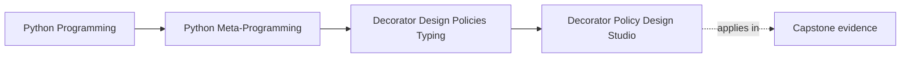
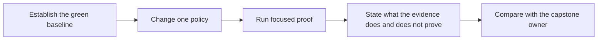

# Exercises: Decorator Policy Design Studio

<!-- page-maps:start -->
## Page Maps




<!-- page-maps:end -->

This studio changes and reviews the shipped Module 05 code. It is not a syntax
worksheet. Each exercise asks you to predict a behavioral delta, make or review one
bounded change, and leave evidence another learner can check.

Work from `programs/python-programming/python-meta-programming`.

## Establish the baseline

Run:

```bash
make decorator-policy-lab-test
make decorator-policy-lab
make capstone-check-action
```

Save these baseline facts:

- retry succeeds on its third underlying execution
- exhausted retry stops after two total attempts
- strict mismatch prevents execution
- warning mismatch permits execution
- `list[int]` is refused during decoration
- cache reset leaves both compared caches empty
- the shipped console action contract is complete and accepted without construction or execution

If the baseline is not green, stop and diagnose it. Do not reinterpret an existing
failure as evidence for your change.

## Studio 1: change a finite retry policy

Starting context:

- `labs/decorator_policy/retry.py` owns the generic wrapper
- `labs/decorator_policy/evidence.py` owns the deterministic scenario
- `tests/test_decorator_policy_evidence.py` owns the claims

Objective: change the success scenario from three attempts with two waits to two
attempts with one wait.

Constraints:

- do not change the generic retry loop
- keep `TransientDeliveryError` as the only retryable failure
- keep real sleeping out of the test
- preserve callable metadata and `__retry_policy__`

Before editing, write the exact new event list. Then update the scenario and its test.

Acceptance:

```bash
python -m unittest \
  tests.test_decorator_policy_evidence.DecoratorPolicyEvidenceTests.test_retry_packet_exposes_captured_policy_and_multiplied_execution
```

Hand in:

- the predicted and actual event lists
- the changed captured policy
- one sentence explaining why fewer attempts reduce exposure but do not prove delivery is idempotent
- the Module 04 transparency contract that remained true

## Studio 2: prove selective failure handling

Objective: add a focused case where:

- the first `ConnectionError` is retryable
- a later `ValueError` is not
- the wrapper stops immediately on `ValueError`

Constraints:

- use a zero-duration injected sleeper
- assert the exact underlying execution count
- assert the `ValueError` object is not replaced
- do not broaden the configured exception tuple

Acceptance:

- the new test fails if the wrapper catches `Exception`
- the new test fails if the wrapper performs an extra attempt
- all existing decorator-policy tests remain green

Explain what this proves about exception selection and what it does not prove about
side-effect safety.

## Studio 3: extend or refuse one annotation

Choose one route.

Route A: extend a supported union from `str | int | None` to
`str | int | float | None`.

Route B: add a decorated function with `dict[str, int]` and prove it is refused.

Constraints:

- do not add deep container checking
- do not silently skip any annotation
- predict whether the outcome occurs during decoration or invocation
- keep `Any`, plain classes, `Union`, and `Optional` working

Acceptance:

```bash
python -m unittest discover \
  -s tests \
  -p "test_decorator_policy_validation.py" \
  -v
```

Hand in:

- the chosen hint and predicted timing
- the test that proves the outcome
- the strongest honest runtime claim after your change
- one static-typing question the runtime test still cannot answer

## Studio 4: audit warning and return timing

Do not change implementation first. Read:

- `test_warning_mode_observes_a_mismatch_but_still_executes`
- `test_strict_return_validation_runs_after_the_wrapped_function`

Draw the two event sequences. Then add one assertion to each test that makes execution
timing harder to misread.

Your review note must answer:

1. Why is warning mode observation rather than enforcement?
2. Why can a return mismatch not prevent the wrapped side effect?
3. Which business operation would be too risky for warning mode?
4. What stronger owner would be needed for rollback or transaction semantics?

Acceptance: another learner can infer both execution orders from test assertions
without opening `validation.py`.

## Studio 5: review cache equivalence and lifecycle

Run the lab and inspect `cache_comparison`. Explain why these two calls share a teaching
cache entry:

```python
render(incident_id="INC-42", severity="critical")
render(severity="critical", incident_id="INC-42")
```

Then explain why this call creates a second entry:

```python
render("INC-42", "critical")
```

Add one focused test that proves a failed call is absent from the teaching cache, then
compare that claim with what the cross-cache packet actually proves.

Acceptance:

```bash
python -m unittest tests.test_bounded_cache_lab tests.test_decorator_policy_evidence
```

Hand in a comparison with:

- key equivalence
- eviction
- failure caching
- inspection
- reset
- thread-safety scope
- one named reason to choose `functools.lru_cache`

## Studio 6: transfer the boundary into the capstone

Run:

```bash
make capstone-bind-action
make capstone-check-action
make capstone-action-wrapper
```

Compare the three outputs:

| Route | Question |
| --- | --- |
| `bind-action` | do these values satisfy Python's call shape? |
| `check-action` | do bound values match the supported runtime hint subset? |
| `action-wrapper` | which wrapper layer owns metadata and signature evidence? |

Now inspect:

- `capstone/src/incident_plugins/actions.py`
- `capstone/src/incident_plugins/framework.py`
- the two action-contract tests in `capstone/tests/test_runtime.py`

Write boundary records for `@action` and `check_action_arguments`. Your review must
explain why the capstone did not add validation directly to the action wrapper.

Acceptance:

```bash
make -C capstone test
```

The report for a complete all-`str` action must be accepted without constructing or
executing the plugin. The partial-contract test must report one mismatch, one refused
generic, and one unannotated argument without claiming completeness.

## Final review packet

Submit one packet containing:

- retry trace before and after your change
- one selective-exception failure proof
- one supported or refused annotation decision
- warning and return-timing diagrams
- cache equivalence and lifecycle comparison
- two capstone boundary records
- the focused commands you ran and their outcomes

For every claim, include:

1. evidence
2. what the evidence proves
3. what it does not prove
4. the owner of the behavior
5. the condition that would force a different owner

## Exit standard

You are ready for Module 06 when you can:

- predict wrapper control flow before running it
- separate call-shape binding from partial runtime hint checking
- identify definition-time refusal and call-time mismatch
- explain why cache keys and reset are correctness surfaces
- keep a wrapper only when its policy and exit condition remain reviewable

## Continue through Module 05

- Previous: [Worked Example](worked-example-building-a-partial-validated-decorator.md)
- Next: [Exercise Answers](exercise-answers.md)
- Return: [Overview](index.md)
- Terms: [Glossary](glossary.md)
