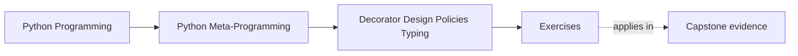

# Exercises

<!-- page-maps:start -->
## Page Maps

<!-- page-maps:end -->

Use these after reading the five core lessons and the worked example. The goal is not to
collect more decorator patterns. The goal is to make policy ownership, typing limits, and
wrapper honesty explicit.

Each exercise asks for three things:

- the policy or contract you are trying to enforce
- the wrapper or explicit boundary you chose
- the reason that choice is honest enough for the problem

Treat the ten exercises as one full lab day on decorator policy and typing boundaries.

This is not a "write ten decorators" worksheet. It is a review lab. A weak answer can
still compile and still fail the learning goal if it hides ownership, skips refusal
boundaries, or overstates runtime guarantees.

Do them in order:

- Exercises 1-3 establish factory capture, resilience policy, and narrow runtime validation
- Exercises 4-6 separate cache policy, overloaded decorators, and partial validator limits
- Exercises 7-8 extend that discipline into escalation boundaries and explicit policy owners
- Exercises 9-10 package the whole module into a reviewable decorator-governance packet

Keep one policy-boundary table while you work:

| Policy or contract | Wrapper or owner | What it really controls | What it refuses to claim | Review judgment |
| --- | --- | --- | --- | --- |

Keep one second table beside it:

| Exercise | Operator or reviewer evidence | What could still go wrong | Repair move |
| --- | --- | --- | --- |

## Exercise 1: Build one decorator factory with real configuration

Write a parameterized decorator and apply it twice with different configuration.

What to hand in:

- the factory implementation
- two differently configured uses
- one explanation of what was captured at definition time and what runs on each call
- one sentence naming the first sign that the factory has started hiding too much policy

## Exercise 2: Review one resilience wrapper

Implement or inspect a retry, timeout, or rate-limit decorator.

What to hand in:

- the rule it enforces at the call boundary
- one concrete control-flow or failure behavior it changes
- one sentence explaining why this is policy rather than a thin transformation
- one sentence naming the exact stopping rule a reviewer should check

## Exercise 3: Validate one narrow hint subset

Build a tiny annotation-aware validator for a supported subset of hints.

What to hand in:

- the supported hint subset
- one call that passes and one that fails
- one example of a hint surface you explicitly refuse to support
- one sentence explaining what claim would become dishonest if you silently skipped that unsupported hint

## Exercise 4: Inspect cache policy instead of only cache speed

Use `functools.lru_cache` or a bounded cache wrapper.

What to hand in:

- the key or typed-mode behavior you are relying on
- one inspection or reset hook such as `cache_info()` or `cache_clear()`
- one explanation of why cache policy is more than "just performance"
- one sentence naming which calls count as the same cached request

## Exercise 5: Reject one decorator that grew too large

Take a wrapper idea that is carrying too much policy and redesign it mentally.

What to hand in:

- the overloaded decorator idea
- the explicit object, service, or later-course mechanism you would move it to
- one explanation of why that new owner is easier to review
- one sentence naming what hidden state or coordination made the old decorator untrustworthy

## Exercise 6: Review a partial validator honestly

Use the worked example pattern on `@validated` or a similar runtime checker.

What to hand in:

- the exact claim the validator is allowed to make
- one unsupported typing feature it must reject or ignore
- one explanation of why warning mode is not the same as safety
- one sentence naming the first threshold where this should stop being a decorator and become a validation component

## Midday self-check

Before moving into the final four exercises, make sure you can already answer these
questions clearly:

- when decorator capture stays narrow and when it turns into hidden policy
- why resilience wrappers and caches need operational review instead of only syntax review
- what a partial runtime validator is allowed to claim without overstating typing support
- when a decorator should give up ownership to an explicit object or service

If you cannot answer those four questions in plain language, return to Exercises 1-6 and
make the policy owner, runtime boundary, and unsupported claim more explicit before
continuing.

If your answers still rely on phrases like "the decorator just handles it" or "it keeps
things simple," revise them before moving on. Those sentences hide the owner story this
module is trying to force into the open.

## Exercise 7: Separate local convenience from durable policy

Choose one decorator idea that feels convenient in a single file but risky as a long-term
course pattern.

What to hand in:

- the convenient decorator idea
- the exact policy it would silently own over time
- one explanation of why an explicit owner would teach the boundary more honestly
- one sentence naming who would have to debug the policy six months later

## Exercise 8: Design one explicit policy owner

Take one broad decorator idea and redesign it as an explicit object, helper, or service.

What to hand in:

- the original decorator shape
- the new owner you would introduce
- one review advantage and one learning advantage the explicit owner creates
- one sentence naming which responsibilities stay at the call boundary and which move away from it

## Exercise 9: Compare safe claims with overstated claims

Choose one typing-aware or policy-heavy decorator and write both an honest description and
an overstated description.

What to hand in:

- the honest description
- the overstated description
- one explanation of which words make the second version misleading
- one replacement sentence that preserves usefulness without inflating the guarantee

## Exercise 10: Produce a decorator-governance packet

Assemble:

- one policy-boundary table
- one resilience or cache example with an explicit control surface
- one partial typing example with a named unsupported feature
- one redesign rule for moving overloaded decorator policy into an explicit owner

The packet is strong when another learner can use it to answer:

- what policy the decorator actually owns
- what typing or runtime claim it can support honestly
- when the wrapper boundary should be replaced by a clearer owner

Make the packet easy to scan. Another learner should be able to review it without knowing
your original implementation details.

## Repair prompts for weak exercise drafts

Use these prompts when an answer feels vague, compact, or suspiciously confident:

| If your answer says... | Ask yourself instead... |
| --- | --- |
| "the decorator adds safety" | what exact unsafe behavior can still happen afterward? |
| "the wrapper improves performance" | what cache key, eviction rule, or reset route makes that statement meaningful? |
| "the validator checks types" | which hints, and which hints are refused? |
| "this is still simple" | simple for whom: caller, reviewer, or operator? |
| "an object would be overkill" | what owner story is currently being hidden to avoid naming it? |

## Mastery standard for this exercise set

Across all six answers, the module wants the same habits:

- you separate thin callable transformation from policy ownership
- you keep runtime typing claims partial and explicit
- you prefer explicit objects or services when decorator policy grows too broad
- you preserve transparency even when wrappers become more powerful

Across all ten answers, add two more habits:

- you distinguish convenient local wrappers from durable course-worthy policy boundaries
- you leave behind a decorator-governance packet another learner could review without guessing

If an answer still sounds like "the decorator just handles it," keep going.

## Exit check for the exercise set

Before you leave Module 05 practice, make sure your packet lets another learner answer
all of these:

- which wrappers in your set stayed narrow enough to remain decorators
- which ones wanted an explicit owner instead
- which runtime or typing claims you refused deliberately
- which control, inspection, or reset surfaces reviewers should inspect first

## Continue through Module 05

- Previous: [Worked Example: Building a Partial `@validated` Decorator](worked-example-building-a-partial-validated-decorator.md)
- Next: [Exercise Answers](exercise-answers.md)
- Return: [Overview](index.md)
- Terms: [Glossary](glossary.md)
