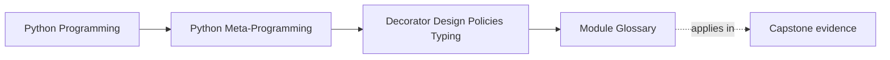

# Module Glossary

<!-- page-maps:start -->
## Page Maps

<!-- page-maps:end -->

This glossary belongs to **Module 05: Decorator Design, Policies, and Typing** in
**Python Metaprogramming**. It keeps the language of this directory stable so the same
ideas keep the same names across lessons, practice, and capstone discussion.

## How to use this glossary

Use the glossary when a wrapper discussion starts to blur together thin transformation,
control-flow policy, runtime validation, and explicit service ownership. Module 05 is
meant to keep those boundaries named and reviewable.

If two reviewers use the same word but mean different ownership stories, pause and return
here. This module gets weak quickly when terms like "validation," "policy," "safe," or
"simple" are left vague.

## Terms in this directory

| Term | Meaning in this directory |
| --- | --- |
| Annotation-aware decorator | A wrapper that reads type hints at runtime and uses them for a limited contract or policy decision. |
| Explicit policy owner | The named object, service, or component that owns broad runtime policy once a decorator boundary becomes too narrow or too hidden. |
| Cache policy | The keying, eviction, and reset behavior a cache wrapper owns across calls. |
| Configuration capture | The once-at-definition-time closure capture performed by a decorator factory. |
| Control-flow wrapper | A wrapper that changes how, when, or how often the underlying callable is allowed to run. |
| Decorator factory | A function that returns a decorator after capturing configuration. |
| Honest claim | The strongest description a wrapper can make without implying broader guarantees than its actual implementation supports. |
| Operational hook | An explicit control or inspection surface such as `cache_info()` or `cache_clear()` on a stateful wrapper. |
| Partial runtime contract | A limited, explicitly scoped runtime check rather than a claim of full type-system enforcement. |
| Policy-heavy decorator | A wrapper that owns retries, timeouts, validation, caching, or other broader rules beyond thin callable transformation. |
| Refused surface | A hint form, runtime case, or policy demand the wrapper names as unsupported instead of pretending to handle it. |
| Resilience wrapper | A decorator that adds retry, timeout, or rate-limit behavior around a call. |
| Review packet | The evidence bundle that lets another learner inspect support limits, owner boundaries, and operational consequences without guessing. |
| Stopping rule | The exact condition that tells a resilience wrapper when to stop retrying, waiting, or throttling. |
| Support surface | The exact subset of inputs, hints, or behaviors a wrapper intentionally handles. |
| Wrapper policy boundary | The design point where behavior may be better owned by an explicit object, field, or service instead of another decorator layer. |
| Warning mode | A mismatch-reporting mode that surfaces contract problems without preventing the wrapped callable from continuing. |
| `Any` passthrough | The decision to treat `Any` as always passing in a partial runtime validator. |
| `lru_cache` reference point | The standard-library cache decorator used as the production-grade comparison for custom cache patterns. |

## Confusing pairs to keep separate

These pairs sound close but should not collapse into each other:

| Do not confuse... | With... | Because... |
| --- | --- | --- |
| thin wrapper | policy-heavy decorator | one stays near callable shape, the other owns broader runtime behavior |
| honest claim | overstated guarantee | the first matches evidence, the second markets beyond it |
| support surface | full typing support | a bounded subset is not the whole type system |
| warning mode | safety | the function may still fail or misbehave after a warning |
| explicit policy owner | convenient local helper | ownership and long-term stewardship are stronger ideas than local convenience |
| operational hook | implementation detail | reset and inspection routes are part of reviewability, not just internals |

## Repair prompts for blurred language

When a term starts sounding too broad, use one of these prompts:

| If someone says... | Ask back... |
| --- | --- |
| "the decorator validates types" | which hints, and which ones are refused? |
| "the cache is just for speed" | what keying, eviction, or reset policy does it own? |
| "warning mode is fine" | what can still go wrong after the warning? |
| "the wrapper keeps it simple" | simple for the caller, the reviewer, or the operator? |
| "an explicit object is overkill" | what owner story are we currently hiding by avoiding it? |

## Exit check for module vocabulary

Before leaving Module 05, make sure you can use these terms in plain language:

- support surface
- refused surface
- stopping rule
- warning mode
- explicit policy owner
- honest claim
- review packet

## Keep the module connected

- Return to [Module 05 Overview](index.md) for the full learning route.
- Use [Exercises](exercises.md) and [Exercise Answers](exercise-answers.md) to pressure-test the policy and typing vocabulary.
- Revisit the [Worked Example](worked-example-building-a-partial-validated-decorator.md) when a wrapper starts to overclaim what runtime typing can prove.
