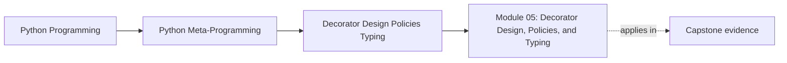

# Module 05: Decorator Design, Policies, and Typing

<!-- page-maps:start -->
## Page Maps




<!-- page-maps:end -->

Module 05 takes the transparent wrapper from Module 04 and gives it authority. The
wrapper may now run work again, delay it, reject it, remember results, or inspect
annotations. Those are changes to the callable's contract, not decorative additions.

The executable thread is one incident-delivery boundary. A bounded retry wrapper may
run delivery three times; a partial validator may stop a bad call before delivery or
merely warn and let it through. You will inspect those consequences in
`labs/decorator_policy/` before judging the same pressure in the incident-plugin
capstone.

For many learners, this is the first module where "I understand the syntax" stops being
enough. A policy-heavy decorator can look tidy while still hiding retry rules, timeout
behavior, validation scope, cache lifetimes, and operational controls that another
maintainer must eventually own.

Treat this module as one full review day on wrapper ownership. The goal is not to collect
more decorator patterns. The goal is to leave with a stable way to answer:

- what policy was captured once at definition time
- what policy now changes behavior at each call boundary
- what evidence still keeps that policy inspectable
- when the decorator should stop growing and hand ownership elsewhere

## What this module is for

By the end of Module 05, you should be able to explain five things clearly:

- how decorator factories capture configuration at definition time
- how resilience wrappers change control flow and error behavior
- what annotation-aware runtime checks can and cannot promise honestly
- how cache policy differs from a thin wrapper and why `lru_cache` exposes control hooks
- when wrapper policy should move to an explicit object, field, or service boundary instead

You should also be able to reject weak explanations such as:

- "the decorator just makes this more convenient"
- "the retry logic is still basically transparent"
- "warning mode is good enough to call it safe"
- "the cache only changes performance"
- "we can always move the policy out later if it grows"

## Keep these pages open

- [Mid-Course Map](../module-00-orientation/mid-course-map.md)
- [Pressure Routes](../guides/pressure-routes.md)
- [Anti-Pattern Atlas](../reference/anti-pattern-atlas.md)
- [Capstone Walkthrough](../capstone/capstone-walkthrough.md)

## Start with executable evidence

Work from `programs/python-programming/python-meta-programming`:

```bash
make decorator-policy-lab
make decorator-policy-lab-test
```

The first command prints three evidence packets:

| Packet | Evidence to find | Claim it supports |
| --- | --- | --- |
| `retry` | three underlying executions and two recorded delays | retry changes execution count and waiting |
| `retry_exhausted` | two attempts and the same final exception object | the stopping rule is finite and the final failure is not replaced |
| `validation` | strict rejection, warning-mode execution, and definition-time refusal | a runtime validator must separate enforcement, observation, and unsupported typing surface |

Do not read the JSON as a trophy. Pick one claim in the right column, locate the
corresponding test, and explain why that test proves the claim. The implementation is in
`labs/decorator_policy/`; its focused proof is in
`tests/test_decorator_policy_evidence.py` and
`tests/test_decorator_policy_validation.py`.

## The module's before-and-after delta

Module 04's honest thin wrapper called the underlying function exactly once and
preserved its result or exception. Module 05 deliberately breaks that thin-wrapper
contract:

| Before | New pressure | New public obligation |
| --- | --- | --- |
| one call enters the original once | transient failure may justify another attempt | publish retryable failures, attempt limit, delays, and side-effect precondition |
| wrapper metadata describes callable identity | annotations are available at runtime | name the supported hint subset and refuse the rest |
| stateful cache is inspectable | more wrapper policies accumulate | identify when an explicit policy owner is clearer |

The old transparency obligations still remain. A policy wrapper must preserve metadata
*and* reveal the behavior it added.

## The learning sequence

1. Overview (`index.md`)
2. [Decorator Factories and Parameter Capture](decorator-factories-and-parameter-capture.md)
3. [Resilience and Control-Flow Wrappers](resilience-and-control-flow-wrappers.md)
4. [Annotation-Aware Runtime Contracts](annotation-aware-runtime-contracts.md)
5. [Cache Policy and lru_cache Behavior](cache-policy-and-lru-cache-behavior.md)
6. [Wrapper Policy Boundaries](wrapper-policy-boundaries.md)
7. [Worked Example: Building a Partial `@validated` Decorator](worked-example-building-a-partial-validated-decorator.md)
8. [Exercises](exercises.md)
9. [Exercise Answers](exercise-answers.md)
10. [Glossary](glossary.md)

## Why this order matters

Use this route if you want one stable teaching sequence instead of ten disconnected files:

| Review question | Why it comes now | Page |
| --- | --- | --- |
| what policy is captured before the function ever runs? | learners need the timing boundary before policy gets heavier | [Decorator Factories and Parameter Capture](decorator-factories-and-parameter-capture.md) |
| how does this wrapper now change execution, waiting, or failure flow? | resilience wrappers are where control-flow policy becomes impossible to ignore | [Resilience and Control-Flow Wrappers](resilience-and-control-flow-wrappers.md) |
| what limited runtime contract can this wrapper support honestly? | typing-aware decorators overclaim easily unless the supported surface is named early | [Annotation-Aware Runtime Contracts](annotation-aware-runtime-contracts.md) |
| what state, history, and operational hooks does the cache now own? | cache policy is the cleanest example of history-dependent wrapper behavior | [Cache Policy and lru_cache Behavior](cache-policy-and-lru-cache-behavior.md) |
| when should the decorator give up ownership altogether? | the earlier cores only help if they culminate in a real design judgment | [Wrapper Policy Boundaries](wrapper-policy-boundaries.md) |

The [worked example](worked-example-building-a-partial-validated-decorator.md) then
traces the shipped `validated` implementation rather than introducing a second,
unverified version. The [exercises](exercises.md) ask you to modify and review that
implementation; the [answers](exercise-answers.md) explain what each change proves and
what it cannot prove.

## The running question

Carry this question through every page:

> Which part of this behavior still belongs in a wrapper, and which part should move to an explicit object, field, or service boundary instead?

Strong Module 05 answers usually mention one or more of these:

- configuration captured once in a decorator factory
- retries, timeouts, or limits changing call semantics
- annotation-aware checks staying partial and reviewable
- explicit cache introspection and reset surfaces
- policy pressure strong enough to reject another decorator layer

Strong answers also say what the wrapper does **not** prove or solve automatically:

- explicit configuration does not make broad policy harmless
- preserved metadata does not cancel control-flow or state complexity
- partial runtime validation does not replace static analysis
- a standard-library cache still needs an honest operational story
- a decorator that "still works" may still be the wrong owner

## Learning outcomes

By the end of this module, you should be able to:

- review policy-heavy decorators without mistaking them for thin transformations
- preserve metadata and callable visibility even when wrappers grow more powerful
- keep annotation-driven runtime behavior honest about its limits
- reject wrapper designs that should become explicit services, objects, or later course mechanisms

## Mid-module warning signs

Slow down and review more carefully if any design in this module does one or more of
these:

- captures multiple interacting policy knobs in one decorator factory
- changes how many times the underlying callable may run
- changes waiting, retry, backoff, or abort behavior
- claims runtime typing guarantees broader than its supported hint subset
- owns state that must be inspected, reset, or tuned operationally
- keeps growing even though an explicit object would reveal ownership more clearly

These are not reasons to ban the design. They are reasons to stop calling it "just a
decorator" without stronger proof.

## Evidence packet to build while you learn

By the time you finish the worked example and exercises, you should have a small packet
that another learner can inspect:

- the lab JSON with one claim annotated in your own words
- one test change that proves a different retry stopping rule
- one test change that proves an annotation is accepted or refused at decoration time
- one cache comparison using Module 04's `bounded_cache` and `functools.lru_cache`
- one capstone action-contract report that distinguishes checked from unsupported hints
- one redesign note explaining why a broad wrapper should move to an explicit owner

## Exit standard

Do not move on until all of these are true:

- you can explain what a decorator factory captures and when it runs
- you can name how retries, timeouts, or rate limits change semantics at the call boundary
- you can say which annotation-aware checks remain partial rather than pretending to replace static typing
- you can judge when a decorator has become hidden policy that should move elsewhere
- you can run the focused tests and explain which behavioral claim each one proves

Do not move on if you still need phrases like "it just handles policy for us" or "the
decorator keeps things simple" to explain the design. Module 05 is only complete when you
can state the captured configuration, the runtime policy rule, the unsupported claim, and
the likely explicit owner in plain language.

When those feel ordinary, Module 05 has done its job and the course can move into
class-level customization with a clearer sense of wrapper ownership.
