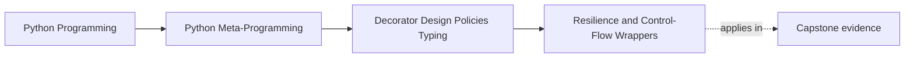

# Resilience and Control-Flow Wrappers


<!-- page-maps:start -->
## Page Maps




<!-- page-maps:end -->

The moment a wrapper starts retrying, timing out, or rate-limiting, it is no longer only
changing what happens around a call. It is changing whether, when, and how often the
underlying function gets to run.

That makes these decorators especially important to review honestly.
They are often the first wrappers in a codebase that can multiply side effects while
still presenting a deceptively small call surface.

## The sentence to keep

When reviewing a resilience wrapper, ask:

> how does this decorator change control flow, failure behavior, or timing at the call
> boundary?

That is the right question because these wrappers do not merely observe calls. They govern
them.

Add one more question immediately after it:

> what side effect or failure risk becomes more likely because this wrapper is allowed to try again, wait, or refuse work?

## Begin with the actual trace

Run:

```bash
make decorator-policy-lab
```

The `retry` packet contains this sequence:

```text
attempt:1
sleep:0.1
attempt:2
sleep:0.2
attempt:3
```

The caller made one call. The underlying function ran three times. The retry wrapper,
not the business function, selected both waits. That trace is the smallest useful proof
that retry governs control flow.

The `retry_exhausted` packet adds the failure route: the underlying function runs
exactly twice, and the second failure is re-raised as the same exception object. The
wrapper does not convert it, suppress it, or accidentally begin a third attempt.

## Retry changes failure semantics

A retry decorator can be useful, but it is already a policy engine:

- it decides which exceptions count as retryable
- it decides how many attempts are allowed
- it decides how long to sleep between attempts
- it decides when the failure becomes final

That is far more than "just wrapping a function."

The lab implementation requires all control-flow choices at the factory boundary:

```python
@retry(
    exceptions=(TransientDeliveryError,),
    max_attempts=3,
    backoff_seconds=(0.1, 0.2),
    sleep=record_sleep,
)
def deliver(incident_id: str) -> str:
    ...
```

`backoff_seconds` must contain exactly one delay between attempts. A policy with three
attempts therefore needs two delays. This removes a hidden backoff algorithm and makes
the total waiting budget calculable during review.

This wrapper now owns a clear call-policy contract. That is why it belongs in Module 05,
not the thin-wrapper module.

It also owns an idempotency question that thin wrappers usually avoid:

- what if the underlying function already performed part of its work before failing?
- what if a second attempt is not morally the same as the first attempt?

That is why "retry" is never only a reliability keyword. It is a behavior multiplier.

## The idempotency precondition

Retry is defensible only when another attempt is safe enough for the operation's
contract. Compare:

| Underlying work | Failure point | Retry judgment |
| --- | --- | --- |
| read an incident record | before any state change | usually reasonable |
| send a request carrying a stable idempotency key | after an uncertain response | possible if the receiver honors the key |
| append a page to an external queue with no deduplication | after the append but before acknowledgement | unsafe: a retry can duplicate the page |

The lab uses an in-memory failure before returning a delivery result. It proves the
wrapper mechanics and stopping rule. It does **not** prove that retrying a real incident
delivery is safe.

## Timeout changes waiting semantics, not only behavior

A timeout wrapper changes the relationship between caller and work:

- the caller stops waiting after a threshold
- the wrapped work may still continue depending on implementation strategy
- failure now includes timeout-specific behavior, not only the original function's exceptions

That is a major semantic change, even if the wrapper code still looks compact.

It also means timeout language must stay precise. "Timed out" may mean:

- the caller stopped waiting
- the wrapper raised a timeout-specific failure
- the underlying work might still be running depending on strategy

Those are different operational stories, and the wrapper should not blur them.

## Rate limiting changes scheduling semantics

Rate limiting governs when calls are allowed to happen at all:

- calls may block and wait
- calls may be rejected
- state about prior calls now shapes later calls

At that point the decorator is governing traffic, not just transforming one callable in
place.

That is exactly why policy-heavy decorators need slower review than thin wrappers.

Rate limits also expose a fairness question:

- who waits?
- who gets rejected?
- which earlier calls now shape later callers?

That is scheduling policy, not only defensive wrapping.

## One picture of the control-flow change

```text
Thin wrapper:
  caller -> wrapper -> original function -> result

Resilience wrapper:
  caller -> policy gate -> maybe wait / retry / abort -> original function -> maybe repeat
```

That diagram is the difference between observation and governance.

Use it as a repair prompt when a review comment says "the decorator just retries." The
diagram shows that the wrapper has inserted a policy gate between caller and work.

## Single-threaded boundaries matter here

The examples in this module stay synchronous and single-threaded on purpose.

That means:

- no async cancellation model
- no cross-thread state coordination
- no distributed rate-limit storage

Those limits are important because they keep the design cost visible. A wrapper that is
already subtle in single-threaded sync code becomes even more expensive under concurrency.

This is also the right place to reject overconfident wording. A synchronous teaching
wrapper should not imply production-grade cancellation, coordination, or distributed
quota behavior that it does not actually implement.

## Backoff, jitter, and quotas are policy knobs

Small configuration details matter a lot:

- exponential backoff changes retry pacing
- jitter changes herd behavior under failure
- quota windows change fairness and burst behavior

These are policy decisions, not harmless implementation details. If the wrapper owns them,
the review has to own them too.

Use this quick comparison during review:

| Policy knob | What it changes for callers |
| --- | --- |
| retry count | how many chances the work gets before failure becomes final |
| backoff schedule | how long the caller may wait across attempts |
| jitter | how predictable or coordinated repeated attempts become |
| quota window | whether bursts are absorbed, delayed, or rejected |

The lab deliberately injects `sleep` as a controlled boundary. Tests replace real time
with an event recorder, so the backoff order is deterministic. This seam does not make
the wrapper production-ready; it makes the teaching claim executable without making
the test suite wait.

## Counterexample: broad exception retry

Do not configure `(Exception,)` merely because it is concise. A programming error such
as `ValueError` would then be treated like a transient delivery failure. The focused
test `test_retry_catches_only_the_configured_exception_types` configures
`ConnectionError`, raises `ValueError`, and proves the function runs only once.

That negative test matters more than another success example: it proves the retry
boundary is selective.

## These wrappers should preserve non-policy surfaces

Even when semantics change, the wrapper should still preserve what it can:

- callable metadata
- names and docs
- signature transparency when the wrapper claims to preserve the original call contract

This is one of the recurring lessons of the course: stronger policy does not excuse weaker
observability.

Observability also includes the stopping rule. A reviewer should be able to say, in plain
language, exactly when the wrapper stops retrying, stops waiting, or stops admitting
calls.

## Common resilience-wrapper failure modes

These are the failures to catch before approving the design:

| Failure mode | Why it weakens the wrapper | Repair move |
| --- | --- | --- |
| retrying non-idempotent work blindly | later attempts may duplicate side effects | narrow the retry surface or move the policy to an explicit owner |
| hiding timeout strategy behind vague language | callers cannot tell whether work was cancelled, abandoned, or still running | state the waiting contract and the unresolved work story explicitly |
| rate limiting with invisible shared state | later callers are governed by history they cannot inspect | expose the owner or move coordination to a clearer component |
| preserving metadata while hiding stop conditions | tools can inspect the callable but humans still cannot predict wrapper behavior | document or expose the control-flow rule directly |

## Smallest honest proof route

From the course root:

```bash
python -m unittest \
  tests.test_decorator_policy_evidence.DecoratorPolicyEvidenceTests.test_retry_packet_exposes_captured_policy_and_multiplied_execution \
  tests.test_decorator_policy_evidence.DecoratorPolicyEvidenceTests.test_exhausted_retry_has_a_finite_rule_and_preserves_final_failure \
  tests.test_decorator_policy_evidence.DecoratorPolicyEvidenceTests.test_retry_catches_only_the_configured_exception_types
```

Together these tests prove success after retries, exhaustion, exception identity, delay
order, and selective exception handling. They do not prove concurrency safety,
idempotency, cancellation, jitter quality, or distributed coordination.

## Review rules for resilience wrappers

When reviewing retry, timeout, or rate-limit decorators, keep these questions close:

- what control-flow rule does the wrapper now own?
- which exceptions or timing outcomes are now different from the original callable?
- what state or timing knobs shape later calls?
- are concurrency or async limitations being documented honestly?
- has this policy become large enough that an explicit object or service would be easier to review?
- what is the exact stopping rule, and can a reviewer state it without paraphrasing vaguely?

## Exit check for this page

Before moving on, make sure you can do all of these:

- name one way a retry wrapper can multiply side-effect risk
- explain one timeout sentence that would be misleading without clarifying what still happens to the work
- describe one fairness question a rate-limit wrapper now owns
- state the wrapper's stopping rule in plain language

## What to practice from this page

Try these before moving on:

1. Change the lab policy to two attempts and one delay. Update the expected trace before
   changing the code.
2. Add a test where the first attempt has a visible side effect and the second succeeds.
   Explain why the test demonstrates risk rather than safety.
3. Write down one timeout implementation caveat for synchronous code.
4. Compare one rate-limit decorator to an explicit limiter object and explain which
   design would be easier to inspect and reset under growth.

If those feel ordinary, the next step is annotation-aware runtime behavior, where the
wrapper begins to claim knowledge about types and contracts.

## Continue through Module 05

- Previous: [Decorator Factories and Parameter Capture](decorator-factories-and-parameter-capture.md)
- Next: [Annotation-Aware Runtime Contracts](annotation-aware-runtime-contracts.md)
- Practice: [Exercises](exercises.md)
- Terms: [Glossary](glossary.md)
