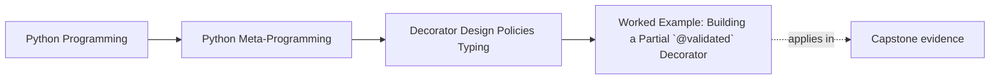

# Worked Example: Building a Partial `@validated` Decorator


<!-- page-maps:start -->
## Page Maps




<!-- page-maps:end -->

The five core lessons in Module 05 become much easier to trust when they all appear in
one wrapper that is useful, tempting, and easy to overclaim.

A partial runtime validator is exactly that kind of wrapper.

Treat this page as a review packet, not as a recipe to paste unchanged into production.
Its teaching job is to show where a validator decorator stays honest, where it starts
overpromising, and what evidence a reviewer should demand before accepting it.

It combines:

- factory configuration
- signature-aware call binding
- annotation-aware runtime checks
- policy decisions about strictness and failure handling

That makes it the right worked example for the module.

## Review questions for the page

Keep two questions active while reading:

1. what exact runtime promise is this decorator allowed to make?
2. what stronger typing or safety promise must it refuse?

## The incident

Assume a team wants a `@validated` decorator for selected callable boundaries.

They want it to:

- read type hints once
- validate supported argument types at call time
- optionally validate returns
- offer strict and warning-based modes

Those are reasonable goals. The danger is pretending this now amounts to full typing or a
general validation framework.

That sentence is the real incident. The syntax is easy. The hard part is stopping the
team from calling a bounded runtime checker "type safety" or "complete validation."

## The first design rule: keep it partial on purpose

This wrapper should be explicit about what it supports and what it refuses.

Supported cases might include:

- plain runtime classes
- `Union` and `Optional`
- `Any`

Unsupported cases might include:

- parameterized generics
- deep `Annotated` enforcement
- broader typing constructs that really belong to a separate validation framework

That refusal is a design strength, not a lack of ambition.

Add one more refusal boundary: this decorator does not try to infer business meaning from
annotations. It checks a narrow runtime shape. It does not decide whether the overall API
contract is sensible.

## Non-goals to keep visible

This worked example is intentionally not trying to deliver:

- a full runtime type system
- coercion or conversion rules
- cross-parameter semantic validation
- nested container validation
- framework-grade error reporting

If a review conversation expects those features, the design already wants a more explicit
validation owner than this module's decorator boundary.

## Step 1: capture configuration and reusable evidence once

The factory shape makes the timing explicit:

```python
@validated(raise_on_error=True)
def func(...):
    ...
```

This means the wrapper can cache:

- the resolved type hints
- the signature

once at definition time, rather than rebuilding them on every call.

That is a good example of factory configuration and evidence caching working together
honestly.

It is also the first place a review should look for hidden cost. If hint resolution is
expensive, environment-sensitive, or brittle under forward references, the wrapper should
say so plainly instead of pretending definition-time capture is always harmless.

## Step 2: bind the call before validating

One of the most important design choices is to validate after `sig.bind(...)`, not by
guessing from raw `args` and `kwargs`.

That makes the validation path:

1. bind arguments using Python's own call rules
2. apply defaults if needed
3. validate the resulting parameter/value mapping

This is stronger and easier to review than ad hoc argument parsing.

It also gives the reviewer a clean proof route:

| Evidence step | What it proves |
| --- | --- |
| `inspect.signature(func)` | the validator uses Python's call model as its starting point |
| `sig.bind(*args, **kwargs)` | argument matching follows real parameter rules |
| `bound.apply_defaults()` | omitted values still become visible to the validator |
| iterating `bound.arguments.items()` | checks are attached to named parameters, not positional guessing |

## Step 3: keep the type checker small and explicit

A compact helper such as `_is_instance` should stay honest about its scope:

- `Any` passes
- `Union` is checked recursively
- unsupported generic hints raise `NotImplementedError`

That clarity keeps the wrapper from drifting into fake comprehensiveness.

The helper should also make unsupported space noisy. Quietly skipping unsupported hint
forms teaches the wrong lesson, because it makes the wrapper look broader than it is.

## A bounded implementation

```python
import functools
import inspect
import types
import warnings
from typing import Any, Callable, Union, get_args, get_origin, get_type_hints


def _is_instance(value: Any, hint: Any) -> bool:
    if hint is Any:
        return True
    origin = get_origin(hint)
    if origin in (Union, types.UnionType):
        return any(_is_instance(value, arg) for arg in get_args(hint))
    if origin is not None:
        raise NotImplementedError(
            f"runtime type checking for generic types like {hint!r} is not supported here"
        )
    return isinstance(value, hint)


def validated(raise_on_error: bool = True) -> Callable:
    def decorator(func: Callable) -> Callable:
        hints = get_type_hints(func)
        sig = inspect.signature(func)

        @functools.wraps(func)
        def wrapper(*args, **kwargs):
            bound = sig.bind(*args, **kwargs)
            bound.apply_defaults()

            for name, value in bound.arguments.items():
                if name in hints and not _is_instance(value, hints[name]):
                    msg = (
                        f"Argument '{name}={value!r}' is "
                        f"{type(value).__name__}, expected {hints[name]!r}"
                    )
                    if raise_on_error:
                        raise TypeError(msg)
                    warnings.warn(msg, UserWarning)

            result = func(*args, **kwargs)
            if "return" in hints and not _is_instance(result, hints["return"]):
                msg = (
                    f"Return '{result!r}' is "
                    f"{type(result).__name__}, expected {hints['return']!r}"
                )
                if raise_on_error:
                    raise TypeError(msg)
                warnings.warn(msg, UserWarning)
            return result

        return wrapper

    return decorator
```

## What this implementation proves and what it does not

Use the code block as evidence, not as marketing:

| Claim | Supported by this implementation? | Why |
| --- | --- | --- |
| it validates a narrow runtime hint subset | yes | `_is_instance` names and limits the supported cases |
| it follows Python's own call binding rules | yes | `sig.bind(...)` does the call matching |
| it can raise or warn on mismatches | yes | `raise_on_error` branches make the mode visible |
| it enforces full static typing semantics | no | many typing surfaces are refused intentionally |
| it makes warning mode safe | no | the wrapped function still runs after the warning |
| it is already a full validation framework | no | there is no broader owner, registry, coercion model, or reporting layer |

## Why this version is useful for review

This wrapper is useful because it keeps all the important choices visible:

- configuration is explicit
- signature and hint resolution happen once
- supported hint handling is narrow and readable
- unsupported surfaces are refused clearly
- strict and warning modes are plainly separate

That is the kind of honesty a policy-heavy decorator needs.

## Failure surfaces a reviewer should inspect

Even this bounded version has pressure points:

| Failure surface | Why it matters |
| --- | --- |
| `get_type_hints(func)` can fail or resolve differently than expected | definition-time evidence may not be as stable as the wrapper claims |
| `NotImplementedError` on generic hints | refusal is honest, but reviewers must know whether callers will hit it |
| warning mode lets execution continue | downstream failures may happen after the contract warning |
| return validation happens after function execution | bad outputs are detected late, not prevented early |

Those are not bugs in the teaching example. They are the boundaries the teaching example
must keep visible.

## Warning mode is not safety mode

One especially important design boundary is:

- warning on mismatch does not make the function safe

The wrapped function can still fail internally after the warning. That is exactly why the
module frames this as a partial runtime contract rather than as a complete safety system.

Use this boundary table when someone overstates the mode switch:

| Mode | What it changes | What it does not change |
| --- | --- | --- |
| `raise_on_error=True` | mismatch becomes an immediate `TypeError` | the decorator still only understands a limited hint subset |
| `raise_on_error=False` | mismatch becomes an observable warning | the underlying function may still break or produce a bad result |

## What this example makes clear about Module 05

This worked example ties the module together:

- factories capture policy once
- binding keeps call matching honest
- annotation-aware checks stay partial
- metadata preservation still matters
- the wrapper is useful only because it refuses to overclaim

That is the durable takeaway. The validator is not here as a universal recipe. It is here
as a clear case study in policy ownership and boundary honesty.

## Evidence packet to leave behind

If you adapt this example, leave behind a packet another reviewer can inspect quickly:

- the supported hint subset
- the refused hint subset
- the exact behavior of strict mode
- the exact behavior of warning mode
- one sentence explaining why the policy still belongs in a decorator
- one sentence naming the next threshold that would justify an explicit validator object

## The review loop to keep

When you inherit or design an annotation-aware decorator, run this loop:

1. name the exact hint subset it supports
2. verify it binds calls before validating
3. check whether strict and warning modes are explicit
4. ask whether the policy still belongs in a decorator or should move to a more explicit validator component

Add one last question:

5. which unsupported feature would be the first sign that this wrapper has outgrown the decorator boundary?

If you can do that here, Module 05 has done its job and the course can move into
class-level customization with a stronger sense of wrapper limits.

## Exit check for this page

Before leaving the worked example, make sure you can do all of these:

- explain why `sig.bind(...)` is a stronger review choice than raw `args` inspection
- name two supported hint forms and two refused hint forms
- explain why warning mode is still operationally risky
- say when this decorator should be replaced by an explicit validation component

## Continue through Module 05

- Previous: [Wrapper Policy Boundaries](wrapper-policy-boundaries.md)
- Next: [Exercises](exercises.md)
- Reference: [Exercise Answers](exercise-answers.md)
- Terms: [Glossary](glossary.md)
