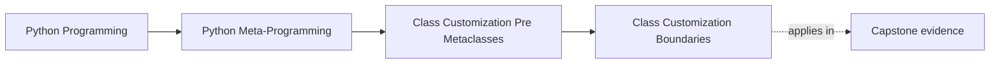

# Class Customization Boundaries


<!-- page-maps:start -->
## Page Maps




<!-- page-maps:end -->

Module 06 is not only a collection of class-level tools. It is also a decision module.

This page is the module's main stewardship page. The goal is not to crown the most
powerful mechanism. The goal is to identify the smallest honest owner for a class rule
before the design hardens into unnecessary machinery.

By this point, the course has introduced several ways to change class behavior without
reaching for metaclasses:

- plain methods and constructors
- class decorators
- dataclasses
- properties
- descriptor-backed validation

The last core exists to ask the real design question:

> which of these is the smallest honest owner for the current invariant?

That sentence is more important than any single syntax example in the directory.

## The sentence to keep

When class-level behavior feels like it is escalating, ask:

> can this still stay explicit after class creation, or does the invariant truly require a
> lower-level attribute owner or class-creation control?

That question is the whole point of the module.

Keep one more question beside it:

> if I choose the stronger tool now, what missing condition am I claiming already exists?

That question is the page's safeguard against prestige reasoning. If you cannot name the
missing condition, you are not justifying escalation; you are admiring it.

## Plain class code is still the first option

One of the easiest mistakes in metaprogramming work is skipping over the obvious option:

- a plain constructor
- a plain method
- a plain helper function

If explicit class code already makes the rule easy to see, that is often the best answer.

Metaprogramming does not win by default just because it is available.

The lab does not need a separate "plain class" abstraction. Ordinary `__init__`
methods, direct backing fields, and explicit validation remain visible inside every
packet until another owner earns responsibility.

This is the page where readers should start distrusting prestige reasoning. "Advanced"
does not mean "better." If ordinary class code owns the invariant clearly, escalation is a
loss, not an upgrade.

Use this downward rewrite route when a design already feels overpowered:

1. say what invariant the current design claims to own
2. remove one layer of mechanism in your head
3. ask whether the invariant is still clearly enforceable
4. stop lowering only when clarity would truly break

That route helps learners practice restraint actively rather than only hearing about it.

## Class decorators are good for opt-in post-construction changes

Class decorators are strongest when:

- the class already exists
- the change is opt-in
- the transformation stays inspectable and reversible

They are weaker when the requirement depends on class-body-time control or deeper
attribute semantics.

They are also weaker when the transformation needs its own lifecycle, configuration
surface, or operational review story. At that point the decorator may be too compact for
the policy it carries.

## Dataclasses are excellent for generated boilerplate, not for broad policy

Dataclasses are a great answer when the real need is:

- generated constructors
- generated reprs
- generated equality behavior

They are a weak answer when people start assuming:

- runtime validation appears automatically
- deep immutability appears automatically
- every field policy belongs in dataclass flags

That is a good example of a tool being strong within one boundary and misleading outside
it.

Dataclasses deserve special caution because their ergonomics make weak owner stories sound
plausible. Method generation is real. Policy generation is not.

## Properties are strongest at one attribute boundary

Properties are a good fit when:

- one field needs validation or computation
- one attribute should expose a controlled surface

They are a weaker fit when:

- many fields want the same rule
- the same invariant repeats across many classes

At that point a reusable descriptor may be the clearer owner.

That is the page transition this module is trying to teach: one field boundary is a
property problem; repeated field boundaries are descriptor territory.

## Descriptors are the next step, not the first reflex

This module introduces descriptor-backed validation carefully because descriptors are
stronger than properties in one important way:

- they can be reused across many attributes and classes

That is powerful. It is also why the course does not jump to them immediately.

If one property solves the problem honestly, stay there.

Descriptor reuse is valuable only when reuse is the real need. It is not a reward for
wanting a more advanced-looking solution.

## A scenario clinic for the lower-power ladder

Use this table when you need a concrete placement test:

| Scenario | Smallest honest owner | Why |
| --- | --- | --- |
| one field must stay lowercase on assignment | property | the invariant lives on one named boundary |
| three classes share the same non-empty-string rule | descriptor | repeated field policy is now the real owner story |
| a plugin class should register itself after definition | class decorator | the class already exists when the rule needs to run |
| the class body must be scanned before methods are finalized | metaclass territory | the requirement exists during class creation |
| a constructor must reject one cross-field mismatch | plain class code or `__post_init__` | no reusable or creation-time surface is needed yet |

## Run the ladder as one comparison

`make class-customization-lab` gives each lower-power candidate one concrete job:

| Evidence packet | Owner selected | Why it fits | First exit condition |
| --- | --- | --- | --- |
| `class_transformation` | class decorator | opt-in mark on a finished class | body writes or namespace preparation must be observed |
| `dataclass_boundary` | standard dataclass decorator | generate field-shaped methods and storage constraints | runtime invariant lacks an explicit owner |
| `property_boundary` | property | one HTTPS invariant on one attribute | the same setter/storage rule repeats |
| `descriptor_boundary` | descriptor | repeated shallow type and storage policy | schema-wide or cross-field policy appears |
| `frozen_surface` | class decorator | narrow post-initialization surface rule | slots, deep immutability, sealed inheritance, or tamper resistance is required |

This is not a ranking from weak to prestigious. It is a set of ownership matches.

## Metaclasses should still be treated as a later escalation

A metaclass becomes worth considering only when the requirement truly depends on
class-creation-time control:

- namespace preparation
- creation-time registration rules
- logic that must run before or during class construction itself

If the behavior can still be expressed after class creation with the tools in this module,
that is usually the clearer design.

## Why the capstone crosses the line

The incident-plugin runtime does more than modify one finished class:

- `DefinitionNamespace` rejects duplicate tracked definitions while the body executes
- `PluginMeta.__new__` combines inherited and newly declared fields and actions
- the metaclass generates constructors and class signatures for every participating
  concrete plugin
- registration applies across a class family without repeating an opt-in decorator

A class decorator receives a namespace after duplicate ordinary assignments have
collapsed to the last value. It can inspect a completed method-resolution order but did
not participate in creating it. Those are timing reasons for `PluginMeta`, not appeals
to framework style.

The capstone still keeps lower-power owners underneath it:

- `@action` owns one callable boundary
- `Field` owns one attribute boundary
- ordinary plugin methods own delivery behavior
- `PluginMeta` owns only the class-family creation contract

## A decision table for likely owners

Use this table when the right owner feels uncertain:

| If the requirement mainly... | Likely strongest owner |
| --- | --- |
| stays local to one constructor or one method | plain class code |
| applies uniformly after the class already exists | class decorator |
| governs one named field boundary | property |
| repeats the same field rule across classes or attributes | descriptor |
| depends on class creation timing, namespace preparation, or metaclass resolution | metaclass |

## One picture of the lower-power ladder

```text
Plain class code
  -> class decorator
  -> property or focused descriptor
  -> metaclass only when class-creation control is truly required
```

This is not a prestige ladder. It is a blast-radius ladder.

Another way to read it is:

- every upward move increases hidden timing or reuse power
- every upward move also increases the review burden
- if the review burden rises faster than the clarity gained, the move was a mistake

## How to read the ladder honestly

Move upward only when the lower level leaves a concrete gap:

| Move from... | Move to... | Only when... |
| --- | --- | --- |
| plain class code | class decorator | the class-wide post-construction rule is still uniform and explicit |
| property | descriptor | the same field rule repeats and copied properties become the real smell |
| descriptor or decorator | metaclass | the requirement truly depends on class creation rather than finished-class behavior |

## Surface immutability is a good example of boundary pressure

Take "make this class frozen" as an example:

- plain code might already be enough for explicit APIs
- a class decorator can enforce surface immutability after creation
- deeper immutability is a much broader policy question

That is why the worked example stays carefully at surface immutability instead of
pretending to solve every mutability problem.

It is also why surface immutability is such a good review case. The moment someone starts
describing it as "full immutability," the owner story has already slipped.

## A boundary review worksheet

Fill these blanks when a design pressure feels ambiguous:

- the invariant is:
- the smallest owner that can enforce it is:
- the stronger tool I am rejecting first is:
- the missing condition that stronger tool would require is:
- the first symptom that would force me to escalate later is:

If you cannot fill all five lines, keep the design lower-power until you can.

Use this completed example:

| Worksheet field | Answer |
| --- | --- |
| invariant | reject two tracked declarations with the same name in one class body |
| smallest owner | prepared mapping returned by `__prepare__` |
| stronger tool rejected | global import hook |
| missing condition for that stronger tool | behavior would have to span module loading rather than one class namespace |
| first escalation symptom | none toward metaclass power; body-write timing already requires it |
| evidence | capstone duplicate-definition test |

## Common overclaims to reject

Reject these descriptions when they appear in review:

| Overclaim | Better replacement |
| --- | --- |
| "a metaclass is cleaner here" | "a metaclass is justified only if class creation timing matters" |
| "a dataclass already owns the rule" | "the dataclass may generate methods, but the rule still needs an owner" |
| "a property is too simple" | "a property is correct when one attribute boundary is the real surface" |
| "a descriptor is more reusable, so it is better" | "reuse matters only if repeated field policy is the actual problem" |

## Failure modes for boundary decisions

These are the design mistakes this page is trying to prevent:

| Failure mode | Why it weakens the design | Repair move |
| --- | --- | --- |
| escalating to a metaclass for prestige | the mechanism outgrows the real need | name the missing class-creation requirement or step back down |
| using copied properties for a repeated field rule | repetition becomes the hidden owner | promote the rule to a descriptor |
| leaning on dataclass flags to imply broader policy | generation and invariants blur together | state the missing owner explicitly |
| using a class decorator for policy that needs inspection or lifecycle surfaces | compact syntax hides broader ownership | move the policy into a clearer explicit component |

One more failure mode deserves attention:

| Failure mode | Why it weakens the design | Repair move |
| --- | --- | --- |
| treating "reusable" as sufficient reason to escalate | the mechanism outgrows the actual invariant | show the repetition or timing pressure concretely before moving up |

## Review rules for class customization boundaries

When reviewing a class-level design, keep these questions close:

- is plain explicit class code already enough?
- if not, is the change really post-construction, or does it need attribute-boundary or class-creation control?
- is one property enough, or is there now a repeated field rule that deserves a descriptor?
- are dataclass features being used for generation, or are they carrying broader policy than they should?
- has the design crossed the threshold where a metaclass is being proposed for prestige instead of necessity?
- can another reviewer say which stronger mechanism was rejected and why?

## Evidence packet for boundary decisions

Leave this page with a small packet:

- one invariant placed on the ladder with its chosen owner
- one rejected stronger tool and the missing condition it would need
- one downward rewrite note showing how you tested whether a lower-power design was still enough
- one escalation symptom you would watch for later in real code

## Smallest honest proof route

Start with:

```bash
make class-customization-lab
make class-customization-lab-test
```

Then inspect `DefinitionNamespace`, `PluginMeta.__prepare__`, and the capstone duplicate
tracked-definition test. The lab proves what finished-class tools can own; the capstone
test proves one fact that would otherwise be lost before a class decorator could see it.

Run the learner-facing transfer:

```bash
make capstone-class-creation
```

The report exposes the prepared namespace type, declared and inherited fields/actions,
initializer-generation decision, visible signature, registration, and absence of plugin
construction or execution.

## Exit check for this page

Before moving on, make sure you can do all of these:

- place one requirement honestly on the lower-power ladder
- name one missing condition that would justify moving up one level
- explain one case where a property should stay a property
- explain one case where a descriptor or metaclass would finally become justified

## What to practice from this page

Try these before moving on:

1. Write a boundary worksheet for every lab packet.
2. Name the exact event that would force each owner upward.
3. Compare `mark_class` collision refusal with `DefinitionNamespace` duplicate refusal
   and explain the timing difference.
4. Write one rejected metaclass decision and one justified metaclass decision without
   using "automatic" or "framework" as the reason.

If those feel ordinary, the worked example can pressure-test this whole decision model
inside a minimal frozen class decorator.

## Continue through Module 06

- Previous: [Type Hints and Descriptor-Backed Validation](type-hints-and-descriptor-backed-validation.md)
- Next: [Worked Example: Building a Minimal `@frozen` Class Decorator](worked-example-building-a-minimal-frozen-class-decorator.md)
- Return: [Overview](index.md)
- Terms: [Glossary](glossary.md)
