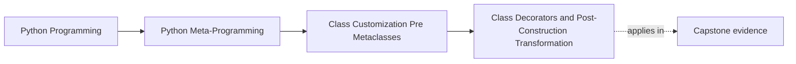
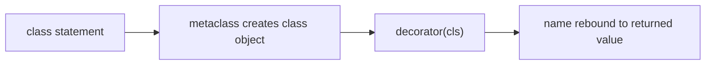

# Class Decorators and Post-Construction Transformation


<!-- page-maps:start -->
## Page Maps




<!-- page-maps:end -->

Module 06 starts with the lowest-power class-wide customization tool in this part of the
course:

> a class decorator sees a fully created class object and returns the class or a
> replacement.

That timing matters because it tells you what a class decorator can still change and what
it cannot retroactively control.

This page is strongest when you read it as a timing review, not as a collection of
decorator tricks. The question is not "can a decorator do this?" The better question is
"what part of the class lifecycle is still visible and honest here?"

## The sentence to keep

When reviewing a class decorator, ask:

> what is being changed after class creation, and is post-construction transformation still
> enough for this requirement?

That question is the gateway to the whole module.

Keep a second question beside it:

> if the decorator vanished tomorrow, what explicit helper or owner would still need to exist for the behavior to make sense?

That second question matters because decorator syntax is compact enough to hide weak
ownership. If the only story you can tell is "the decorator makes it happen," the page has
not yet done its teaching job.

## Class decorators run after the class exists

At the simplest level:

```python
def decorator(cls):
    ...
    return cls


@decorator
class C:
    ...
```

means:

```python
class C:
    ...


C = decorator(C)
```

The metaclass has already done its work. The class object already exists. The decorator is
now rewriting or extending that finished object.

That one fact rules out a large amount of accidental confusion. A class decorator can
still modify, wrap, register, or replace the finished class binding. It cannot go back in
time and participate in namespace preparation or metaclass resolution.

## Run the exact timing trace

```bash
make class-customization-lab
```

Read `class_transformation.events`:

```text
factory:outer
factory:inner
body:Delivery
decorate:inner:Delivery
decorate:outer:Delivery
```

Decorator expressions are evaluated from top to bottom before the class body. After the
body and `type` have produced the class, decorators apply from the nearest one outward.
The separate `application_trace` therefore reads `inner`, then `outer`.

The packet also applies `mark_class("incident-delivery")` as an explicit helper and
compares object identity before and after. The same class object returns, its metaclass
remains `type`, and an immutable `ClassCustomization` record becomes visible on the
class rather than on instances.

## One picture of the timing



Caption: class decorators see a completed class object; they do not participate in class-body namespace construction.

This timing is the most important boundary on the page.

## Evidence route for timing reviews

Use this route whenever a class decorator starts sounding more powerful than it really is:

| Evidence step | What it proves |
| --- | --- |
| `class C: ...` runs first | class body execution is already over before decoration |
| metaclass builds the class object | class creation happened before the decorator receives anything |
| `decorator(C)` runs after creation | the decorator can only act on the finished object |
| rebinding assigns the return value back to `C` | replacement is possible, but only after creation is complete |

## Attaching an inspectable class mark is a straightforward use

Open `labs/class_customization/transformation.py`. `mark_class`:

- validates its label when the decorator factory runs
- receives a finished class
- refuses to overwrite a reserved class attribute
- attaches one immutable policy record
- returns the same class object

This is an honest early example because:

- the decorator changes the finished class
- the added public surface is directly inspectable through `vars(cls)`
- nothing about class creation timing is being hidden

It also shows a useful review habit: ask whether the behavior is truly clearer as a
decorator or whether an explicit helper call would explain the transformation more plainly.

Use this comparison when you are unsure:

| Form | What it makes obvious | What it can hide |
| --- | --- | --- |
| explicit helper call after class definition | the transformation is post-construction and opt-in | a repeated pattern that wants a named abstraction |
| class decorator | the class advertises the transformation at definition time | the amount of policy or side effect carried by the decorator |

If the helper form makes the ownership story clearer, the decorator has to earn its
compactness rather than receiving it for free.

## Registration can be an honest post-construction use

```python
registry = []


def register(cls):
    registry.append(cls)
    return cls


@register
class Registered:
    pass
```

This is often a reasonable use of a class decorator when:

- the registry is explicit
- reset behavior is testable
- the decorator does not pretend to be more than opt-in post-construction registration

That last point matters because registry behavior can drift upward quickly if it stops
being explicit.

Reviewers should also ask who owns cleanup. Registration that can only grow and never be
reset may be operationally convenient in a toy example and operationally confusing in real
tests or repeated imports.

Use this quick review card for registry decorators:

| Review question | Why it matters |
| --- | --- |
| can the registry be inspected after import? | a hidden registration surface is hard to debug |
| can tests reset the registry cheaply? | repeated imports and order-sensitive tests otherwise become brittle |
| is the registration policy still smaller than the decorator syntax? | large policy hidden behind `@register` stops being honest |

## Returning a non-class is legal but usually costly

A class decorator can technically return something that is not a class at all:

```python
def replace_with_callable(cls):
    def proxy(*args, **kwargs):
        return f"Replaced {cls.__name__}; args={args}, kwargs={kwargs}"
    return proxy
```

This is legal. It also usually creates a bad surprise around:

- `isinstance` expectations
- tooling
- names that no longer clearly refer to classes

That does not make it impossible. It does make it something the design should justify
very strongly if used at all.

If the binding no longer names a class, the code now owes readers a better explanation
than decorator elegance. Surprise replacement is expensive.

## Stacked class decorators still compose bottom-up

Like function decorators, stacked class decorators apply from the bottom up:

```python
@d2
@d1
class C:
    ...
```

means:

```python
class C:
    ...


C = d1(C)
C = d2(C)
```

That matters because each decorator receives the result of the previous one, not the raw
original class.

Order therefore becomes part of meaning. If one decorator registers classes and another
replaces them, the stack may stay legal while becoming much harder to review.

## A stack-order review trace

Use this trace whenever two or more decorators appear:

1. write the helper expansion by hand
2. name which decorator sees the raw class and which sees an already transformed value
3. identify whether registration, replacement, or mutation happens first
4. ask whether a later decorator is now relying on an earlier one silently

If step 3 or 4 takes more than a short paragraph to explain, the stack may be carrying
too much policy for this surface.

## What class decorators cannot do well

Because they run after class creation, class decorators are not the right tool when the
requirement depends on:

- controlling the class namespace while the body executes
- participating in metaclass resolution
- changing how descriptors receive `__set_name__`
- owning class-creation-time invariants that must run before the class exists

That is exactly why this module comes before the metaclass module. This boundary should
feel obvious, not mysterious.

Use this boundary table to keep late versus early power visible:

| Requirement | Honest fit | Why |
| --- | --- | --- |
| add one method to an already defined class | class decorator | post-construction mutation is enough |
| register finished classes in a manifest | class decorator | the class only needs opt-in side effects after creation |
| guarantee declaration order during class body execution | not a class decorator | the requirement exists before the class object is finished |
| resolve metaclass conflicts or customize namespace preparation | not a class decorator | those are class-creation-time concerns |

The lab's collision test is a useful boundary case. `mark_class` can notice and reject a
reserved attribute after creation, but it cannot detect that the same tracked name was
assigned twice while the class body executed: the finished namespace retains only the
last ordinary assignment. The capstone's `DefinitionNamespace` exists because duplicate
tracked declarations must be caught during body execution, before that evidence is lost.

## Common overclaims to reject

Reject these descriptions when they appear in review:

| Overclaim | Better replacement |
| --- | --- |
| "the decorator changes how the class is created" | "the decorator changes the class after creation" |
| "registration is automatic class infrastructure" | "registration is opt-in post-construction side effect" |
| "returning a proxy is the same as returning a class" | "replacement changes the binding contract and must be justified" |
| "stacking decorators is just style" | "stack order can carry real meaning" |

## Failure modes for class decorators

These are the main ways the design can weaken without looking obviously broken:

| Failure mode | Why it weakens the design | Repair move |
| --- | --- | --- |
| hiding important side effects behind concise decorator syntax | readers lose the owner story | show the explicit helper form or document the effect directly |
| using a class decorator for a true class-creation need | the mechanism runs too late | move to a descriptor or metaclass only if the need is real |
| replacing the class binding with a surprising proxy | introspection and type expectations become less trustworthy | return a class unless replacement has a concrete review case |
| stacking decorators with silent order dependence | meaning spreads across layers | reduce the stack or document the order as part of the contract |

One more failure mode is worth naming directly:

| Failure mode | Why it weakens the design | Repair move |
| --- | --- | --- |
| using decorator syntax to avoid naming a real helper component | the compact surface hides a larger policy owner | extract the helper openly and let the decorator become a thin adapter only if still useful |

## Review rules for class decorators

When reviewing a class decorator, keep these questions close:

- what post-construction transformation is it performing?
- does it return a class, or does it replace the binding with something more surprising?
- is registration or method injection explicit and resettable?
- is the decorator trying to solve a class-creation problem too late?
- would an explicit helper call be clearer than hiding the change in decorator syntax?
- can another reviewer describe the post-construction effect in one sentence?

## Evidence packet for decorator reviews

Leave this page with a small proof packet:

- one helper-form expansion for a decorator you read or wrote
- one sentence naming the post-construction effect
- one reset, inspection, or reversal note if the decorator has side effects
- one rejected stronger claim explaining why this is not metaclass territory
- one stack-order note if more than one decorator appears

## Smallest honest proof route

```bash
python -m unittest discover \
  -s tests \
  -p "test_class_customization_transformation.py" \
  -v
```

These tests prove timing, bottom-up application, in-place identity, factory-time
configuration failure, decoration-time collision refusal, instance separation, and base
relationships. They do not prove a class decorator can prepare a namespace, intercept
class-body writes, or govern every subclass automatically.

## Exit check for this page

Before moving on, make sure you can do all of these:

- explain why class decorators run too late for namespace-preparation requirements
- name one honest use for registration or method injection
- explain one reason returning a non-class is usually costly
- say when stacked decorator order becomes part of the design contract

## What to practice from this page

Try these before moving on:

1. Predict the five-event stack trace, then add a third decorator and update the expected
   application order.
2. Apply `mark_class` through explicit helper syntax and prove identity is preserved.
3. Add one collision case and explain why refusal happens after class creation.
4. Write one class requirement that the decorator can solve and one whose evidence has
   already disappeared by the time the decorator runs.

If those feel ordinary, pressure-test yourself with one more question:

> If I rewrote this decorator as an explicit helper call, would any claimed power disappear?

If the answer is no, you are probably reviewing the timing honestly.

If those feel ordinary, the next step is dataclasses, where method generation and field
discovery automate class code without turning into metaclass control.

## Continue through Module 06

- Previous: [Overview](index.md)
- Next: [Dataclass Generation Boundaries](dataclass-generation-boundaries.md)
- Practice: [Exercises](exercises.md)
- Terms: [Glossary](glossary.md)
