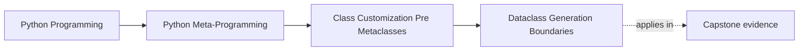
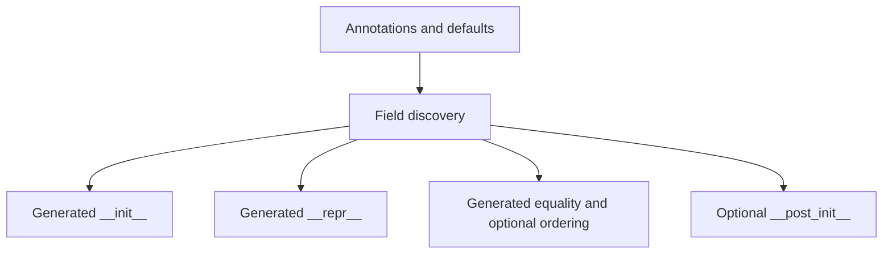

# Dataclass Generation Boundaries


<!-- page-maps:start -->
## Page Maps




<!-- page-maps:end -->

Dataclasses are one of the most important class-customization tools in Python precisely
because they are powerful and easy to overstate.

This page matters because dataclasses produce one of the most common beginner-to-advanced
confusions in Python: generated convenience starts to feel like enforced policy. The
syntax is pleasant enough that readers often stop reviewing too early.

The key sentence is:

> `@dataclass` generates useful class methods from declarative field information, but it
> does not automatically become a validation framework or a metaclass substitute.

That boundary is what this page keeps clear.

## The sentence to keep

When reviewing a dataclass, ask:

> what boilerplate did `@dataclass` generate for me, and what behavior am I still
> responsible for explicitly?

That question prevents one of the most common class-customization mistakes: treating method
generation as if it were full policy enforcement.

Keep a second question beside it:

> if I removed `@dataclass` tomorrow, which rules would disappear completely and which ones would still need a real owner?

That is the fastest way to separate generated convenience from policy theater. If the
answer is "almost everything important would still need explicit logic," the page is
working.

## What `@dataclass` generates

At a high level, `dataclasses.dataclass` can synthesize:

- `__init__`
- `__repr__`
- `__eq__`
- optional ordering support
- `__hash__` under particular rule combinations
- a `__post_init__` hook call when defined

That is already very useful. It is also narrower than many people casually imply.

## Inspect generation and missing policy together

Run `make class-customization-lab` and read `dataclass_boundary`. The evidence comes
from one class:

```python
@dataclass(frozen=True, slots=True)
class DeliveryPlan:
    attempts: int
    tags: list[str] = field(default_factory=list)
```

| Evidence | Meaning |
| --- | --- |
| `__init__`, `__repr__`, and `__eq__` appear in `vars(DeliveryPlan)` | the decorator generated ordinary methods |
| `DeliveryPlan(attempts="three")` succeeds | the `int` annotation did not enforce a runtime type |
| two `tags` lists have different identities | `default_factory` created per-instance mutable state |
| `plan.tags.append("urgent")` succeeds | `frozen=True` did not make the nested list immutable |
| rebinding `attempts` raises `FrozenInstanceError` | frozen dataclass policy blocks ordinary field rebinding |
| the instance has no `__dict__` | `slots=True` changed storage shape |

No option in that table is allowed to borrow guarantees from another.

Use this review split before reading any larger example:

| Surface | Typical owner in a dataclass design |
| --- | --- |
| constructor shape, repr, equality boilerplate | `@dataclass` generation |
| cross-field invariants and normalization | `__post_init__` or another explicit hook |
| repeated attribute policy across classes | property or descriptor, not dataclass generation alone |
| broader lifecycle or registration rules | a different owner entirely |

## Generated convenience versus missing owners

Use this table when a dataclass starts sounding more capable than it really is:

| Dataclass feature | What it gives you | What it does not give you |
| --- | --- | --- |
| generated `__init__` | constructor boilerplate based on declared fields | semantic validation of field values |
| generated `__repr__` | readable instance display | secrecy or redaction policy beyond explicit field settings |
| generated equality | value-style comparison across fields | domain-specific equivalence rules unless you add them |
| `__post_init__` hook | clear place to resume explicit logic | automatic invariants without your code |

## One picture of dataclass generation



Caption: dataclasses turn declared fields into generated methods; they do not automatically own every class invariant.

## Dataclasses do not validate types at runtime

This is the most important warning on the page.

Annotations on a dataclass:

- help define fields
- influence generated signatures and reprs
- help static tooling

They do not, by themselves, enforce runtime types.

That means a dataclass is a great generator of boilerplate, not a free runtime contract
checker.

That sentence needs to stay loud. If a reader walks away believing annotations on a
dataclass behave like runtime validation, the module has failed one of its main teaching
jobs.

The lab deliberately constructs `DeliveryPlan(attempts="three")`. A static checker
should reject that call, but Python executes it. The right conclusion is narrow:
annotations and generated constructors are not runtime validators.

## A quick pressure test for generated fields

Run this check when a field annotation starts sounding stronger than it is:

1. assign a wrong runtime value mentally or in code
2. ask what line would actually reject it
3. if the answer is "nothing yet," the rule still lacks an owner

That small drill helps independent learners stop mistaking signatures for enforcement.

## Defaults and `default_factory` are about instance shape, not policy

```python
from dataclasses import dataclass, field


@dataclass(kw_only=True)
class Employee:
    name: str
    id: int = field(default=0, repr=False)
    dept: str = field(default_factory=lambda: "Unknown")
```

This example shows a few important dataclass features:

- declared fields become constructor parameters
- `repr=False` changes representation policy for one field
- `default_factory` creates fresh defaults per instance

These are strong conveniences, but they are still part of generated class shape, not deep
validation or lifecycle orchestration.

Identity is the proof in the lab: two plans receive different `tags` list objects.
That establishes fresh instance state. It does not establish which tags are valid,
whether their count is bounded, or whether later mutation is allowed by the domain.

Reviewers should ask what policy, if any, is being smuggled into defaults. A fresh
default is often correct for instance shape and still irrelevant to business invariants.

Use this table to keep default shape separate from policy:

| Default choice | What it controls honestly | What it must not overclaim |
| --- | --- | --- |
| literal default such as `0` or `""` | constructor convenience and initial shape | semantic validity for every instance |
| `default_factory` for lists, dicts, or helper values | per-instance fresh state | deep policy about what values are allowed later |
| `repr=False` or `compare=False` | representation or comparison surface | privacy, secrecy, or domain correctness by itself |

## Frozen and slotted modes change surface area

```python
from dataclasses import dataclass


@dataclass(frozen=True, slots=True)
class Point:
    x: float
    y: float
```

These flags matter because they change what the class promises:

- `frozen=True` changes surface mutability
- `slots=True` changes storage layout and dynamic-attribute behavior

That is a good example of how dataclasses can move beyond convenience into design
constraints. Reviewers should treat those flags as real behavior choices, not as syntax
decoration.

Use this review table for the common flags:

| Flag | Real behavioral effect | Overclaim to reject |
| --- | --- | --- |
| `frozen=True` | blocks normal rebinding of fields after initialization | "this makes everything deeply immutable" |
| `slots=True` | restricts normal instance storage and dynamic attributes | "this is only a performance tweak" |
| `kw_only=True` | changes constructor calling style | "this changes validation or business rules" |

Compare `dataclass_boundary` with `frozen_surface`. Both block ordinary rebinding and
both allow nested list mutation, but their contracts differ. The standard dataclass
owns generated field behavior and slots integration. The teaching decorator refuses
slotted instances and advertises bypass and subclass limits. Prefer the standard tool
when its declared contract fits.

## `__post_init__` is where explicit logic resumes

`__post_init__` is a particularly useful reminder that dataclasses are not magical.

The generated `__init__` can build the instance, then hand control back to an ordinary
method where you can:

- validate relationships between fields
- derive additional values
- normalize state

That design is healthy because it keeps the generated part and the explicit part separate.

It also gives the reviewer a clean owner story: dataclass generation owns boilerplate,
while `__post_init__` owns the first wave of explicit invariant logic.

Use this decision card for `__post_init__`:

| If the rule... | `__post_init__` fit |
| --- | --- |
| compares two or more fields after construction | strong fit |
| normalizes instance state once at initialization time | strong fit |
| must run on every later assignment | weak fit; look toward a property or descriptor |
| repeats across many classes as reusable field policy | weak fit; generation is no longer the main story |

## A minimal manual emulation makes the limits clearer

Even a tiny home-grown dataclass-like decorator quickly exposes the right boundary:

- field discovery is one thing
- method generation is another
- runtime validation is still something you must add consciously

That is why this module keeps dataclass generation and descriptor-based validation in
different lessons instead of blurring them together.

Do not turn the manual sketch into a second implementation. The executable course uses
the standard-library decorator and inspects its observable results.

## A review walkthrough to keep nearby

When you inspect a dataclass, read it in this order:

1. list what generation clearly supplies
2. mark every invariant the generated code does not own
3. find where explicit policy resumes: `__post_init__`, property, descriptor, or elsewhere
4. reject any sentence that makes the generated surface sound like a runtime schema system

## Common overclaims to reject

Reject these sentences when they show up in review:

| Overclaim | Better replacement |
| --- | --- |
| "the dataclass enforces the schema" | "the dataclass generates methods from declared fields" |
| "annotations make the fields safe" | "annotations describe fields; runtime safety still needs an owner" |
| "frozen means immutable" | "frozen means the normal field rebinding surface is restricted" |
| "slots is just optimization" | "slots also changes how instances can carry state" |

## Failure modes for dataclass reviews

These are the mistakes that make a class look stronger than it is:

| Failure mode | Why it weakens the design | Repair move |
| --- | --- | --- |
| assuming annotations imply runtime validation | missing owners stay invisible | move the rule into `__post_init__`, a property, or a descriptor |
| packing broad policy into dataclass flags | generation and invariants get blurred together | separate generated convenience from explicit rules |
| ignoring `default_factory` semantics | shared or per-instance state becomes unclear | state clearly what shape the default is meant to create |
| using `frozen=True` as marketing for deep immutability | reviewers stop asking about nested mutability | define the exact immutability boundary in plain language |

One more failure mode deserves attention:

| Failure mode | Why it weakens the design | Repair move |
| --- | --- | --- |
| piling many business rules into `__post_init__` because dataclasses feel convenient | the class starts hiding several owners inside one hook | keep `__post_init__` for initialization-time policy and move ongoing field rules to clearer boundaries |

## Review rules for dataclass use

When reviewing a dataclass, keep these questions close:

- which methods were generated, and which behaviors remain explicit?
- is anyone assuming the annotations imply runtime validation when they do not?
- do `frozen=True` or `slots=True` change the design in ways the review should call out explicitly?
- is `default_factory` being used where fresh per-instance defaults matter?
- would a plain class or a later lower-level tool be clearer if the dataclass is carrying too much policy?
- can another reviewer separate the generated part from the explicit policy part in one pass?

## Evidence packet for dataclass reviews

Leave this page with a small packet:

- one list of methods generated for a sample class
- one invariant that still needs an explicit owner
- one note explaining whether `__post_init__` is enough or whether later assignment needs its own boundary
- one sentence rejecting a false schema or immutability claim

## Smallest honest proof route

```bash
python -m unittest \
  tests.test_class_customization_evidence.ClassCustomizationEvidenceTests.test_dataclass_packet_separates_generation_validation_and_freezing
```

This proves the exact method, type, default, mutation, rebinding, and storage evidence
above. It does not prove static-checker coverage, deep copying, hash safety, or domain
correctness.

## Exit check for this page

Before moving on, make sure you can do all of these:

- list two things `@dataclass` generates and two things it still does not own
- explain why annotations on dataclass fields do not validate runtime values by themselves
- say what `__post_init__` is responsible for that generation is not
- describe one overclaim about `frozen=True` or `slots=True` that should be rejected

## What to practice from this page

Try these before moving on:

1. Predict the generated method list before reading the packet.
2. Replace `"three"` with another incompatible runtime value and explain why construction
   still succeeds.
3. Remove `default_factory`, attempt a shared mutable default, and interpret the
   dataclass error rather than bypassing it.
4. Compare `frozen=True` with `surface_frozen` using their exact refusal and mutation
   evidence.

If those feel ordinary, the next step is the friendly face of descriptor behavior:
properties at the attribute boundary.

## Continue through Module 06

- Previous: [Class Decorators and Post-Construction Transformation](class-decorators-and-post-construction-transformation.md)
- Next: [Properties and Attribute-Boundary Control](properties-and-attribute-boundary-control.md)
- Return: [Overview](index.md)
- Terms: [Glossary](glossary.md)
