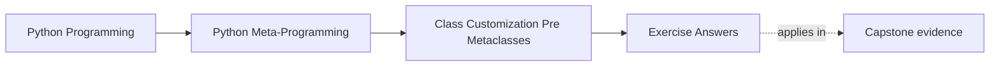

# Exercise Answers


<!-- page-maps:start -->
## Page Maps




<!-- page-maps:end -->

Use this page after attempting the exercises yourself. The point is not to match every
example literally. The point is to compare your reasoning against answers that keep
class-level power, attribute boundaries, and escalation limits honest.

Treat each answer as a review calibration, not as a final script to copy. A strong answer
names the owner, the rejected stronger mechanism, and the remaining boundary in plain
language. A weak answer may sound tidy while still hiding where the real rule lives.

## Answer 1: Use one class decorator for an opt-in class rule

Example answer:

A class decorator that registers decorated classes in a plugin registry is a good fit
when:

- registration is opt-in
- the class already exists before registration runs
- the effect can be inspected after decoration

Good conclusion:

This does not need a metaclass because the rule does not depend on controlling namespace
preparation or class creation itself. The decorator can apply the behavior after the class
object already exists.

Reasoning checkpoint:

- can you name the post-construction effect in one sentence?
- can you say what missing class-creation requirement would finally justify a metaclass?

## Answer 2: Separate dataclass generation from validation

Example answer:

```python
from dataclasses import dataclass


@dataclass
class User:
    name: str
    age: int = 0
```

Generated behavior:

- `__init__`
- `__repr__`
- equality methods

Missing invariant:

- `age` is not automatically checked to be non-negative

Good conclusion:

The missing rule should live in an explicit validation boundary such as `__post_init__`, a
property, or a descriptor, depending on how broad the rule becomes.

Reasoning checkpoint:

- can you separate generated convenience from the missing invariant owner?
- can you name one overclaim about dataclass annotations that this answer rejects?

## Answer 3: Control one attribute boundary with a property

Example answer:

```python
class Product:
    def __init__(self, price):
        self.price = price

    @property
    def price(self):
        return self._price

    @price.setter
    def price(self, value):
        if value < 0:
            raise ValueError("price must be non-negative")
        self._price = value
```

Good conclusion:

A property is the clearest owner because the rule applies to one field and stays visible
exactly where reads and writes cross the attribute boundary.

Reasoning checkpoint:

- can you name the one attribute boundary clearly?
- can you say what repetition pattern would push this answer toward a descriptor instead?

## Answer 4: Promote one repeated property rule into a descriptor

Example answer:

Suppose several classes each need string attributes that must be non-empty.

A descriptor is now a better fit because:

- the same rule repeats across multiple attributes or classes
- one reusable owner is clearer than copied property setters
- the rule still lives at the attribute boundary

Good conclusion:

This is still not metaclass control because the descriptor governs how specific
attributes behave on access and assignment, not how the class itself is created.

Reasoning checkpoint:

- can you name the exact reuse pressure that made copied properties the weaker owner?
- can you explain why this still stays below class-creation control?

## Answer 5: Place one design on the lower-power ladder

Example answer:

Requirement:

- keep one `email` field normalized to lowercase on assignment

Best placement:

- property

Rejected stronger options:

- a descriptor is unnecessary if only one attribute in one class needs the rule
- a metaclass would be extreme overreach because no class-creation control is required

Good conclusion:

Strong answers do not just pick a tool. They explain why a stronger tool would add power
without adding clarity.

Reasoning checkpoint:

- can you name the stronger rejected option directly?
- can you say what missing condition that stronger option would need?

## Answer 6: Review the limits of a frozen surface

Example answer:

A minimal `@frozen` decorator can honestly control:

- reassignment of instance attributes after initialization
- deletion of instance attributes after initialization

It still allows:

- mutation of nested mutable objects such as lists or dictionaries already stored on the instance

Good conclusion:

That remaining mutability does not make the example dishonest as long as the decorator
defines frozen as a surface-level attribute rule rather than as universal deep
immutability.

Reasoning checkpoint:

- can you name one mutation the decorator still allows?
- can you explain why "surface immutability" is a more accurate phrase than "full immutability"?

## Answer 7: Separate repeated field policy from class-wide policy

Example answer:

Suppose several classes each need normalized email fields and trimmed name fields.

Strong assessment:

- `__post_init__` can work when the rule is local to one dataclass instance boundary
- a property is good when one field in one class needs a visible read/write boundary
- a descriptor is stronger when the same attribute rule repeats across several classes or fields

Good conclusion:

The owner should follow the repetition pattern. Repeated field policy belongs at the
attribute boundary, not in copied class-local code or a broader class-wide mechanism.

Reasoning checkpoint:

- can you say who would debug the failing rule if it spread across several classes?
- can you explain why the chosen owner is clearer than one named alternative?

## Answer 8: Reject one unnecessary escalation to metaclass power

Example answer:

Requirement:

- register classes after definition and enforce one naming convention

Better owner:

- a class decorator plus ordinary validation logic

Strong explanation:

- the requirement does not need custom namespace preparation
- it does not need to change class creation protocol itself
- the class already exists before the rule needs to run

Good conclusion:

A real metaclass need is still missing because nothing here depends on controlling how the
class object is built. Post-construction customization is enough.

Reasoning checkpoint:

- can you describe the missing creation-time need precisely?
- can you name the lower-power owner without relying on prestige language?

## Answer 9: Compare honest class claims with overstated class claims

Example answer:

Honest description:

- "This decorator prevents reassignment of top-level instance attributes after initialization."

Overstated description:

- "This makes instances fully immutable."

Good conclusion:

The second version is misleading because words such as "fully" and "immutable" imply deep
and universal guarantees the tool does not actually provide. Honest language keeps the
attribute-surface boundary visible.

Reasoning checkpoint:

- can you point to the inflated words in the bad claim?
- can you replace them with a useful but narrower sentence?

## Answer 10: Produce a class-boundary packet

The packet is strong when another learner can answer:

- which invariant is being enforced
- which owner carries it directly
- which stronger mechanism was rejected and why
- where generated convenience ends and real policy ownership begins

Add one more packet test:

- could a reviewer identify the owner boundary without seeing the implementation first?

## Repair moves for weak answer keys

If your answer key still feels shallow, use these repair moves:

| Weak answer habit | Repair move |
| --- | --- |
| naming only the feature used | add the owner story and the rejected stronger tool |
| calling a class "frozen" without naming limits | state one allowed mutation explicitly |
| praising dataclasses without naming missing invariants | point to `__post_init__`, a property, or a descriptor |
| using "advanced" as justification | name the concrete missing condition instead |
| describing a descriptor as automatically better | explain the repetition pressure that made reuse necessary |

## What strong Module 06 answers have in common

Across the whole set, strong answers share the same habits:

- they separate generated convenience from real invariants
- they keep rules at the smallest honest boundary
- they treat descriptors as reusable attribute owners, not as a shortcut to extra prestige
- they reject metaclass escalation unless class-creation-time control is truly required
- they distinguish repeated field policy from real class-creation policy
- they leave behind a packet another learner can review without guessing

If an answer still sounds like "a more advanced class feature could handle it," revise it
until you can say why the chosen owner is the clearest one.

## Exit check for the answer key

Before leaving this page, make sure you can do all of these:

- identify the owner boundary in every answer
- name one rejected stronger tool in every escalation-focused answer
- name one remaining gap or allowed mutation in every immutability-focused answer
- explain one case where post-construction tooling is enough and one where it would stop being enough

## Continue through Module 06

- Previous: [Exercises](exercises.md)
- Return: [Overview](index.md)
- Next module: [Module 07](../module-07-descriptors-lookup-attribute-control/index.md)
- Terms: [Glossary](glossary.md)
