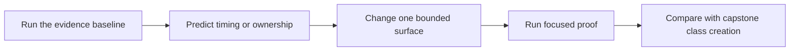

# Exercises: Lower-Power Class Design Studio

<!-- page-maps:start -->
## Page Maps


<!-- page-maps:end -->

This studio modifies and reviews the shipped Module 06 code. It is not a collection of
class-syntax prompts. Each part asks you to predict behavior, preserve an earlier
contract, and leave evidence another learner can review.

Work from `programs/python-programming/python-meta-programming`.

## Establish the baseline

```bash
make class-customization-lab-test
make class-customization-lab
make capstone-class-creation
```

Record these facts before editing:

- class decorator expressions run before the body and apply after creation, bottom-up
- `mark_class` preserves class identity
- dataclass annotations do not enforce runtime types
- the property wins over a same-named instance entry
- `TypedField` keeps values in each instance and exposes a field spec through class access
- `surface_frozen` blocks rebinding but permits nested mutation
- capstone class-creation inspection constructs and executes no plugin

Do not reinterpret an existing failure as evidence for your change.

## Studio 1: extend the class-decorator trace

Objective: add a third tracing decorator and predict the exact event and application
orders before running the test.

Constraints:

- do not change `tracing_class_decorator`
- keep one class-body event
- assert factory, body, and application timing separately
- preserve the final class identity and metaclass

Acceptance:

```bash
python -m unittest \
  tests.test_class_customization_transformation.ClassCustomizationTransformationTests.test_decorator_expression_precedes_body_and_application_is_bottom_up
```

Hand in the desugared helper form and one sentence explaining which requirement would
already be too early for this decorator.

## Studio 2: test dataclass claims independently

Objective: add one assertion for each independent dataclass claim:

- generated method
- runtime annotation non-enforcement
- fresh default
- surface rebinding failure
- nested mutation
- slotted storage

Constraints:

- use the standard-library dataclass
- do not add validation merely to make the wrong-type call fail
- do not describe `frozen=True` as deep immutability

Acceptance: the focused dataclass packet test passes, and every assertion has a note
stating what it does not prove.

## Studio 3: defend one property boundary

Objective: change the valid endpoint, attempt an invalid later assignment, and prove:

- the failure comes from the setter
- the prior valid value remains
- a same-named `__dict__` entry still loses during normal lookup

Then write the repetition threshold that would move the storage-and-type part into a
descriptor while leaving the domain-specific HTTPS rule local.

Acceptance:

```bash
python -m unittest \
  tests.test_class_customization_evidence.ClassCustomizationEvidenceTests.test_property_packet_proves_data_descriptor_precedence
```

## Studio 4: add one reusable typed field

Add:

```python
channel: str = TypedField(str)
```

Predict its private storage name before running the lab. Extend the evidence and tests to
prove:

- class access returns a descriptor with a `TypedFieldSpec`
- two instances keep independent values
- a wrong runtime class is rejected on assignment
- an unset read raises `AttributeError`

Constraints:

- do not infer the runtime contract from the annotation
- do not claim element validation for `TypedField(list)`
- keep all storage on instances, never on the descriptor

State which repeated rule justified this descriptor and which richer requirement would
force a validation component or the later descriptor-system module.

## Studio 5: audit the frozen surface

Draw this state transition:

```text
decorated class -> initializer open -> original initialization -> boundary closed
```

Add or review one proof for each route:

- successful initialization
- rejected rebinding
- rejected deletion
- nested list mutation
- `object.__setattr__` bypass
- slotted-class refusal
- subclass override escape

Acceptance:

```bash
python -m unittest discover \
  -s tests \
  -p "test_frozen_surface_class_decorator.py" \
  -v
```

Write the strongest honest frozen claim and the first requirement that would make
`surface_frozen` the wrong owner.

## Studio 6: explain the capstone escalation

Run:

```bash
make capstone-class-creation
make capstone-action-wrapper
make capstone-field
```

Build this ownership table from the outputs and source:

| Concern | Owner | Timing | Evidence |
| --- | --- | --- | --- |
| one action call | `@action` | call and post-call | wrapper audit and runtime tests |
| one configuration attribute | `Field` | class creation plus instance assignment | field manifest and field tests |
| one plugin class family | `PluginMeta` | namespace preparation and class creation | class-creation report and registry tests |

Now compare two collision cases:

- `mark_class` notices a reserved attribute on a finished class
- `DefinitionNamespace` notices a second tracked write while the body executes

Explain which evidence is already gone before a class decorator can run.

Acceptance: the capstone report must name `DefinitionNamespace`, separate inherited from
declared members, report initializer generation, and keep construction and execution
false.

## Final review packet

Submit:

- the three-decorator timing trace and desugaring
- the dataclass claim/non-claim ledger
- the property lookup conflict
- the added descriptor field and storage proof
- the frozen state-transition and limitation ledger
- the capstone owner/timing table
- focused command results

For every mechanism, state:

1. when it runs
2. what object owns behavior
3. what public surface changes
4. how inspection exposes it
5. what failure or maintenance cost remains
6. why the next stronger mechanism was rejected or accepted

## Exit standard

Move to Module 07 only when you can:

- distinguish class-body, class-creation, decoration, instance, and assignment timing
- select a property for one rule and a descriptor for genuine repetition
- keep annotations separate from runtime enforcement
- define frozen as a bounded surface claim
- justify `PluginMeta` using evidence unavailable to post-construction tools

## Continue

- Previous: [Worked Example](worked-example-building-a-minimal-frozen-class-decorator.md)
- Next: [Exercise Answers](exercise-answers.md)
- Return: [Overview](index.md)
