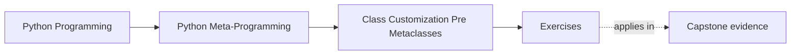

# Exercises

<!-- page-maps:start -->
## Page Maps

<!-- page-maps:end -->

Use these after reading the five core lessons and the worked example. The goal is not to
collect more class tricks. The goal is to make class-level ownership, attribute
boundaries, and escalation decisions explicit.

Each exercise asks for three things:

- the class rule or invariant you are trying to enforce
- the class-level tool you chose
- the reason that choice is the smallest honest owner

Treat the ten exercises as one full lab day on class customization before metaclasses.

Do them in order:

- Exercises 1-3 establish class decorators, dataclass limits, and single-attribute boundaries
- Exercises 4-6 move into reusable attribute control, lower-power placement, and frozen-surface limits
- Exercises 7-8 extend that discipline into escalation decisions and explicit invariant ownership
- Exercises 9-10 package the whole module into a reviewable class-boundary packet

Keep one class-boundary table while you work:

| Invariant or class rule | Smallest honest owner | What it controls directly | What it does not control | Review judgment |
| --- | --- | --- | --- | --- |

## Exercise 1: Use one class decorator for an opt-in class rule

Write or inspect a class decorator that adds one visible post-construction behavior.

What to hand in:

- the behavior it adds
- one sentence explaining why the class decorator can install it after class creation
- one sentence explaining why this does not need a metaclass

## Exercise 2: Separate dataclass generation from validation

Create or review a small `@dataclass` example with defaults and generated methods.

What to hand in:

- the generated behavior you are relying on
- one invariant that the dataclass still does not enforce for you
- one sentence describing where that missing rule should live instead

## Exercise 3: Control one attribute boundary with a property

Implement one property that protects a single attribute.

What to hand in:

- the attribute rule it enforces
- one setter or getter behavior that makes the boundary visible
- one explanation of why a property is clearer here than a class-wide hook

## Exercise 4: Promote one repeated property rule into a descriptor

Take a repeated field rule and sketch or build a reusable descriptor for it.

What to hand in:

- the repeated rule
- one reason the rule is now better owned by a descriptor than by copied properties
- one sentence explaining why this is still different from metaclass control

## Exercise 5: Place one design on the lower-power ladder

Choose one class customization requirement and place it on this ladder:

- plain class code
- class decorator
- property
- descriptor
- metaclass

What to hand in:

- the requirement
- the level you chose
- one sentence rejecting at least one stronger option as unnecessary

## Exercise 6: Review the limits of a frozen surface

Use the worked example pattern on a minimal `@frozen` decorator or a similar design.

What to hand in:

- the exact mutation boundary the decorator controls
- one kind of mutation it still allows
- one explanation of why that remaining mutability does not make the example dishonest

## Midday self-check

Before moving into the final four exercises, make sure you can already answer these
questions clearly:

- when a class decorator is enough and when class-creation-time control is not actually needed
- which invariants `@dataclass` generates for convenience and which ones still need a real owner
- why a property, descriptor, or `__post_init__` hook may be clearer than a broader class-wide mechanism
- what kind of "frozen" claim remains honest for a shallow attribute boundary

If you cannot answer those four questions in plain language, return to Exercises 1-6 and
make the owner, boundary, and rejected stronger option more explicit before continuing.

## Exercise 7: Separate repeated field policy from class-wide policy

Choose one rule that repeats across attributes or classes and decide whether it belongs in
`__post_init__`, a property, or a descriptor.

What to hand in:

- the repeated rule
- the owner you chose
- one explanation of why at least one alternative owner would be less clear

## Exercise 8: Reject one unnecessary escalation to metaclass power

Choose one class customization idea that may tempt someone to reach for a metaclass too
early.

What to hand in:

- the original requirement
- the lower-power owner you would choose instead
- one sentence explaining what true class-creation-time need is still missing

## Exercise 9: Compare honest class claims with overstated class claims

Choose one class customization tool and write both an honest description and an overstated
description of what it guarantees.

What to hand in:

- the honest description
- the overstated description
- one explanation of which words make the overstated version misleading

## Exercise 10: Produce a class-boundary packet

Assemble:

- one class-boundary table
- one dataclass example with a named missing invariant owner
- one attribute-boundary example using a property or descriptor
- one rule for rejecting unnecessary escalation to metaclasses

The packet is strong when another learner can use it to answer:

- which owner is carrying the invariant
- what that owner controls directly
- why a stronger mechanism was rejected as unnecessary

## Mastery standard for this exercise set

Across all six answers, the module wants the same habits:

- you distinguish generated convenience from real policy ownership
- you keep attribute control at the narrowest honest boundary
- you treat descriptors as reusable attribute tools, not as prestige mechanisms
- you reject metaclass escalation when post-construction or attribute-boundary tools are still enough

Across all ten answers, add two more habits:

- you distinguish repeated field policy from truly class-wide creation policy
- you leave behind a class-boundary packet another learner could review without guessing

If an answer still sounds like "the class magic handles it," keep going.

## Continue through Module 06

- Previous: [Worked Example: Building a Minimal `@frozen` Class Decorator](worked-example-building-a-minimal-frozen-class-decorator.md)
- Next: [Exercise Answers](exercise-answers.md)
- Return: [Overview](index.md)
- Terms: [Glossary](glossary.md)
