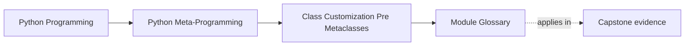

# Module Glossary

<!-- page-maps:start -->
## Page Maps

<!-- page-maps:end -->

This glossary belongs to **Module 06: Class Customization Before Metaclasses** in
**Python Metaprogramming**. It keeps the language of this directory stable so the same
ideas keep the same names across lessons, practice, review, and capstone discussion.

## How to use this glossary

Use the glossary when a class-level discussion starts to blur together generated
convenience, attribute-boundary control, reusable descriptors, and true class-creation
power. Module 06 is meant to keep those boundaries explicit.

If two reviewers use the same word but mean different owner stories, stop and return
here. This module gets weak quickly when terms like "frozen," "validation," "generated,"
or "advanced" stay vague.

## Terms in this directory

| Term | Meaning in this directory |
| --- | --- |
| Attribute boundary | The point where a read, write, or delete operation crosses into class-controlled logic for one attribute. |
| Class customization boundary | The design line where you choose between plain class code, a class decorator, a property, a descriptor, or a metaclass. |
| Class decorator | A callable that takes a class object after creation, modifies or replaces it, and returns the resulting class binding. |
| Data descriptor | A descriptor that defines `__set__`, `__delete__`, or both, and therefore wins over instance-dictionary entries during attribute lookup. |
| Dataclass generation | The automatic creation of methods such as `__init__` and `__repr__` from field declarations. |
| Explicit invariant owner | The concrete function, method, property, descriptor, hook, or metaclass surface that actually enforces a class rule. |
| Deep immutability | A stronger claim that nested mutable objects are also made immutable, which this module deliberately does not promise with a minimal `@frozen` decorator. |
| Descriptor-backed validation | Validation owned by a reusable descriptor rather than by repeated property setters or constructor-only checks. |
| Escalation condition | The missing requirement that must become real before moving to a stronger class-customization tool is justified. |
| Honest class claim | The strongest description a class customization tool can make without implying guarantees it does not actually provide. |
| Lower-power ladder | The ordered review habit of preferring plain code, then class decorators, then attribute-boundary tools, and only later metaclasses if required. |
| Metaclass escalation | The move from post-construction or attribute-boundary customization into class-creation-time control. |
| Post-construction transformation | A class change that happens after the class object already exists, such as registration or method injection by a class decorator. |
| Property | A built-in descriptor used to control one attribute through managed getter, setter, and deleter methods. |
| Rejected stronger tool | The more powerful mechanism a review considered and deliberately declined because the need was not real yet. |
| Shallow runtime contract | A runtime rule that checks one visible surface, such as assignment to an attribute, without claiming complete semantic enforcement. |
| Surface immutability | The narrower rule that instance attributes cannot be rebound or deleted after initialization, even though nested objects may still mutate. |
| `__delattr__` | The attribute-deletion hook that can be overridden to reject or control deletion on an instance. |
| `__post_init__` | The dataclass hook that runs after generated initialization, often used for explicit validation or normalization. |
| `__setattr__` | The attribute-assignment hook that can intercept writes and enforce post-initialization rules. |

## Confusing pairs to keep separate

These pairs sound close but should not collapse into each other:

| Do not confuse... | With... | Because... |
| --- | --- | --- |
| dataclass generation | invariant enforcement | generated methods are not the same thing as owned policy |
| surface immutability | deep immutability | blocked rebinding does not freeze nested mutable state |
| property | plain stored attribute | the first is a runtime boundary owner, the second is just storage |
| descriptor reuse | metaclass power | reusable field control still stays below class creation timing |
| post-construction transformation | class creation control | the decorator acts on a finished class object |
| advanced tool | justified tool | stronger mechanisms need missing conditions, not prestige |

## Repair prompts for blurred language

When a term starts sounding too broad, use one of these prompts:

| If someone says... | Ask back... |
| --- | --- |
| "the dataclass handles it" | what explicit invariant owner is still missing? |
| "the class is frozen" | what exact mutation surface is blocked, and what still mutates? |
| "a descriptor is better" | what repeated field pressure makes reuse necessary? |
| "this needs a metaclass" | what class-creation-time requirement exists right now? |
| "it is just a property" | what one attribute boundary is it actually owning? |

## Exit check for module vocabulary

Before leaving Module 06, make sure you can use these terms in plain language:

- explicit invariant owner
- rejected stronger tool
- escalation condition
- post-construction transformation
- surface immutability
- honest class claim

## Keep the module connected

- Return to [Module 06 Overview](index.md) for the full learning route.
- Use [Exercises](exercises.md) and [Exercise Answers](exercise-answers.md) to pressure-test the class-customization vocabulary.
- Revisit the [Worked Example](worked-example-building-a-minimal-frozen-class-decorator.md) when a class decorator starts to carry immutability or policy claims that need review.
