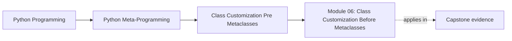

# Module 06: Class Customization Before Metaclasses

<!-- page-maps:start -->
## Page Maps




<!-- page-maps:end -->

Module 06 is the bridge from callable policy to class-level ownership. The executable
thread is one incident-delivery configuration model examined through successively
stronger tools: class decorator, dataclass, property, and reusable attribute descriptor.
The question is not which tool looks most sophisticated. It is which owner is powerful
enough for the rule and no stronger.

This is the point in the course where "I know the syntax" stops being enough. A reader
who studies alone needs to learn how to review class-level power, not just how to produce
it. Module 06 is therefore a review module as much as a feature module.

The strongest habit to build here is restraint. Many class requirements sound sophisticated
enough to deserve descriptors or metaclasses long before they actually do. This module is
meant to slow that reflex down.

## What this module is for

By the end of Module 06, you should be able to explain five things clearly:

- how class decorators transform classes after creation
- what `@dataclass` generates and what it pointedly does not do
- why `@property` is still descriptor-driven attribute control
- how shallow type-hint validation can live at the attribute boundary
- when class customization should stop before descriptors or metaclasses take over

You should also be able to say what this module does not prove automatically:

- that generated code is the same as enforced policy
- that a frozen surface is the same as deep immutability
- that type annotations become runtime behavior without a real owner
- that a reusable descriptor automatically justifies itself

## Weak answers to reject early

Do not let the module collapse into any of these:

| Weak answer | Why it fails |
| --- | --- |
| "`@dataclass` already enforces the rule." | generated methods are not the same as owned validation or policy |
| "A property is simpler, so it must be correct." | friendly syntax does not prove the rule belongs to one attribute boundary |
| "A descriptor is better because it is more advanced." | reuse is only honest when repeated field pressure is real |
| "A metaclass could handle it." | possibility is not justification; class-creation-time need must be named |
| "Frozen means immutable." | blocked rebinding is weaker than deep control over nested mutable state |

## Keep these pages open

- [Mid-Course Map](../module-00-orientation/mid-course-map.md)
- [Pressure Routes](../guides/pressure-routes.md)
- [Module Checkpoints](../guides/module-checkpoints.md)
- [Capstone Architecture Guide](../capstone/capstone-architecture-guide.md)

## Start with executable evidence

Work from `programs/python-programming/python-meta-programming`:

```bash
make class-customization-lab
make class-customization-lab-test
```

The lab prints five evidence packets:

| Packet | Evidence to locate | Claim it constrains |
| --- | --- | --- |
| `class_transformation` | body timing, bottom-up application, preserved class identity | class decorators transform an already-created class |
| `dataclass_boundary` | generated methods, accepted wrong runtime type, distinct defaults, mutable nested list | generation, validation, and deep immutability are separate claims |
| `property_boundary` | a property beating a same-named instance entry | one data descriptor owns one attribute boundary |
| `descriptor_boundary` | two reusable typed fields with isolated instance storage | repeated attribute enforcement has a first-class owner |
| `frozen_surface` | blocked rebinding beside allowed nested mutation | surface freezing is not deep immutability |

The implementation lives in `labs/class_customization/`; focused proof lives in the
three matching test files under `tests/`.

## The module delta

Module 05 asked whether runtime policy still belonged in a callable wrapper. Module 06
moves ownership upward only when the rule is about class or attribute structure:

| Previous boundary | New pressure | Smallest candidate |
| --- | --- | --- |
| callable invocation | mark one finished class opt-in | class decorator |
| repeated handwritten constructor boilerplate | generate ordinary class methods | dataclass |
| one validated attribute | guard lookup and assignment locally | property |
| the same attribute rule repeats | reuse one storage and validation owner | descriptor |
| rule must see the namespace before class creation finishes | reject the earlier tools and justify later metaclass study |

Every row retains Modules 01–05 obligations: timing, identity, inspection, failure, and
public-surface changes must remain visible.

## The review route through the module

Read the module in this order if you are learning without an instructor present:

| Read this page when you need to... | Review question to keep active |
| --- | --- |
| [Class Decorators and Post-Construction Transformation](class-decorators-and-post-construction-transformation.md) | what can still be changed honestly after the class already exists? |
| [Dataclass Generation Boundaries](dataclass-generation-boundaries.md) | what did the tool generate, and what owner is still missing? |
| [Properties and Attribute-Boundary Control](properties-and-attribute-boundary-control.md) | does this rule really belong to one attribute boundary? |
| [Type Hints and Descriptor-Backed Validation](type-hints-and-descriptor-backed-validation.md) | where does enforcement actually happen, and what hint surface is refused? |
| [Class Customization Boundaries](class-customization-boundaries.md) | what is the smallest honest owner for this invariant? |
| [Worked Example: Building a Minimal `@frozen` Class Decorator](worked-example-building-a-minimal-frozen-class-decorator.md) | what does frozen mean here, and what stronger claim must stay rejected? |
| [Exercises](exercises.md) | can I justify the lower-power owner in plain language? |
| [Exercise Answers](exercise-answers.md) | is my reasoning honest about missing guarantees and rejected stronger tools? |
| [Glossary](glossary.md) | am I using ownership words consistently? |

## Session route for independent learners

Use this route if you are studying without class discussion or live demos:

| Session block | What to produce before moving on |
| --- | --- |
| class decorators plus dataclass generation | one note separating post-construction transformation from generated convenience |
| properties plus hint-backed descriptors | one note naming a single-attribute owner and one repeated-field owner |
| class-customization boundaries | one lower-power ladder judgment with a rejected stronger tool |
| worked example | one proof note defining frozen narrowly and naming an allowed mutation |
| exercises plus answers | one review packet another learner could inspect without your code open |

## The learning sequence

1. Overview (`index.md`)
2. [Class Decorators and Post-Construction Transformation](class-decorators-and-post-construction-transformation.md)
3. [Dataclass Generation Boundaries](dataclass-generation-boundaries.md)
4. [Properties and Attribute-Boundary Control](properties-and-attribute-boundary-control.md)
5. [Type Hints and Descriptor-Backed Validation](type-hints-and-descriptor-backed-validation.md)
6. [Class Customization Boundaries](class-customization-boundaries.md)
7. [Worked Example: Building a Minimal `@frozen` Class Decorator](worked-example-building-a-minimal-frozen-class-decorator.md)
8. [Exercises](exercises.md)
9. [Exercise Answers](exercise-answers.md)
10. [Glossary](glossary.md)

## The running question

Carry this question through every page:

> What can still be owned honestly after class creation, without taking control of class creation itself?

Keep a second question beside it:

> what stronger mechanism am I refusing, and what missing need would have to appear before that stronger mechanism became justified?

Strong Module 06 answers usually mention one or more of these:

- post-construction class decorators
- generated dataclass methods with explicit limits
- property-based control at one attribute boundary
- shallow runtime hint enforcement through descriptors
- a lower-power decision that rejects metaclass escalation

Weak answers usually sound like one of these instead:

- "`@dataclass` handles the rule for us"
- "a property is simpler" without naming the attribute boundary
- "a metaclass could do it" without naming a class-creation-time need
- "`@frozen` makes the object immutable" without naming the surface limit

## Evidence packet to build while you learn

Keep one packet beside the module as you work:

| Surface | What to record |
| --- | --- |
| class decorator note | exact factory/body/application trace plus identity evidence |
| dataclass note | generated methods, accepted wrong type, default isolation, and one mutable nested value |
| property note | visible value, conflicting instance entry, and assignment failure |
| descriptor note | field specs, private storage, per-instance values, and refused broad typing claim |
| frozen note | blocked mutation, allowed nested mutation, bypass, subclass, and slots limits |
| capstone note | evidence separating post-construction possibilities from `PluginMeta` creation-time ownership |

## Learning outcomes

By the end of this module, you should be able to:

- compare class decorators, dataclasses, properties, and descriptor-backed validation without conflating their roles
- keep class customization explicit and inspectable after creation
- explain why some invariants belong on the attribute boundary rather than inside global `__setattr__` hacks
- reject metaclass escalation when post-construction tools are still enough

## Mid-module warning signs

Pause and repair your understanding if you catch yourself doing any of these:

- calling generated convenience the same thing as enforced policy
- describing a class decorator as if it participated in class creation
- treating properties as if they were only friendly syntax and not descriptor-driven lookup
- using annotations as if they enforce behavior by themselves
- proposing a metaclass without naming a requirement that truly depends on class creation timing

## Review packet standard

By the end of the module, your notes should let another learner answer all of these
without guessing:

- what class rule is being enforced
- which owner carries that rule directly
- which stronger mechanism was considered and rejected
- which boundary, gap, or allowed mutation still remains visible
- what first condition would justify escalating to a stronger tool later

## Artifacts to collect page by page

Leave yourself a review packet as you move through the module:

- one class decorator example that is clearly post-construction
- one dataclass example with a named missing invariant owner
- one property example that owns exactly one attribute boundary
- one descriptor example with a named supported hint subset
- one explicit sentence rejecting metaclass escalation for a concrete case

If you can assemble those five artifacts, the module is becoming standalone instead of
lecture-dependent.

## Exit standard

Do not move on until all of these are true:

- you can explain what a class decorator can and cannot do after the class already exists
- you can say what dataclasses generate and what they still leave to you
- you can distinguish property-driven attribute control from broader descriptor or metaclass ownership
- you can place one class customization requirement honestly on the lower-power side of the ladder
- you can name one rejected stronger mechanism and the missing condition that would be required to justify it
- you can map every important claim to lab output and a focused test

When those feel ordinary, Module 06 has done its job and the descriptor modules can start
from a much cleaner ownership model.
