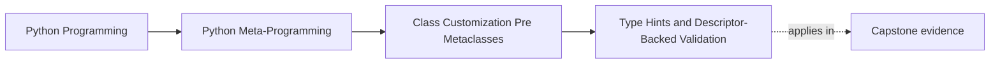
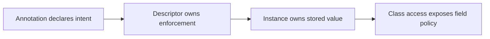
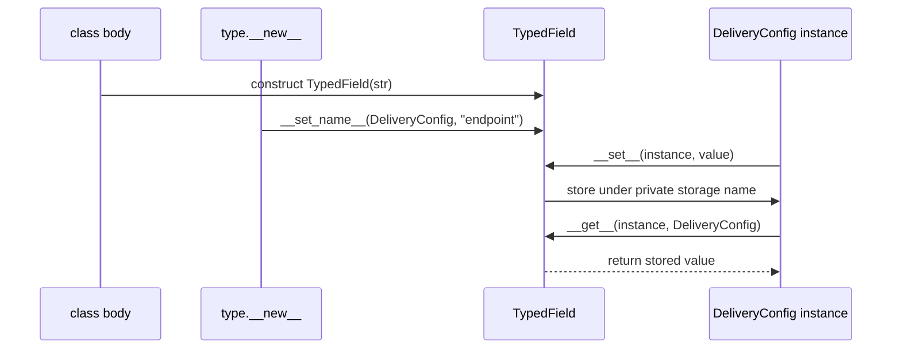

# Type Hints and Descriptor-Backed Validation

<!-- page-maps:start -->
## Page Maps




<!-- page-maps:end -->

The property core kept one HTTPS rule local to one attribute. Now imagine the same
shallow runtime type rule repeated for `endpoint`, `attempts`, and fields on several
classes. Copied setters would make repetition the real owner.

This core introduces one reusable descriptor without pretending to teach the full
descriptor protocol—that belongs to Modules 07 and 08. Its purpose here is to make one
boundary judgment executable:

> an annotation declares an expected type; a runtime object must still own enforcement.

## Prerequisites and scope

Before this page, you should be able to:

- explain why dataclass annotations did not reject `"three"` for an `int` field
- prove that a property is a data descriptor
- identify backing storage separately from a public attribute

This page supports plain runtime classes supplied explicitly to `TypedField`. It does
not interpret `Union`, `Optional`, parameterized generics, protocols, or arbitrary class
annotations. Module 05 already showed the cost of a partial hint interpreter. This core
does not hide another one inside attribute access.

## Run the evidence

From `programs/python-programming/python-meta-programming`:

```bash
make class-customization-lab
```

Read `descriptor_boundary`. Its class declaration is:

```python
class DeliveryConfig:
    endpoint: str = TypedField(str)
    attempts: int = TypedField(int)
```

The annotation and descriptor argument look redundant because they serve different
consumers:

| Surface | Consumer | Promise |
| --- | --- | --- |
| `endpoint: str` | readers and static tooling | declared program-level type |
| `TypedField(str)` | Python runtime | shallow `isinstance(value, str)` enforcement |
| `TypedFieldSpec` | inspection and teaching tools | public name, expected runtime class, storage name |

If the runtime owner disappears, the annotation remains and assignment stops being
checked. If the annotation disappears, the descriptor still enforces, but static
readability becomes weaker.

## Trace the descriptor lifecycle

Open `labs/class_customization/attributes.py`.



The timing and owners are distinct:

1. the class body creates descriptor objects
2. class creation calls `__set_name__`
3. instance initialization crosses `__set__`
4. ordinary reads cross `__get__`

A class decorator runs after step 2. It can inspect the finished descriptor but cannot
retroactively participate in `__set_name__`.

## Storage must remain per instance

`TypedField` stores values in `vars(instance)` under a name derived from the descriptor
class and public field:

```text
_TypedField__endpoint
_TypedField__attempts
```

The descriptor object is shared on the class; the values are not. The packet constructs
two configurations and proves their values remain independent.

Storing the value on the descriptor itself would leak state across instances. That is a
failure of ownership, not a minor implementation bug.

## Class access is an inspection surface

The descriptor returns itself when accessed through the class:

```python
DeliveryConfig.endpoint.spec()
```

That produces an inspectable `TypedFieldSpec`. The focused test also proves that reading
an unset instance field raises `AttributeError` instead of returning the descriptor or
inventing a default.

This is the same course discipline applied to a new mechanism: stronger runtime behavior
must come with stronger observable evidence.

## Assignment owns the failure

This assignment:

```python
config.attempts = "three"
```

reaches `TypedField.__set__` and raises:

```text
attempts must be int; got str
```

The annotation does not raise. `get_type_hints` does not raise. The descriptor is the
runtime owner.

The contract remains deliberately shallow. `TypedField(list)` could prove only that a
value is a list; it would say nothing about element types. The course therefore does not
present `list[int]` as supported runtime enforcement here.

## Why explicit expected types are healthier in this core

It is possible to make a descriptor discover its rule from class annotations. That
introduces additional questions:

- when are string and forward-reference annotations resolved?
- where are resolution errors reported?
- does an inherited annotation change a reused descriptor?
- which class owns cached resolved hints?

Those are valid framework questions, but they would obscure this core's learning target.
`TypedField(str)` keeps the runtime contract local and visible. The parallel `: str`
annotation keeps the static declaration visible.

The capstone later uses explicit `Field` subclasses for the same reason: a
`StringField` owns runtime behavior directly instead of asking an annotation to become
a hidden schema language.

## Property to descriptor delta

| Property version | Descriptor version |
| --- | --- |
| getter, setter, and storage repeated inside one class | reusable `__get__`, `__set__`, and `__set_name__` owner |
| ideal for one domain-specific HTTPS rule | useful for repeated shallow type rules |
| class attribute is a `property` object | class attribute is a `TypedField` object with `spec()` |
| backing name handwritten | backing name derived once during class creation |

Do not promote the HTTPS rule merely because a descriptor exists. Domain-specific
validation may still be clearer as the property. Promote the part that actually repeats.

## Failure and maintenance costs

| Failure | Why it matters | Repair |
| --- | --- | --- |
| value stored on descriptor | instances share state accidentally | store in each instance |
| class access tries to read instance storage | inspection breaks | return the descriptor when `instance is None` |
| unset read invents `None` | absence becomes ambiguous | raise `AttributeError` |
| annotation described as enforcement | reviewers trust a surface with no runtime owner | point to `__set__` |
| generic hints treated as shallow classes | contract silently ignores element types | refuse the broader claim |
| descriptor introduced for one unique rule | reuse power is unearned | keep the property |

## Smallest honest proof route

```bash
python -m unittest \
  tests.test_class_customization_evidence.ClassCustomizationEvidenceTests.test_descriptor_packet_exposes_reusable_owner_and_per_instance_state \
  tests.test_class_customization_evidence.ClassCustomizationEvidenceTests.test_typed_field_returns_itself_from_class_access_and_rejects_unset_reads
```

These tests prove assignment enforcement, per-instance state, class-level inspection,
storage naming, and unset-read behavior. They do not prove deep generic validation,
coercion, inheritance policy, thread safety, or schema-wide error reporting.

## Capstone transfer

Inspect `capstone/src/incident_plugins/fields.py`, but do not treat it as required
reading before understanding this lab. The capstone fields add defaults, constraints,
manifests, and initialization behavior because the application needs them.

The learning transfer is:

- `TypedField` proves the reusable attribute-owner mechanics
- capstone `Field` proves how those mechanics participate in an application contract
- `PluginMeta` collects field declarations across a class family, a separate
  class-creation responsibility

## Learner work

1. Add a `channel: str = TypedField(str)` field and predict its storage name.
2. Prove two instances do not share field state.
3. Add `TypedField(list)` and explain why accepting `["urgent", 3]` does not support
   `list[str]`.
4. Replace the descriptor with only an annotation and prove the runtime failure
   disappears.
5. Write the exact repetition that justified moving beyond a property.

## Exit standard

Do not move on until you can:

- identify annotation, descriptor, and instance storage as separate owners
- trace `__set_name__`, `__set__`, and `__get__` in order
- explain why class access returns the descriptor
- reject deep typing claims for a shallow runtime class check
- say why this repeated rule earned descriptor reuse

## Continue through Module 06

- Previous: [Properties and Attribute-Boundary Control](properties-and-attribute-boundary-control.md)
- Next: [Class Customization Boundaries](class-customization-boundaries.md)
- Return: [Overview](index.md)
- Practice: [Exercises](exercises.md)
