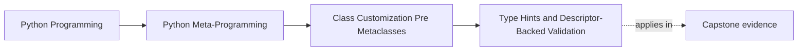
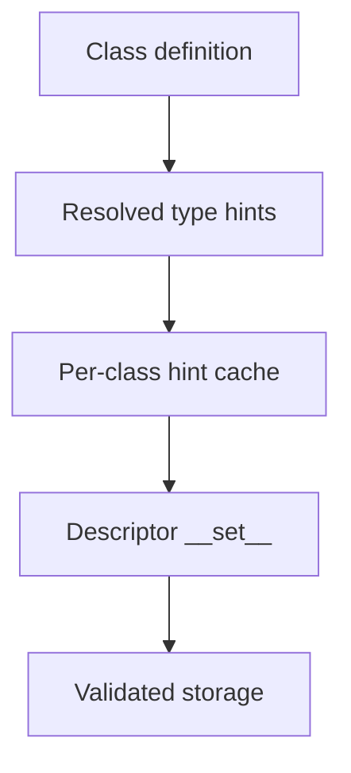

# Type Hints and Descriptor-Backed Validation


<!-- page-maps:start -->
## Page Maps




<!-- page-maps:end -->

Module 06 now has enough machinery in place to use type hints in a more disciplined class
context:

> annotations can act as declarative input for shallow runtime validation, but they still
> do nothing on their own.

That is the boundary this page keeps explicit.

This page should be read as a bridge page. It is not trying to turn type hints into a
runtime type system. It is trying to teach how declared expectations become runtime
behavior only when a real owner, such as a descriptor, takes responsibility for them.

## The sentence to keep

When a class uses type hints for runtime validation, ask:

> where is the actual enforcement happening, and how shallow is the contract?

That question stops annotations from being mistaken for behavior.

Keep a second question beside it:

> which hint shapes are supported deliberately, and which ones must stay refused to keep the contract honest?

## Hints are declarations, not enforcement

At the class level, `get_type_hints(MyClass)` can resolve field annotations into runtime
objects.

That is useful because it gives you a declarative description of expected field types.
It is not useful enough by itself to validate anything.

To enforce behavior, the class still needs a runtime owner, such as:

- a property
- a descriptor
- a validating constructor path

This page focuses on the descriptor route because it scales beyond one property while
still staying below metaclass power.

That owner story is the core teaching move here. The annotation declares. The descriptor
enforces. The class stores. If those roles blur together, the design becomes harder to
review.

## One picture of the typing bridge



Caption: type hints provide declarative input, but the descriptor still owns the runtime enforcement.

## Evidence route for hint-backed validation

Use this route whenever a design starts sounding like annotations are magical:

| Evidence step | What it proves |
| --- | --- |
| class annotations exist | the class declares expected shapes |
| `get_type_hints(MyClass)` resolves them | the declarations become usable runtime objects |
| the class caches those hints | the declaration surface is treated as stable evidence |
| descriptor `__set__` checks assigned values | enforcement happens at the attribute boundary, not inside the annotation itself |

## A minimal `_is_instance` helper stays honest

Like Module 05, this module benefits from a deliberately limited runtime checker:

```python
from typing import Any, Union, get_args, get_origin


def _is_instance(value, hint) -> bool:
    if hint is Any:
        return True

    origin = get_origin(hint)

    if origin is Union:
        return any(_is_instance(value, option) for option in get_args(hint))

    if origin is not None:
        raise NotImplementedError(f"Generic validation not supported: {hint!r}")

    try:
        return isinstance(value, hint)
    except TypeError as exc:
        raise NotImplementedError(f"Unsupported hint: {hint!r}") from exc
```

That helper is intentionally small because the module focuses on a shallow validation
bridge, not a full runtime typing system.

It should also stay loud about what it refuses. Quiet fallback is one of the fastest ways
to make a runtime validation story sound broader than it really is.

## Supported and refused hint shapes

Keep the contract explicit:

| Hint shape | Status in this page's pattern |
| --- | --- |
| plain runtime classes | supported |
| `Union` and `Optional`-style unions | supported |
| `Any` | allowed as passthrough |
| parameterized generics such as `list[int]` | refused |
| richer typing constructs that need framework-level semantics | refused |

## A typed descriptor gives the enforcement a real owner

```python
import sys
from typing import get_type_hints


class TypedDescriptor:
    def __set_name__(self, owner, name):
        self.public_name = name
        self.storage_name = f"_{name}"

        if not hasattr(owner, "_field_hints_cache"):
            owner._field_hints_cache = get_type_hints(
                owner,
                globalns=vars(sys.modules[owner.__module__]),
                localns=dict(owner.__dict__),
            )

    def __get__(self, obj, objtype=None):
        if obj is None:
            return self
        return getattr(obj, self.storage_name)

    def __set__(self, obj, value):
        hints = obj.__class__._field_hints_cache
        expected = hints.get(self.public_name)

        if expected is not None and not _is_instance(value, expected):
            raise TypeError(f"{self.public_name}={value!r} expected {expected!r}")

        setattr(obj, self.storage_name, value)
```

This is a good Module 06 pattern because it makes ownership explicit:

- hints describe the expected shape
- the descriptor performs enforcement
- storage remains visible and local

It also keeps the timing honest. Class annotations are resolved once for the class. Each
assignment is then checked by the descriptor at the moment the attribute boundary is
crossed.

## Per-class caching matters

One subtle but important quality point is:

- resolve type hints once per class
- do not recompute them on every assignment

That is both cleaner and more honest. The class owns a stable declaration surface, so the
validation helper should cache that declaration rather than repeatedly rediscover it.

Use this table when reviewing the cache boundary:

| Choice | Why it is better or worse |
| --- | --- |
| resolve hints once per class | matches the class-level declaration surface and avoids repeated introspection |
| recompute hints on every assignment | wastes work and makes the validation path noisier |
| hide the cache behind vague class state | weakens the evidence trail for reviewers |

## This is still shallow runtime validation

The strongest honest claim here is:

> the descriptor enforces a limited runtime contract for supported hint shapes.

It does not mean:

- full generic validation
- full typing-system enforcement
- zero-cost runtime checking

That narrow claim is exactly what keeps the pattern useful instead of misleading.

## Common overclaims to reject

Reject these sentences when they appear in review:

| Overclaim | Better replacement |
| --- | --- |
| "the annotations validate the fields" | "the descriptor validates assignments using the resolved annotations" |
| "this class is type-safe at runtime" | "this class enforces a shallow supported hint subset at assignment time" |
| "unsupported hints can just be skipped" | "unsupported hints must stay visible as refusals" |
| "caching is just optimization" | "caching is part of keeping the declaration and enforcement story reviewable" |

## Failure modes for hint-backed descriptors

These are the main ways the design can weaken:

| Failure mode | Why it weakens the design | Repair move |
| --- | --- | --- |
| silent fallback on unsupported hints | the contract sounds broader than it is | refuse unsupported shapes explicitly |
| recomputing type hints on every assignment | the owner story becomes noisy and wasteful | cache per class |
| confusing annotation presence with enforcement | readers overtrust the class contract | point directly to `__set__` as the runtime owner |
| broadening the helper until it imitates a full framework | the page stops teaching shallow boundary honesty | keep the supported surface narrow and named |

## Review rules for hint-backed validation

When reviewing hint-backed class validation, keep these questions close:

- where does enforcement actually happen?
- what hint subset is supported, and what is refused explicitly?
- are hints being cached per class instead of recomputed per assignment?
- is the attribute-boundary owner clear: property, descriptor, or constructor?
- has the design grown large enough that a dedicated validation layer would be clearer?
- can another reviewer identify the exact enforcement point without reading the whole class twice?

## Exit check for this page

Before moving on, make sure you can do all of these:

- name the runtime owner that actually enforces the hint-backed rule
- list at least two supported hint shapes and two refused ones
- explain why per-class hint caching is part of the review story, not only a speed tweak
- say when this pattern should stop and give way to a more explicit validation layer

## What to practice from this page

Try these before moving on:

1. Implement a descriptor that validates plain classes plus `Union` or `Optional`.
2. Cache resolved hints on the class and explain why that is better than repeated `get_type_hints` calls.
3. Write down one reason this remains a shallow contract rather than a full runtime type system.

If those feel ordinary, the next step is the bigger boundary question: when are these
class-level tools still enough, and when is the design drifting upward?

## Continue through Module 06

- Previous: [Properties and Attribute-Boundary Control](properties-and-attribute-boundary-control.md)
- Next: [Class Customization Boundaries](class-customization-boundaries.md)
- Return: [Overview](index.md)
- Terms: [Glossary](glossary.md)
