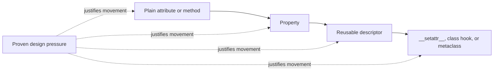
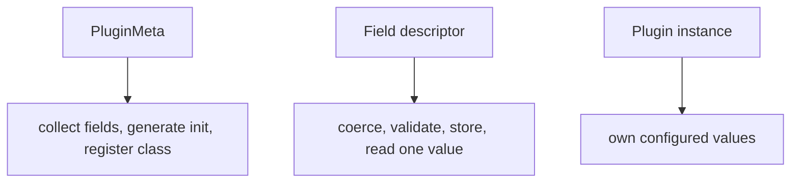

# Descriptor Boundaries and Attribute Ownership

<!-- page-maps:start -->
## Page Maps


<!-- page-maps:end -->

Understanding descriptor mechanics does not justify using them. This core asks whether
attribute access is truly the narrowest owner of the requirement.

## The decision rule

Choose a reusable descriptor when the same attribute-level contract repeats and class
declarations become clearer by naming that contract once.

Two conditions matter:

1. The behavior belongs to reads, writes, or deletes of one attribute.
2. The behavior repeats enough to justify an additional owner object.

Without the first, a descriptor owns the wrong boundary. Without the second, a property
or explicit method is usually easier to review.

## Start from the lowest sufficient power

| Need | Likely owner |
| --- | --- |
| store a value with no access rule | plain attribute |
| perform an explicit operation | method |
| manage one attribute on one class | property |
| reuse one attribute contract across fields or classes | descriptor |
| coordinate all assignments on an object | `__setattr__` |
| inspect or transform a class family during creation | class hook or metaclass |

This is not a ranking of sophistication. It is a map of ownership width.

## A descriptor that earns its place

The lab's `Quantity` is used for repeated quantity fields:

```python
class DeliveryTiming:
    latency = Quantity("s", {"s": 1.0, "ms": 0.001})
    timeout = Quantity("s", {"s": 1.0, "ms": 0.001})
```

Each field needs the same access-time behavior:

- accept a numeric value or `(number, unit)`
- convert on assignment
- store one canonical representation
- return a conversion-capable value
- expose field metadata through class access

A property could implement one field clearly. Repeating two properties would duplicate
the conversion and bounds contract. The descriptor earns its cost through real
repetition.

## A descriptor that does not earn its place

Requirement:

> One `Incident` class needs a display-only `summary` derived from three existing values.

A property is the clearer owner:

```python
@property
def summary(self) -> str:
    return f"{self.severity}: {self.title}"
```

There is no stored field, repeated access contract, or class-level field metadata. A
custom descriptor would introduce a second class only to reproduce property behavior.

“It might be reused later” is not current design pressure.

## Descriptor versus method

Use a method when the operation deserves to be explicit:

```python
incident.render_summary(style="compact")
```

Turning a parameterized or effectful operation into attribute access hides work:

```python
incident.summary
```

Descriptors are especially risky when reads perform I/O, consume iterators, acquire
resources, or mutate unrelated state. Attribute syntax suggests a cheap and repeatable
observation unless the API clearly establishes otherwise.

## Descriptor versus `__setattr__`

`__setattr__` sees all assignments. That makes it useful for object-wide policy and
dangerous for unrelated field rules.

Prefer descriptors when:

- each field owns a different validator
- class declarations should expose those field contracts
- per-field metadata is useful

Prefer `__setattr__` only when the invariant truly spans assignments as a whole, such as
freezing an object after initialization. Even then, document bypass and inheritance
behavior.

## Descriptor versus metaclass

A descriptor runs during attribute access and receives its installation name during
class creation. It cannot by itself:

- choose the namespace used for the class body
- reject duplicate definitions before a dictionary overwrites them
- collect actions and fields across an inheritance family
- generate a constructor for the whole field set
- register the completed class

Those are why the incident-plugin capstone uses `PluginMeta`. Its `Field` objects remain
responsible only for one attribute contract.

The boundary is visible:



## A decision worksheet

Before approving a descriptor, complete this:

| Question | Required answer |
| --- | --- |
| What exact public attribute is managed? | a concrete name or reusable declaration pattern |
| Which hooks are required? | the smallest honest hook set |
| Where do values live? | an exact instance key or external store |
| What repeats? | current fields or classes, not speculative reuse |
| Why is a property too narrow? | a concrete duplication or metadata problem |
| Why is wider machinery excessive? | the need does not span object or class-family behavior |
| What does a read or write cost? | visible computation and effects |

If the repetition row is blank, downgrade the design.

## Maintenance costs to price explicitly

A descriptor adds:

- another object in the ownership chain
- special lookup precedence
- class-access behavior
- storage compatibility decisions
- inheritance and override questions
- more indirect stack traces

Those costs can be worth paying. They are not free because the syntax at the declaration
site looks compact.

## Capstone judgment

The capstone has multiple field kinds—strings, integers, booleans, and choices—used across
several plugins. Each kind owns reusable coercion and validation. Descriptors are
justified.

The capstone does not put registry behavior into `Field.__set_name__`. Registration needs
the complete class, inherited members, and a plugin group. That belongs to `PluginMeta`.

It also does not use a descriptor for action calls. Call entry and metadata preservation
belong to wrappers, which Modules 04 and 05 established.

## Failure routes

Reject these review arguments:

| Claim | Repair |
| --- | --- |
| “Descriptors are cleaner.” | Name the repeated attribute contract and compare code ownership. |
| “A property cannot be reused.” | Show that reuse is currently required. |
| “The metaclass already exists, so it can validate values.” | Keep field access policy on the field owner. |
| “Attribute syntax is convenient for this operation.” | State the hidden cost or effect of the read. |
| “The descriptor prevents invalid state.” | Name bypasses and the exact public operations covered. |

## Exit check

For each requirement below, choose an owner and defend it:

1. one class computes a read-only label
2. six plugin fields coerce bounded integers
3. every assignment must be rejected after initialization
4. duplicate plugin action names must fail during class-body execution
5. an explicit delivery operation performs network I/O

Your defense must reject one lower-power and one higher-power option where applicable.

## Continue through Module 07

- Previous: [Reusable Field Descriptors and Storage](reusable-field-descriptors-and-storage.md)
- Next: [Worked Example: Building a Unit-Aware Quantity Descriptor](worked-example-building-a-unit-aware-quantity-descriptor.md)
