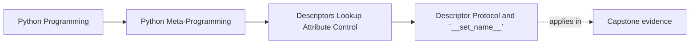

# Descriptor Protocol and `__set_name__`


<!-- page-maps:start -->
## Page Maps




<!-- page-maps:end -->

Module 07 starts by making one thing explicit:

attribute access is a protocol surface, not just a dictionary lookup.

Descriptors are a big part of that protocol.

This page is strongest when read as a protocol review, not as a novelty page. The point
is not that descriptors are exotic. The point is that normal attribute access already
depends on a small set of hooks that you can inspect, name, and review.

## The sentence to keep

A descriptor is any object stored on a class that defines `__get__`, `__set__`, or
`__delete__`, and Python consults those hooks during attribute access instead of always
returning the raw class attribute.

That is the foundation the rest of the module depends on.

Keep a second sentence beside it:

> `__set_name__` helps a descriptor configure itself, but it does not make the object a descriptor by itself.

That distinction matters because "name-aware" and "descriptor" are not interchangeable.
If a review blurs them together, the real protocol boundary disappears immediately.

## The four hooks in one place

The full descriptor surface for this module is:

- `__get__(self, obj, owner=None)` for reads
- `__set__(self, obj, value)` for writes
- `__delete__(self, obj)` for deletes
- `__set_name__(self, owner, name)` for class-creation-time self-configuration

Only the first three participate in making an object a descriptor.

`__set_name__` matters because reusable descriptors often need to learn:

- the owning class
- the public attribute name
- the private storage name they should use internally

Use this split when you inspect a descriptor for the first time:

| If you are asking... | Look at... |
| --- | --- |
| is this object actually a descriptor? | `__get__`, `__set__`, `__delete__` |
| how did it learn the field name? | `__set_name__` |
| what behavior does it own? | the exact read/write/delete hook that implements it |

## Which hook answers which question

Use this table when a descriptor starts sounding fuzzier than it should:

| Hook | Review question it answers |
| --- | --- |
| `__get__` | what should reads through this attribute return? |
| `__set__` | what rule governs assignment to this attribute? |
| `__delete__` | what does deletion mean or refuse to mean here? |
| `__set_name__` | how does the descriptor learn where it was installed? |

## What each hook is really for

Keep the jobs separate:

- `__get__` decides what `obj.attr` or `Cls.attr` should return
- `__set__` decides what happens when code assigns `obj.attr = value`
- `__delete__` decides what `del obj.attr` means
- `__set_name__` lets the descriptor configure itself once when the class is created

That separation matters because many production descriptors use only two or three of these
hooks, not all four.

Readers need this separation early because weak explanations often collapse all descriptor
behavior into one vague phrase like "it intercepts the attribute." Strong explanations
name the exact hook and the exact boundary.

## A proof route for protocol status

Use this route whenever a class attribute starts sounding mystical:

1. confirm the object is stored on the class
2. inspect whether any of `__get__`, `__set__`, or `__delete__` exist
3. inspect whether `__set_name__` also exists
4. name which read, write, delete, or naming boundary each hook actually owns

If step 2 fails, the object may still be useful, but it is not a descriptor yet.

## A small but important clarification

`__set_name__` alone does not make something a descriptor.

This object:

```python
class NameAwareOnly:
    def __set_name__(self, owner, name):
        self.name = name
```

is name-aware, but it is not a descriptor until it also defines `__get__`, `__set__`, or
`__delete__`.

That distinction prevents a lot of fuzzy explanations later.

It also prevents a common teaching error: treating `__set_name__` as if it were a hidden
activation switch. It is a configuration hook, not proof of descriptor status.

That is also why returning to the class body matters. The class installs the object; the
protocol hooks decide whether attribute access becomes descriptor-driven afterward.

## The default pipeline still begins with `__getattribute__`

Even though Module 07 is about descriptors, instance lookup still begins here:

```python
obj.__getattribute__("attr")
```

The key point is that `object.__getattribute__` applies descriptor rules as part of the
default lookup pipeline.

So the useful mental model is:

```text
attribute access
  -> default __getattribute__
  -> descriptor / instance dictionary / class lookup rules
```

Keep one more sentence attached to that model:

> descriptor behavior is part of normal attribute access, not a separate metaprogramming subsystem that only frameworks use.

Later modules may discuss overrides of `__getattribute__`, but here the goal is to master
the default behavior first.

## Evidence route for protocol reviews

Use this route whenever attribute access starts sounding mystical:

| Evidence step | What it proves |
| --- | --- |
| the object is stored on the class | descriptor protocol can participate |
| one of `__get__`, `__set__`, `__delete__` exists | the object is actually a descriptor |
| `object.__getattribute__` drives default lookup | descriptor behavior is part of normal attribute access |
| `obj is None` on class access | the descriptor can choose a class-level review surface |

## A compact descriptor example

```python
class IntegerField:
    def __set_name__(self, owner, name):
        self.public_name = name
        self.private_name = f"_{name}"

    def __get__(self, obj, owner=None):
        if obj is None:
            return self
        return obj.__dict__.get(self.private_name, 0)

    def __set__(self, obj, value):
        if not isinstance(value, int):
            raise TypeError(f"{self.public_name} must be an int")
        obj.__dict__[self.private_name] = value


class Counter:
    count = IntegerField()


c = Counter()
c.count = 3
print(c.count)  # 3
```

This example is small, but it already shows the module's main mechanics:

- class-level installation
- name learning through `__set_name__`
- per-instance storage in `obj.__dict__`
- validation at the attribute boundary

It also gives the reader a real owner story:

- the class owns installation
- `__set_name__` owns field naming
- `__set__` owns validation
- the instance dictionary owns the stored value

## Why class access usually returns the descriptor itself

A common convention is:

```python
if obj is None:
    return self
```

inside `__get__`.

That makes class access such as `Counter.count` return the descriptor object itself so
review, debugging, and introspection can still see the configured field owner.

It is not the only possible design, but it is the standard one and the clearest default.

Returning `self` on class access matters because it leaves a review surface behind. A
descriptor that hides itself on class access is often harder to inspect, debug, or explain
to a learner reading the class definition.

## A class-access review card

When a descriptor chooses what to return for `Class.field`, ask:

| Question | Why it matters |
| --- | --- |
| can a learner still inspect the configured field owner? | class access should usually leave an evidence surface behind |
| does class access return the descriptor, metadata, or something more surprising? | reviewability depends on that choice |
| would debugging become harder if the descriptor hid itself? | invisible owners are expensive to trace later |

## Which hooks matter most in practice

The hooks are not equally common:

- `__get__` appears in almost every useful descriptor
- `__set__` is common for validators, coercion, and field systems
- `__set_name__` is very common in modern reusable descriptors
- `__delete__` is comparatively rare

That matters because beginners sometimes assume a descriptor is incomplete unless it
implements every hook. It is not.

Descriptors should be judged by honest ownership, not by hook count.

## Minimal hook sets worth recognizing

Use these as quick classification anchors:

| Shape | What it usually means |
| --- | --- |
| `__get__` only | readable non-data descriptor surface |
| `__get__` plus `__set__` | data descriptor with write ownership |
| `__get__` plus `__set_name__` | readable descriptor that also derives installation metadata |
| `__set_name__` only | name-aware helper, not a descriptor by protocol status |

## What not to do with descriptor state

One of the earliest descriptor mistakes is storing per-instance values on the descriptor
object itself.

That is wrong because the descriptor instance usually lives on the class and is shared by
every object of that class.

Bad pattern:

```python
class BrokenField:
    def __init__(self):
        self.value = None
```

That shape almost always means instance state will leak across objects.

Module 07 will come back to storage patterns in detail, but the rule starts here:

store per-instance state on the instance or in safe external storage, not on the
descriptor itself.

## Evidence packet for protocol reviews

Leave this page with a small packet:

- one object that is a descriptor and one object that is only name-aware
- one exact hook mapped to one exact boundary it owns
- one class-access example showing what `obj is None` returns
- one note naming where per-instance state should live and why the descriptor object itself is the wrong place

## Common overclaims to reject

Reject these descriptions when they appear in review:

| Overclaim | Better replacement |
| --- | --- |
| "`__set_name__` makes this object a descriptor" | "`__set_name__` configures a descriptor or name-aware helper after class creation" |
| "the descriptor handles the attribute" | "the descriptor handles reads, writes, deletes, or naming through specific hooks" |
| "class access just gives the field" | "class access usually exposes the descriptor object for review or alternate behavior" |
| "descriptors need all four hooks" | "descriptors need only the hooks required by the owned boundary" |

## Failure modes for protocol explanations

These are the mistakes this page is trying to prevent:

| Failure mode | Why it weakens the design | Repair move |
| --- | --- | --- |
| treating `__set_name__` as sufficient for descriptor status | readers lose the real protocol boundary | name the actual read/write/delete hooks |
| storing instance values on the descriptor object | state leaks across instances | move state to the instance or safe external storage |
| hiding class-access behavior | debugging and inspection become weaker | explain or preserve the `obj is None` branch |
| using generic "intercepts the attribute" language | the owner story becomes vague | say which hook owns which boundary |

## Review rules for the protocol

When reviewing descriptor code, keep these questions close:

- which of the protocol hooks are actually implemented?
- does the code know that `__set_name__` is supportive, not sufficient?
- where does per-instance state live?
- what happens on class access when `obj is None`?
- is this really attribute-boundary behavior, or is a simpler method or property enough?
- can another reviewer point to the exact hook that owns the behavior in question?

## Exit check for this page

Before moving on, make sure you can do all of these:

- explain why `__set_name__` is helpful but not sufficient
- name the exact hook used for one read boundary and one write boundary
- explain what class access usually returns and why that matters for review
- say where per-instance state should live in a well-behaved field descriptor

## What to practice from this page

Try these before moving on:

1. Write one descriptor that only defines `__get__` and explain why it is still a descriptor.
2. Add `__set_name__` to a reusable field and show how it removes hard-coded attribute names.
3. Inspect one class access such as `MyClass.field` and explain why returning the descriptor object is useful.

If those feel ordinary, the next step is precedence: why some descriptors beat instance
state while others can be shadowed.

## Continue through Module 07

- Previous: [Overview](index.md)
- Next: [Data and Non-Data Descriptor Precedence](data-and-non-data-descriptor-precedence.md)
- Practice: [Exercises](exercises.md)
- Terms: [Glossary](glossary.md)
