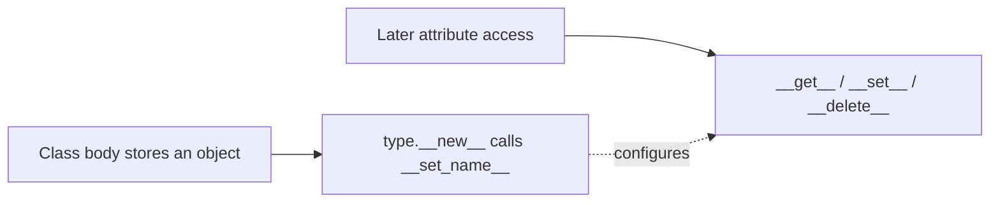

# Descriptor Protocol and `__set_name__`

<!-- page-maps:start -->
## Page Maps


<!-- page-maps:end -->

The first descriptor mistake is to treat every class-level helper as a descriptor. The
second is to treat `__set_name__` as the switch that activates descriptor behavior.
Those claims blur two different times and two different responsibilities.

## The claim

An object participates in descriptor lookup when its type defines `__get__`, `__set__`,
or `__delete__`. `__set_name__` is a class-creation callback that can configure that
object, but it does not make the object a descriptor.

That distinction gives us two questions:

| Question | Evidence |
| --- | --- |
| did the object learn where the class installed it? | `__set_name__` and its recorded names |
| can the object participate in later attribute access? | `__get__`, `__set__`, or `__delete__` on its type |

## Start with the counterexample

The lab ships a `NameAware` object:

```python
class NameAware:
    def __init__(self) -> None:
        self.owner_name = ""
        self.public_name = ""

    def __set_name__(self, owner: type[object], name: str) -> None:
        self.owner_name = owner.__name__
        self.public_name = name
```

Install it on a class:

```python
class Delivery:
    marker = NameAware()
```

After class creation, `vars(Delivery)["marker"]` knows the owner and public name. Normal
instance lookup still treats it as a plain class value because its type defines none of
the three descriptor access hooks.

Run:

```bash
make descriptor-lookup-lab
```

The `protocol.name_aware` packet reports:

```json
{
  "descriptor_type": "NameAware",
  "has_delete": false,
  "has_get": false,
  "has_set": false,
  "has_set_name": true,
  "kind": "not-a-descriptor"
}
```

This is the failure case the prose-only version of the lesson could describe but not
prove.

## Inspect the type, not an invented label

Python's special-method machinery consults the type of the class attribute. The lab's
`inspect_descriptor_protocol` therefore checks `type(value)`:

```python
owner = type(value)
has_get = hasattr(owner, "__get__")
has_set = hasattr(owner, "__set__")
has_delete = hasattr(owner, "__delete__")
```

The resulting category is mechanical:

| Hook set | Classification |
| --- | --- |
| no access hooks | not a descriptor |
| `__get__` only | non-data descriptor |
| `__set__` or `__delete__` | data descriptor |

The label “field,” “managed,” or “important” has no effect on the category.

## Trace the shipped data descriptor

`StoredField` owns reads and writes:

```python
class StoredField:
    def __set_name__(self, owner, name):
        self.public_name = name
        self.storage_name = f"_{name}"

    def __get__(self, instance, owner=None):
        if instance is None:
            return self
        try:
            return vars(instance)[self.storage_name]
        except KeyError as error:
            raise AttributeError(f"{self.public_name} is unset") from error

    def __set__(self, instance, value):
        vars(instance)[self.storage_name] = value
```

Timing and ownership are now explicit:

1. The class body creates one `StoredField`.
2. `type.__new__` creates the owner class.
3. Class creation calls `StoredField.__set_name__` once for that installation.
4. `Delivery.endpoint` calls `__get__(None, Delivery)` and returns the descriptor.
5. `delivery.endpoint = value` calls `__set__`.
6. `delivery.endpoint` calls `__get__(delivery, Delivery)`.

The descriptor object owns configuration and access behavior. The delivery instance owns
the stored value under `_endpoint`.

## Why class access returns the descriptor

The `instance is None` branch is not boilerplate to copy without thought. It defines the
public class-level surface.

Returning `self` makes this possible:

```python
descriptor = Delivery.endpoint
assert descriptor is vars(Delivery)["endpoint"]
assert descriptor.storage_name == "_endpoint"
```

That is useful for documentation, schema generation, debugging, and the capstone
metaclass. A descriptor could return other metadata on class access, but doing so should
be a deliberate API decision because it hides the actual owner.

## Failure: per-instance state on the shared descriptor

This implementation is wrong:

```python
class BrokenField:
    def __set__(self, instance, value):
        self.value = value
```

There is normally one `BrokenField` in the class dictionary and many owner instances.
`self.value` therefore becomes shared state. The protocol hook is correct; the storage
owner is not.

The lab's test uses two owner instances and asserts two different dictionaries:

```python
assert vars(first) == {"_endpoint": "https://one.test"}
assert vars(second) == {"_endpoint": "https://two.test"}
```

That test proves independence. A single-instance example cannot.

## What the protocol evidence proves

It proves:

- `__set_name__` ran during owner-class creation
- `NameAware` is still not a descriptor
- `StoredField` is a data descriptor
- class access exposes the installed descriptor
- instance values live under derived storage names

It does not prove:

- that every descriptor should use `__dict__`
- that custom `__getattribute__` implementations preserve ordinary lookup
- that a field's validation policy is correct
- that descriptor reuse is justified

Those questions belong to later cores.

## Capstone connection

The capstone `Field` uses the same hook split:

- `__set_name__` records `name` and `storage_name`
- `__get__` owns reads and class inspection
- `__set__` owns coercing writes

`PluginMeta` can collect the field because class access exposes the descriptor object.
The descriptor does not own plugin registration, constructor generation, or action
dispatch. Those remain class-family responsibilities.

## Review checklist

Before accepting a descriptor explanation, ask:

- Which class dictionary holds the descriptor object?
- Which access hooks exist on its type?
- When did `__set_name__` run?
- What does class access return?
- Where are values stored for two different instances?
- Which guarantee is outside this object's ownership?

## Practice before continuing

Open `labs/descriptor_lookup/protocol.py` and make one prediction before running its tests:

```bash
python3 -m unittest discover -s tests \
  -p "test_descriptor_protocol_lab.py" -v
```

Then explain why removing `StoredField.__set__` changes both its category and the next
core's precedence result.

## Continue through Module 07

- Previous: [Module 07 Overview](index.md)
- Next: [Data and Non-Data Descriptor Precedence](data-and-non-data-descriptor-precedence.md)
