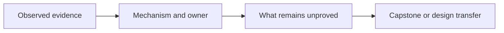
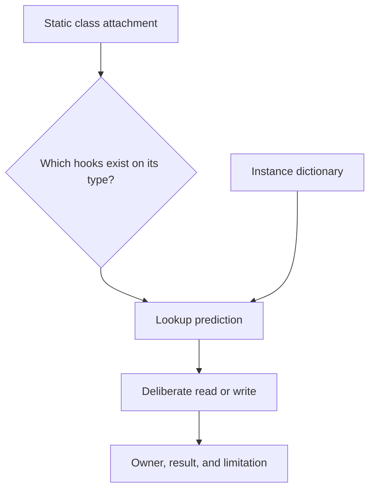

# Exercise Answers: Descriptor Evidence Studio Review

<!-- page-maps:start -->
## Page Maps


<!-- page-maps:end -->

Use these answers to review reasoning, not to compare prose word for word. A defensible
answer names timing, owner, public surface, proof, and limitation.

The answer review should connect evidence back to ownership:



## Answer 1: Naming is not descriptor status

A protocol inventory can be built from the installed objects:

```python
marker = vars(Delivery)["marker"]
field = vars(Delivery)["endpoint"]

marker_protocol = inspect_descriptor_protocol(marker)
field_protocol = inspect_descriptor_protocol(field)
```

Expected conclusion:

| Object | `__set_name__` | Access hooks | Classification |
| --- | --- | --- | --- |
| `NameAware` | yes | none | not a descriptor |
| `StoredField` | yes | `__get__`, `__set__` | data descriptor |

Reasoning:

- both objects receive names during owner-class creation
- only `StoredField` participates in later attribute access
- `__set_name__` configures installation; access hooks establish protocol status

Common wrong turn:

> `NameAware` is a non-data descriptor because it does not define `__set__`.

Why it fails: a non-data descriptor still needs `__get__`.

What this proves:

- the hook sets and installation names of these exact objects

What it does not prove:

- that name-aware helpers are useless
- that every descriptor needs `__set_name__`

Capstone transfer:

`Field.__set_name__` records metadata, while `Field.__get__` and `Field.__set__` own
access.

## Answer 2: Predict lookup before execution

A valid fourth class value is:

```python
fallback = ShadowableValue("fallback-descriptor")
```

With no `vars(delivery)["fallback"]`, the prediction is
`"non-data-descriptor"`. The complete table is:

| Name | Category | Public instance entry | Winner |
| --- | --- | --- | --- |
| `enforced` | data | yes | data descriptor |
| `shadowable` | non-data | yes | instance dictionary |
| `fallback` | non-data | no | non-data descriptor |
| `category` | neither | no | class attribute |

Reasoning:

The descriptor category is determined before deciding where a non-data descriptor sits
relative to instance state. Private `_enforced` storage does not count as a same-named
public entry.

Common wrong turn:

> The instance dictionary wins whenever the name exists there.

Why it fails: data descriptors are checked first.

What this proves:

- the lab predictor agrees with ordinary lookup for these cases

What it does not prove:

- custom `__getattribute__` behavior
- `__getattr__` fallback behavior

Capstone transfer:

Capstone fields are data descriptors, so a public instance entry cannot shadow their
normal reads.

## Answer 3: Binding without action execution

One review route:

```python
plugin = ConsoleNotifier()
static_value = inspect.getattr_static(ConsoleNotifier, "deliver")
bound = plugin.deliver

assert bound.__func__ is static_value
assert bound.__self__ is plugin
assert plugin.action_history() == []
```

Reasoning:

- the action decorator owns the wrapper function and `ActionSpec`
- the function type's `__get__` owns binding
- the plugin instance becomes the method receiver
- retrieving the method does not invoke it

Common wrong turn:

> `PluginMeta` binds the method because it collected the action.

Why it fails: collection happens during class creation; binding happens during instance
attribute access.

What this proves:

- function and receiver identities
- absence of action execution at inspection time

What it does not prove:

- successful delivery behavior
- metadata preservation beyond the inspected identities

Capstone transfer:

Use `action-wrapper` for wrapper ownership and method identity for binding ownership.
They answer different questions about the same public name.

## Answer 4: Extend quantity conversion

A valid declaration is:

```python
class DeliveryTiming:
    timeout = Quantity(
        "s",
        {"s": 1.0, "ms": 0.001, "min": 60.0},
        minimum=0.0,
        maximum=300.0,
    )
```

Focused proof:

```python
first = DeliveryTiming()
second = DeliveryTiming()
first.timeout = (2, "min")
second.timeout = 30

assert vars(first) == {"_timeout_canonical": 120.0}
assert vars(second) == {"_timeout_canonical": 30.0}
assert first.timeout.in_unit("min") == 2.0

with self.assertRaisesRegex(ValueError, "must be <= 300.0 s"):
    first.timeout = (6, "min")
```

Reasoning:

Bounds apply after conversion because storage and comparison use canonical seconds.

Common wrong turn:

> Compare `6` with `300` before applying the unit.

Why it fails: six minutes is 360 canonical seconds.

What this proves:

- minutes use the declared factor
- range checks use canonical values
- two instances remain independent

What it does not prove:

- decimal-exact conversion
- parsing strings such as `"2 min"`

Application connection:

The capstone field family similarly coerces before storing, but it does not model units.

## Answer 5: Schema and ownership are complementary

`make capstone-field` answers:

> What public configuration contract does `endpoint` export?

It reports name, kind, description, required/default status, and minimum length.

`make capstone-field-ownership` answers:

> Which runtime objects implement that contract?

It reports:

```json
{
  "declaring_class": "WebhookNotifier",
  "descriptor_kind": "data",
  "descriptor_type": "StringField",
  "hooks": ["__get__", "__set__", "__set_name__"],
  "storage_name": "_endpoint",
  "storage_owner": "plugin-instance.__dict__",
  "constructed": false,
  "executed": false
}
```

Reasoning:

Schema is a public declaration. Ownership evidence explains the mechanism behind it.
Neither output substitutes for the field tests that execute coercion and rejection.

Common wrong turn:

> Because the metaclass collected the field, the metaclass owns validation.

Why it fails: `PluginMeta` owns collection and constructor generation; `StringField`
owns coercion, validation, reads, and writes.

What this proves:

- static descriptor ownership without plugin construction

What it does not prove:

- that every raw value is accepted or rejected correctly
- that direct private storage mutation is impossible

## Answer 6: Ownership review

| Requirement | Chosen owner | Rejected owner | Deciding pressure |
| --- | --- | --- | --- |
| one class computes a display label | property | custom descriptor | no reuse or stored-field contract |
| many plugin classes reuse bounded integers | descriptor | repeated properties | repeated field semantics and metadata |
| all assignments fail after initialization | `__setattr__` or a bounded freezing policy | one descriptor per field | rule spans the whole object |
| duplicate fields fail during class-body execution | prepared namespace or metaclass | descriptor | failure must happen before duplicate dictionary state is lost |
| one method performs delivery I/O | method | descriptor property | effect must remain explicit |

Reasoning:

Each owner matches the time and width of the requirement. The descriptor row is the only
one whose rule is both attribute-local and repeated.

Common wrong turn:

> Use descriptors for every row because the module is about descriptors.

Why it fails: mechanism practice without ownership judgment creates over-engineered APIs.

What this proves:

- the reviewer can place requirements on the power ladder

What it does not prove:

- that the chosen production implementation handles every inheritance or concurrency
  concern

Capstone transfer:

The capstone uses all three relevant owners deliberately: descriptors for fields,
wrappers for actions, and a metaclass for class-family creation.

## Final review standard

A complete studio packet should make these statements defensible:

- `__set_name__` and descriptor status occur at different boundaries
- data/non-data precedence predicts a concrete conflict
- method binding retains inspectable function and receiver identities
- descriptor configuration is shared while instance values are not
- the quantity example earns reuse through repeated field semantics
- capstone field schema and capstone ownership evidence answer different questions

If your packet states only results, add the owner and timing. If it states only mechanism,
add the design judgment and limitation.

## Continue through Module 07

- Previous: [Exercises](exercises.md)
- Return: [Module 07 Overview](index.md)
- Terms: [Glossary](glossary.md)
