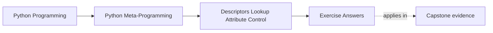

# Exercise Answers


<!-- page-maps:start -->
## Page Maps




<!-- page-maps:end -->

Use this page after attempting the exercises yourself. The point is not to match every
example literally. The point is to compare your reasoning against answers that keep
descriptor mechanics, storage, and ownership boundaries honest.

Treat each answer as a review calibration, not as a final form to imitate blindly. A
strong answer names the winning lookup step, the storage owner, and the rejected
alternatives in plain language. A weak answer may look technically competent while still
hiding where the real rule lives.

Use this page actively:

- compare your winning lookup step against the reference answer
- compare your storage owner against the reference answer
- compare your rejected lower-power and stronger alternatives against the reference answer

If you only compare final mechanism choices, you will miss the teaching point.

## Answer 1: Build one minimal descriptor on purpose

Example answer:

```python
class UpperName:
    def __get__(self, obj, owner=None):
        if obj is None:
            return self
        return obj.__dict__.get("_name", "").upper()
```

Good conclusion:

This is still a descriptor because `__get__` alone is enough. It does not need `__set__`
or `__delete__` if the design only cares about reads, and class access returns the
descriptor itself for inspection.

Weak answer to reject:

- "`__set_name__` would be enough because the object knows its field name"

Why it fails:

- name awareness is not the same thing as descriptor protocol status

Reasoning checkpoint:

- can you name the exact read boundary this hook owns?
- can you say which extra hook would be the first honest expansion only if the requirement changed?

## Answer 2: Show precedence with two concrete cases

Example answer:

For a data descriptor:

- `obj.__dict__["value"] = 999` does not bypass a descriptor that defines `__set__`

For a non-data descriptor:

- an instance assignment like `obj.value = 999` places a same-named entry in `obj.__dict__`
- later reads return that instance value instead of calling the descriptor

Good conclusion:

The outcomes differ because data descriptors beat the instance dictionary, while non-data
descriptors yield to it.

Weak answer to reject:

- "Python preferred the descriptor because descriptors are more powerful"

Why it fails:

- power language replaces the actual precedence rule

Reasoning checkpoint:

- can you point to the exact public name being resolved?
- can you name the evidence that proves which side won in each case?

## Answer 3: Explain ordinary method binding

Example answer:

- `Class.method` returns the underlying function object
- `obj.method` returns a bound method object
- the bound method exposes `__func__` for the original function and `__self__` for the instance

Good conclusion:

Method binding is descriptor behavior, not special syntax magic. Functions on classes are
non-data descriptors whose `__get__` logic produces bound methods on instance access.

Weak answer to reject:

- "instance access just adds `self` automatically"

Why it fails:

- automatic language hides the binding object and the descriptor step

Reasoning checkpoint:

- can you explain why `Class.method` does not bind?
- can you say what `__func__` and `__self__` prove about the result?

## Answer 4: Build one reusable validating field

Example answer:

```python
class PositiveInt:
    def __set_name__(self, owner, name):
        self.public_name = name
        self.private_name = f"_{name}"

    def __get__(self, obj, owner=None):
        if obj is None:
            return self
        return obj.__dict__.get(self.private_name, 0)

    def __set__(self, obj, value):
        number = int(value)
        if number < 0:
            raise ValueError(f"{self.public_name} must be non-negative")
        obj.__dict__[self.private_name] = number
```

Good conclusion:

`__set_name__` removes hard-coded field names, and the stored values live on the instance,
not on the descriptor object.

Weak answer to reject:

- "the descriptor is small, so holding the value there is fine"

Why it fails:

- shared descriptor objects stay shared regardless of size

Reasoning checkpoint:

- can you identify the configuration that stays on the descriptor object?
- can you explain what would leak if the value moved there too?

## Answer 5: Reject one bad storage design

Example answer:

Broken design:

```python
class BrokenField:
    def __init__(self):
        self.value = None
```

Leak example:

- assigning through one instance changes what another instance later reads

Safer redesign:

- store by private name in `obj.__dict__`
- or use `WeakKeyDictionary` when slotted instances need external storage

Good conclusion:

The descriptor object is shared at the class level, so descriptor-held field values are
usually shared-state bugs waiting to happen.

Weak answer to reject:

- "`id(obj)` solves the problem completely"

Why it fails:

- identity reuse and stale mapping state still leave the design fragile

Reasoning checkpoint:

- can you name one concrete cross-instance leak scenario?
- can you explain why `id(obj)` storage is still a weak repair even if it appears to separate instances?

## Answer 6: Place one field rule on the ownership ladder

Example answer:

Requirement:

- every `email` field across several model classes should normalize to lowercase and reject blank values

Best owner:

- reusable descriptor

Rejected stronger option:

- a metaclass is unnecessary because the problem is field behavior, not class-creation control

Rejected weaker option:

- a single property on one class would not scale cleanly across several repeated fields

Good conclusion:

Strong answers justify the chosen owner by naming both the repeated field semantics and
the clearer alternatives that were rejected.

Weak answer to reject:

- "the descriptor is more reusable, so I chose it"

Why it fails:

- reuse has to be present in the actual requirement, not just possible in theory

Reasoning checkpoint:

- can you name one rejected stronger option and one rejected weaker option?
- can you say what real reuse pressure made the descriptor worth keeping?

## Answer 7: Trace one attribute lookup from class to instance

Example answer:

Suppose:

- `Account.balance` is a descriptor
- `acct.__dict__` may also contain a stored backing name such as `"_balance"`

Strong explanation:

- Python starts with the attribute name on the class
- if the class attribute is a data descriptor, it wins before direct instance-dictionary lookup
- if it is only a non-data descriptor, a same-named instance entry can shadow it
- the descriptor may then choose to read or write the backing value stored on the instance

Good conclusion:

The lookup result is determined by precedence rules, not by mystery. The key review
question is always which object owns the name and which rule wins first.

Weak answer to reject:

- "the instance somehow won"

Why it fails:

- "somehow" means the lookup order was never made explicit

Reasoning checkpoint:

- can you narrate the lookup order step by step?
- can you identify where instance storage participates and where it does not?

## Answer 8: Replace one unnecessary descriptor with a lower-power owner

Example answer:

Requirement:

- one `price` field in one class should reject negative values

Better owner:

- a property

Strong explanation:

- the rule applies to one field in one class
- reuse pressure is low
- a descriptor would introduce an extra abstraction layer without making ownership clearer

Good conclusion:

Descriptors earn their keep when attribute behavior repeats or must be shared. Without
that reuse pressure, a property keeps the boundary easier to read and teach.

Weak answer to reject:

- "a descriptor would future-proof the class"

Why it fails:

- speculative reuse is not current reuse pressure

Reasoning checkpoint:

- can you name the one-attribute owner that would be clearer here?
- can you say what descriptor power would add without adding clarity?

## Answer 9: Compare honest descriptor claims with overstated claims

Example answer:

Honest description:

- "This descriptor enforces a non-empty string rule whenever the attribute is assigned."

Overstated description:

- "This descriptor guarantees clean user data everywhere."

Good conclusion:

The second version is misleading because "guarantees" and "everywhere" imply broader
system-wide control than an attribute assignment boundary can actually provide.

Weak answer to reject:

- "the stronger wording is acceptable if the team knows what I mean"

Why it fails:

- review language has to survive readers who only have the text, not the author's intent

Reasoning checkpoint:

- can you point to the inflated words in the bad claim?
- can you replace them with a narrower useful sentence?

## Answer 10: Produce a descriptor-boundary packet

The packet is strong when another learner can answer:

- which attribute rule the descriptor owns
- which lookup precedence rule explains the result
- where per-instance state lives
- when a simpler owner would have been clearer

Add one more packet test:

- could a reviewer identify both the winning lookup step and the storage owner without reading the implementation twice?

Use one more packet test:

- could a missed-class learner explain why at least three stronger or weaker alternatives were rejected without reopening the whole module?

## Repair moves for weak answer keys

If your answer key still feels shallow, use these repair moves:

| Weak answer habit | Repair move |
| --- | --- |
| saying only "the descriptor wins" | name the precedence rule and the evidence step |
| describing storage vaguely | point to `obj.__dict__`, weak-key storage, or the broken shared object directly |
| using "magic" to explain binding | point to `__get__`, `__func__`, and `__self__` |
| choosing descriptors because they are advanced | name the actual reuse pressure and the rejected lower-power owner |
| describing every field rule as descriptor-worthy | explain when one property would stay clearer |

## Cross-answer habits to inspect

Before you leave the answer key, scan your own work for these:

| If your packet keeps doing this... | Repair it by... |
| --- | --- |
| naming mechanisms without naming winners | add the winning lookup step explicitly |
| naming hooks without naming storage | add one sentence that says where the live value actually resides |
| naming descriptors without naming rejected alternatives | add one lower-power rejection and one stronger-power rejection where relevant |

## What strong Module 07 answers have in common

Across the whole set, strong answers share the same habits:

- they explain lookup mechanically
- they distinguish data descriptors from non-data descriptors precisely
- they keep state ownership explicit
- they choose descriptor power only when a field-level boundary truly needs it
- they can narrate lookup order without magical phrasing
- they leave behind a packet another learner can review without guessing

If an answer still sounds like "descriptors are advanced so they fit here," revise it
until you can say exactly what attribute rule they own and why.

## Exit check for the answer key

Before leaving this page, make sure you can do all of these:

- identify the winning lookup step in every precedence-focused answer
- identify the storage owner in every reusable-field answer
- name one rejected lower-power alternative in every ownership-focused answer
- explain one case where descriptor power is justified and one where it is not

## Continue through Module 07

- Previous: [Exercises](exercises.md)
- Return: [Overview](index.md)
- Next module: [Module 08](../module-08-descriptor-systems-validation-framework-design/index.md)
- Terms: [Glossary](glossary.md)
