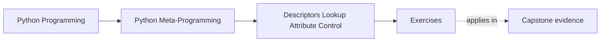

# Exercises

<!-- page-maps:start -->
## Page Maps

<!-- page-maps:end -->

Use these after reading the five core lessons and the worked example. The goal is not to
memorize descriptor trivia. The goal is to make protocol hooks, precedence, storage, and
ownership boundaries explicit.

Each exercise asks for three things:

- the attribute behavior or invariant you are trying to explain or enforce
- the descriptor or lower-power tool you chose
- the reason that choice is the clearest owner

Treat the ten exercises as one full lab day on descriptors, lookup, and attribute control.

This is not a "write ten descriptors" worksheet. It is a lookup-and-ownership review lab.
A weak answer can still run and still fail the learning goal if it hides the winning
lookup step, the storage owner, or the lower-power alternative that should have stayed in
place.

Do them in order:

- Exercises 1-3 establish minimal descriptors, precedence, and method binding as ordinary descriptor behavior
- Exercises 4-6 move into reusable fields, storage safety, and ownership selection
- Exercises 7-8 extend that discipline into lookup tracing and lower-power alternatives
- Exercises 9-10 package the whole module into a reviewable descriptor-boundary packet

Keep one descriptor-boundary table while you work:

| Attribute rule or lookup question | Owner you chose | What lookup or storage rule matters | What stronger power was rejected | Review judgment |
| --- | --- | --- | --- | --- |

Keep one second table beside it:

| Exercise | Evidence the reviewer can inspect | Storage owner | Lower-power alternative considered | Stronger power rejected |
| --- | --- | --- | --- | --- |

## Evidence discipline for the whole exercise set

Do not hand in answers that stop at "the descriptor handles it" or "Python binds it."

Across the set, your packet should name:

- the winning hook or lookup step
- the exact storage owner, if any value is retained
- one lower-power owner you considered first
- one stronger mechanism you rejected because the need did not justify it

## Exercise 1: Build one minimal descriptor on purpose

Write a descriptor that implements one narrow behavior using the smallest useful set of
hooks.

What to hand in:

- the hooks you implemented
- one sentence explaining why those hooks are enough
- one sentence explaining what class access returns
- one sentence naming the first extra hook you would add only if the boundary actually needed it

Verification hint:

- confirm whether the object is still a descriptor if you remove every hook except the one you claim is sufficient

## Exercise 2: Show precedence with two concrete cases

Build or inspect one data descriptor and one non-data descriptor.

What to hand in:

- one case where the descriptor beats `obj.__dict__`
- one case where `obj.__dict__` shadows the descriptor
- one explanation of why the results differ
- one sentence naming the exact evidence that proves which side won in each case

Verification hint:

- inspect the exact public name in both the class and the instance dictionary before narrating the winner

## Exercise 3: Explain ordinary method binding

Use one small class with an instance method and inspect the method through both the class
and an instance.

What to hand in:

- what `Class.method` gives you
- what `obj.method` gives you
- one explanation using `__func__` and `__self__`
- one sentence naming why the result counts as descriptor behavior rather than special method syntax

Verification hint:

- show both the unbound class attribute and the bound instance result side by side

## Exercise 4: Build one reusable validating field

Implement one field descriptor such as `NonEmptyString`, `PositiveInt`, or `Choices`.

What to hand in:

- the field rule it enforces
- how `__set_name__` helps the implementation
- where per-instance state is stored
- one sentence explaining what bug would appear if the stored value lived on the descriptor object instead

Verification hint:

- use two instances so you can prove the chosen storage does or does not leak across objects

## Exercise 5: Reject one bad storage design

Take a descriptor design that stores values on the descriptor object itself and explain why
it fails.

What to hand in:

- the broken storage approach
- one concrete example of state leaking across instances
- one safer replacement using either `obj.__dict__` or weak-reference storage
- one sentence naming why `id(obj)` storage is still a weak repair

Verification hint:

- show the cross-instance leak explicitly instead of only describing it in abstract terms

## Exercise 6: Place one field rule on the ownership ladder

Choose one requirement and decide between:

- plain attribute or method
- property
- reusable descriptor
- wider class machinery

What to hand in:

- the requirement
- the owner you chose
- one sentence rejecting at least one stronger option as unnecessary
- one sentence rejecting at least one lower-power option as too weak

Verification hint:

- rewrite the same requirement one level lower and one level higher before defending your choice

## Midday self-check

Before moving into the final four exercises, make sure you can already answer these
questions clearly:

- when `__get__` alone is enough and when a descriptor becomes a data descriptor
- why data descriptors and non-data descriptors interact differently with `obj.__dict__`
- where per-instance field state belongs and why descriptor-held state usually leaks
- when a property or plain method is clearer than a reusable descriptor

If you cannot answer those four questions in plain language, return to Exercises 1-6 and
make the lookup rule, storage owner, and rejected alternative more explicit before
continuing.

If your answers still rely on phrases like "descriptor magic" or "Python just binds it,"
revise them before moving on. Those phrases hide the exact evidence this module is trying
to teach you to surface.

## Exercise 7: Trace one attribute lookup from class to instance

Choose one object with a descriptor-backed attribute and narrate the full lookup path.

What to hand in:

- the class attribute involved
- the instance storage involved, if any
- one explanation of which object wins the lookup and why
- one sentence naming the exact public attribute name the lookup is resolving

Verification hint:

- narrate the resolution in numbered steps so another learner can audit the order

## Exercise 8: Replace one unnecessary descriptor with a lower-power owner

Choose one rule that someone might implement with a descriptor even though a simpler owner
would be clearer.

What to hand in:

- the rule
- the lower-power owner you would choose instead
- one explanation of what the descriptor would add without adding clarity
- one sentence naming the reuse pressure that would need to appear before a descriptor became justified

Verification hint:

- name the exact repetition that is still missing today

## Exercise 9: Compare honest descriptor claims with overstated claims

Choose one descriptor design and write both an honest description and an overstated
description of what it guarantees.

What to hand in:

- the honest description
- the overstated description
- one explanation of which words make the overstated version misleading
- one replacement sentence that stays useful without inflating the guarantee

Verification hint:

- quote the inflated words directly before replacing them

## Exercise 10: Produce a descriptor-boundary packet

Assemble:

- one descriptor-boundary table
- one precedence example comparing data and non-data behavior
- one storage-safety rule that keeps per-instance data off the shared descriptor object
- one rule for choosing a lower-power owner when descriptor reuse is unnecessary

The packet is strong when another learner can use it to answer:

- what the descriptor or lower-power owner actually controls
- why lookup resolves the way it does
- where state lives and why that storage choice is safe

Make the packet easy to scan. Another learner should be able to inspect it without having
to rediscover the lookup story from code alone.

## Packet quality checks

Before you accept your packet, make sure it does all of these:

- records at least three lookup winners explicitly
- records at least three storage-owner decisions explicitly
- rejects at least three descriptor escalations or stronger mechanisms explicitly
- leaves another learner enough evidence to disagree with you for concrete reasons

## Repair prompts for weak exercise drafts

Use these prompts when an answer feels vague, mystical, or overpowered:

| If your answer says... | Ask yourself instead... |
| --- | --- |
| "the descriptor handles it" | which hook, and what exact boundary does that hook own? |
| "Python picks the descriptor" | what precedence step decided that result? |
| "the field stores the value" | where exactly does the value live after assignment? |
| "a descriptor is cleaner" | what repeated field pressure makes reuse necessary? |
| "a wrapper could also work" | is the rule about attribute access or call entry? |

## Mastery standard for this exercise set

Across all six answers, the module wants the same habits:

- you explain descriptor behavior mechanically instead of mystically
- you use precedence rules precisely
- you keep per-instance state separate from descriptor state
- you choose descriptor power only when attribute-level ownership really justifies it

Across all ten answers, add two more habits:

- you can narrate lookup resolution without relying on "magic" language
- you leave behind a descriptor-boundary packet another learner could review without guessing

If an answer still sounds like "Python just does magic here," keep going.

## Exit check for the exercise set

Before you leave Module 07 practice, make sure your packet lets another learner answer
all of these:

- which lookup step won and why
- where per-instance state lives
- which lower-power owner was considered and why it was rejected
- which stronger mechanism was deliberately avoided because the need was not real

## Continue through Module 07

- Previous: [Worked Example: Building a Unit-Aware Quantity Descriptor](worked-example-building-a-unit-aware-quantity-descriptor.md)
- Next: [Exercise Answers](exercise-answers.md)
- Return: [Overview](index.md)
- Terms: [Glossary](glossary.md)
