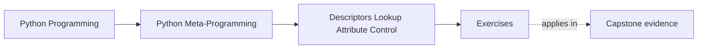

# Exercises

<!-- page-maps:start -->
## Page Maps

<!-- page-maps:end -->

Use these after reading the five core lessons and the worked example. The goal is not to
memorize descriptor trivia. The goal is to make protocol hooks, precedence, storage, and
ownership boundaries explicit.

Each exercise asks for three things:

- the attribute behavior or invariant you are trying to explain or enforce
- the descriptor or lower-power tool you chose
- the reason that choice is the clearest owner

Treat the ten exercises as one full lab day on descriptors, lookup, and attribute control.

Do them in order:

- Exercises 1-3 establish minimal descriptors, precedence, and method binding as ordinary descriptor behavior
- Exercises 4-6 move into reusable fields, storage safety, and ownership selection
- Exercises 7-8 extend that discipline into lookup tracing and lower-power alternatives
- Exercises 9-10 package the whole module into a reviewable descriptor-boundary packet

Keep one descriptor-boundary table while you work:

| Attribute rule or lookup question | Owner you chose | What lookup or storage rule matters | What stronger power was rejected | Review judgment |
| --- | --- | --- | --- | --- |

## Exercise 1: Build one minimal descriptor on purpose

Write a descriptor that implements one narrow behavior using the smallest useful set of
hooks.

What to hand in:

- the hooks you implemented
- one sentence explaining why those hooks are enough
- one sentence explaining what class access returns

## Exercise 2: Show precedence with two concrete cases

Build or inspect one data descriptor and one non-data descriptor.

What to hand in:

- one case where the descriptor beats `obj.__dict__`
- one case where `obj.__dict__` shadows the descriptor
- one explanation of why the results differ

## Exercise 3: Explain ordinary method binding

Use one small class with an instance method and inspect the method through both the class
and an instance.

What to hand in:

- what `Class.method` gives you
- what `obj.method` gives you
- one explanation using `__func__` and `__self__`

## Exercise 4: Build one reusable validating field

Implement one field descriptor such as `NonEmptyString`, `PositiveInt`, or `Choices`.

What to hand in:

- the field rule it enforces
- how `__set_name__` helps the implementation
- where per-instance state is stored

## Exercise 5: Reject one bad storage design

Take a descriptor design that stores values on the descriptor object itself and explain why
it fails.

What to hand in:

- the broken storage approach
- one concrete example of state leaking across instances
- one safer replacement using either `obj.__dict__` or weak-reference storage

## Exercise 6: Place one field rule on the ownership ladder

Choose one requirement and decide between:

- plain attribute or method
- property
- reusable descriptor
- wider class machinery

What to hand in:

- the requirement
- the owner you chose
- one sentence rejecting at least one stronger option as unnecessary

## Midday self-check

Before moving into the final four exercises, make sure you can already answer these
questions clearly:

- when `__get__` alone is enough and when a descriptor becomes a data descriptor
- why data descriptors and non-data descriptors interact differently with `obj.__dict__`
- where per-instance field state belongs and why descriptor-held state usually leaks
- when a property or plain method is clearer than a reusable descriptor

If you cannot answer those four questions in plain language, return to Exercises 1-6 and
make the lookup rule, storage owner, and rejected alternative more explicit before
continuing.

## Exercise 7: Trace one attribute lookup from class to instance

Choose one object with a descriptor-backed attribute and narrate the full lookup path.

What to hand in:

- the class attribute involved
- the instance storage involved, if any
- one explanation of which object wins the lookup and why

## Exercise 8: Replace one unnecessary descriptor with a lower-power owner

Choose one rule that someone might implement with a descriptor even though a simpler owner
would be clearer.

What to hand in:

- the rule
- the lower-power owner you would choose instead
- one explanation of what the descriptor would add without adding clarity

## Exercise 9: Compare honest descriptor claims with overstated claims

Choose one descriptor design and write both an honest description and an overstated
description of what it guarantees.

What to hand in:

- the honest description
- the overstated description
- one explanation of which words make the overstated version misleading

## Exercise 10: Produce a descriptor-boundary packet

Assemble:

- one descriptor-boundary table
- one precedence example comparing data and non-data behavior
- one storage-safety rule that keeps per-instance data off the shared descriptor object
- one rule for choosing a lower-power owner when descriptor reuse is unnecessary

The packet is strong when another learner can use it to answer:

- what the descriptor or lower-power owner actually controls
- why lookup resolves the way it does
- where state lives and why that storage choice is safe

## Mastery standard for this exercise set

Across all six answers, the module wants the same habits:

- you explain descriptor behavior mechanically instead of mystically
- you use precedence rules precisely
- you keep per-instance state separate from descriptor state
- you choose descriptor power only when attribute-level ownership really justifies it

Across all ten answers, add two more habits:

- you can narrate lookup resolution without relying on "magic" language
- you leave behind a descriptor-boundary packet another learner could review without guessing

If an answer still sounds like "Python just does magic here," keep going.

## Continue through Module 07

- Previous: [Worked Example: Building a Unit-Aware Quantity Descriptor](worked-example-building-a-unit-aware-quantity-descriptor.md)
- Next: [Exercise Answers](exercise-answers.md)
- Return: [Overview](index.md)
- Terms: [Glossary](glossary.md)
