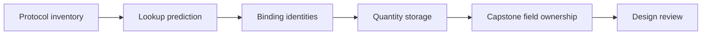

# Exercises: Descriptor Evidence Studio

<!-- page-maps:start -->
## Page Maps


<!-- page-maps:end -->

This studio uses the shipped Module 07 lab and the incident-plugin capstone. Do not create
unrelated toy descriptors unless an exercise explicitly asks for a minimal counterexample.

Start from:

```bash
make descriptor-lookup-lab
make descriptor-lookup-lab-test
```

Keep the JSON output available while you work.

Every exercise uses the same evidence cycle:


## Submission packet

For each exercise record:

| Field | Required evidence |
| --- | --- |
| owner | class, descriptor, instance, wrapper, or metaclass |
| timing | class creation, class access, instance read, instance write, or call |
| static evidence | value retrieved without triggering the behavior |
| predicted result | winning hook or lookup layer |
| observed result | output, instance dictionary, identity, or failure |
| preserved contract | earlier behavior that must remain true |
| limitation | what the evidence does not prove |

## Exercise 1: Separate naming from descriptor status

Starting context:

- `NameAware` defines only `__set_name__`
- `StoredField` defines `__get__`, `__set__`, and `__set_name__`

Objective:

Produce a protocol inventory for both objects without using their class names as evidence.

Constraints:

- inspect hooks on `type(value)`
- retrieve each installed object with `vars(owner)`
- do not call an instance attribute during classification

Expected evidence:

- both recorded installation names
- one `not-a-descriptor` classification
- one `data` classification
- a sentence explaining why `__set_name__` belongs to a different time

Acceptance check:

```bash
python3 -m unittest discover -s tests \
  -p "test_descriptor_protocol_lab.py" -v
```

Preserve:

- class access to `StoredField` returns the descriptor itself

## Exercise 2: Predict lookup before reading

Starting context:

Use `precedence_evidence()` and `explain_lookup()`.

Objective:

Add a fourth name to the local `Delivery` example: a non-data descriptor with no
same-named instance entry. Predict all four winners before performing reads.

Constraints:

- use `inspect.getattr_static` through the shipped helper
- distinguish the public shadow name from a private storage name
- keep `ordinary_lookup_only` explicit

Expected evidence:

- four `LookupDecision` records
- four actual reads
- one intentional data-descriptor conflict in `vars(instance)`
- one intentional non-data shadow

Acceptance checks:

- every prediction matches the actual result
- removing the non-data shadow changes only that one winner

Preserve:

- the data descriptor continues to read its private storage value

## Exercise 3: Audit binding without invoking the action

Starting context:

The capstone stores a wrapped `deliver` function on `ConsoleNotifier`.

Objective:

Inspect the transition from static wrapper function to bound method.

Constraints:

- retrieve the static value with `inspect.getattr_static`
- construct a plugin only if needed for binding; do not invoke `deliver`
- compare with the Module 07 `MethodBinding` fields

Expected evidence:

- static value type
- descriptor category
- bound value type
- `bound.__func__ is static_value`
- `bound.__self__ is plugin`
- a note separating wrapper ownership from binding ownership

Acceptance check:

- action history remains empty

Preserve:

- the visible action signature remains unchanged

## Exercise 4: Extend the quantity field honestly

Starting context:

`Quantity` accepts seconds and milliseconds and stores canonical seconds.

Objective:

Create a `timeout` field that also accepts minutes and has a maximum of five minutes.

Constraints:

- keep seconds canonical
- add `"min": 60.0`
- do not add string parsing
- reject `bool`, non-finite values, and values above 300 seconds
- use two instances

Expected evidence:

- `timeout = (2, "min")` stores `120.0`
- `timeout.in_unit("min")` returns `2.0`
- `(6, "min")` fails against the canonical maximum
- two owner dictionaries remain independent

Acceptance check:

Add focused tests rather than changing the stable lab packet.

Preserve:

- all existing descriptor lab tests pass

## Exercise 5: Compare capstone field schema with ownership

Starting context:

Run:

```bash
make capstone-field
make capstone-field-ownership
```

Objective:

Explain why these commands are complementary rather than duplicates.

Constraints:

- do not construct or invoke a plugin
- identify which output is public schema and which is implementation ownership evidence
- trace `WebhookNotifier.endpoint`

Expected evidence:

- `StringField` as the static descriptor type
- `data` as its category
- `WebhookNotifier` as the declaring class
- `_endpoint` and `plugin-instance.__dict__` as the storage boundary
- `constructed: false` and `executed: false`

Acceptance checks:

```bash
make -C capstone field-ownership
```

and the focused capstone field and CLI tests.

Preserve:

- the existing `field` command retains its schema-focused output

## Exercise 6: Write the ownership review

Review these requirements:

1. one class computes a display label
2. many plugin classes reuse bounded integer configuration
3. all assignments fail after initialization
4. duplicate field names fail during class-body execution
5. one method performs delivery I/O

Objective:

Choose the narrowest honest owner for each requirement.

Constraints:

- choose among property, descriptor, `__setattr__`, metaclass namespace, and method
- reject one lower or higher power where a realistic alternative exists
- price maintenance cost

Expected evidence:

| Requirement | Chosen owner | Rejected owner | Deciding pressure |
| --- | --- | --- | --- |

Acceptance checks:

- every chosen owner matches the timing it needs
- no descriptor owns whole-object or class-family policy
- no property is rejected merely because descriptors are “more reusable”
- the I/O operation remains explicit

Preserve:

- Module 06's lower-power ladder remains the starting point

## Final studio proof

Run focused verification:

```bash
make descriptor-lookup-lab-test
make capstone-field-ownership
```

Then submit:

- the six exercise records
- any focused tests you added
- one paragraph connecting `Quantity` to the capstone `Field`
- one remaining limitation that neither descriptor solves

## Self-review before answers

Do not open the answers until you can state:

- why `__set_name__` is insufficient for descriptor status
- why the same instance dictionary entry wins in one case and loses in another
- what `__func__` and `__self__` prove
- where both quantity and capstone values live
- why metaclass collection does not make the metaclass the field-access owner

## Continue through Module 07

- Previous: [Worked Example](worked-example-building-a-unit-aware-quantity-descriptor.md)
- Next: [Exercise Answers](exercise-answers.md)
