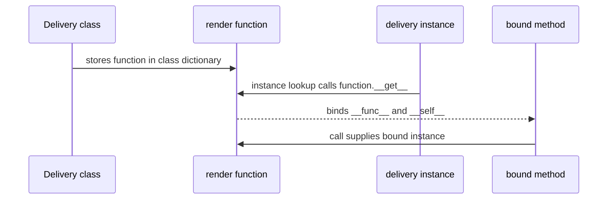

# Functions, Binding, and Method Descriptors

<!-- page-maps:start -->
## Page Maps


<!-- page-maps:end -->

“Python adds `self` automatically” predicts a common result but hides the object
transition. A method is ordinary descriptor behavior that can be inspected through
identity.

## The claim

A function stored on a class is a non-data descriptor. Class access normally returns the
function. Instance access returns a method object that keeps:

- the original function in `__func__`
- the receiving instance in `__self__`

Calling the method combines those two pieces with the supplied arguments.

## Observe all three surfaces

The lab uses:

```python
class Delivery:
    def render(self, title: str) -> str:
        return f"{self.prefix}: {title}"
```

Inspect the name three ways:

```python
static_value = inspect.getattr_static(Delivery, "render")
class_value = Delivery.render
instance_value = delivery.render
```

These are not interchangeable:

| Access | Result | Descriptor invoked? |
| --- | --- | --- |
| `inspect.getattr_static(Delivery, "render")` | function stored in class state | no |
| `Delivery.render` | function | yes, with no instance |
| `delivery.render` | bound method | yes, with `delivery` |

The static read is the evidence anchor because it retrieves the owner without performing
the behavior being studied.

## Prove the identities

Run:

```bash
make descriptor-lookup-lab
```

The `method_binding.binding` packet reports:

```json
{
  "bound_function_is_static_function": true,
  "bound_self_is_instance": true,
  "class_access_is_function": true,
  "class_access_type": "function",
  "descriptor_kind": "non-data",
  "instance_access_type": "method",
  "public_name": "render",
  "static_type": "function"
}
```

The important proof is not the type name alone:

```python
bound = delivery.render
assert bound.__func__ is vars(Delivery)["render"]
assert bound.__self__ is delivery
```

Those identities show exactly what the method object owns.

## Expand a bound call

This call:

```python
delivery.render("CPU high")
```

is behaviorally related to:

```python
Delivery.render(delivery, "CPU high")
```

The first form asks the descriptor to create the binding. The second retrieves the
function through the class and passes the receiver explicitly. This equivalence is useful
for reasoning, but do not claim that Python literally rewrites source code into the second
line.

## Why functions are non-data descriptors

The function type supplies `__get__`, but ordinary functions do not supply descriptor
`__set__` or `__delete__`. They therefore yield to a same-named instance entry:

```python
first = Delivery()
second = Delivery()
vars(first)["render"] = "replacement"

assert first.render == "replacement"
assert second.render() == "method"
```

Only `first` is shadowed. The class function remains available to every other instance.

This behavior follows the previous core's lookup rule; method syntax introduces no new
precedence category.

## Failure: observing binding by invoking domain behavior

Suppose `render` sends a notification rather than formatting a string. Calling it merely
to discover whether it is bound mixes introspection with effects.

Prefer:

```python
bound = inspect.getattr_static(type(plugin), "deliver").__get__(plugin, type(plugin))
assert bound.__self__ is plugin
```

or simply inspect an already retrieved bound method's identities. Execute domain behavior
only when the behavior itself is the subject of the proof.

## Built-in method families are not identical

This core focuses on plain Python functions. `staticmethod`, `classmethod`, built-in
method descriptors, and extension types have related but distinct binding behavior.

Useful contrasts:

| Class-body value | Instance access |
| --- | --- |
| plain function | method bound to the instance |
| `staticmethod` | underlying callable without instance binding |
| `classmethod` | method bound to the class |
| custom non-data descriptor | whatever its `__get__` contract returns |

Do not generalize the exact identity shape of a Python function to every callable class
attribute.

## Capstone connection

The incident-plugin action decorator returns a wrapper function. That wrapper is stored
on the plugin class, so it also participates in method binding.

The ownership chain is:

```mermaid
flowchart LR
  class["ConsoleNotifier.__dict__['deliver']"] --> wrapper["wrapper function"]
  wrapper --> binding["function.__get__"]
  binding --> method["bound method"]
  method --> call["plugin.deliver(...)"]
```

The decorator owns action policy and metadata. The function descriptor owns binding. The
plugin instance becomes `__self__`. `PluginMeta` collects the action specification but
does not perform ordinary method binding.

This separation matters in review: a signature problem, wrapper problem, and binding
problem may all appear on the same public name while having different owners.

## What the lab proves

It proves:

- the static class value is a function
- that function is a non-data descriptor
- instance access creates a method
- the method retains the original function and exact receiver
- a same-named instance entry can shadow the function

It does not prove:

- that the wrapped function preserves its metadata
- that calling the method is safe
- that every callable attribute uses function binding
- that shadowing a method is a good API design

Module 04 and Module 05 own the wrapper-policy questions.

## Focused proof

Run:

```bash
python3 -m unittest discover -s tests \
  -p "test_method_binding_descriptor_lab.py" -v
```

Before reading the assertions, predict which identities are `is` comparisons and which
results are ordinary equality comparisons.

## Exit check

Explain `delivery.render` without using “automatic”:

1. locate the static class value
2. classify it as a non-data descriptor
3. name the `__get__` transition
4. identify `__func__` and `__self__`
5. state how an instance dictionary entry could change the result

## Continue through Module 07

- Previous: [Data and Non-Data Descriptor Precedence](data-and-non-data-descriptor-precedence.md)
- Next: [Reusable Field Descriptors and Storage](reusable-field-descriptors-and-storage.md)
