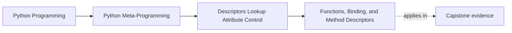

# Functions, Binding, and Method Descriptors


<!-- page-maps:start -->
## Page Maps




<!-- page-maps:end -->

This core takes the most familiar everyday feature in the module and re-explains it in
descriptor language:

ordinary instance methods bind because functions on classes are non-data descriptors.

This page matters because it turns one of the most ordinary Python behaviors into a
reviewable lookup event. A reader who can explain method binding cleanly will usually stop
treating descriptors as remote framework machinery.

## The sentence to keep

When Python reads a plain function from a class through an instance, the function's
descriptor behavior binds the instance and produces a bound method.

That is the hidden descriptor many people use every day without naming it.

Keep a second sentence beside it:

> class access and instance access produce different results because the descriptor sees different inputs, not because methods are a special magical category.

That sentence matters because method folklore survives easily. The goal here is to replace
folklore with objects and lookup steps you can inspect directly.

## What a bound method really contains

A bound method is not mysterious. It is a small object that carries:

- `__func__`, the original function
- `__self__`, the instance it was bound to

Calling the bound method is effectively:

```python
bound.__func__(bound.__self__, *args, **kwargs)
```

Once that is visible, method objects become much easier to inspect and debug.

Use this split whenever method language stays fuzzy:

| Surface | What it actually is |
| --- | --- |
| `Class.method` | the underlying function object on the class |
| `obj.method` | the bound result produced by descriptor behavior |
| `bound.__func__` | the original callable that still expects `self` explicitly |
| `bound.__self__` | the instance attached during binding |

## Evidence route for method-binding reviews

Use this route whenever method access starts sounding mystical:

| Evidence step | What it proves |
| --- | --- |
| the function object is stored on the class | descriptor behavior can participate |
| the function defines `__get__` but not `__set__` or `__delete__` | it is a non-data descriptor |
| `Class.method` returns the raw function | no instance was available to bind |
| `obj.method` returns a bound method | instance access triggered binding through `__get__` |
| `bound.__func__` and `bound.__self__` can be inspected | the binding result is a concrete object, not hidden magic |

## A compact example

```python
def describe(self, label):
    return f"{self.name}: {label}"


class Item:
    name = "widget"
    describe = describe


item = Item()
bound = item.describe

print(bound.__func__ is describe)  # True
print(bound.__self__ is item)      # True
print(bound("stock"))              # widget: stock
```

The key move is not special method syntax. It is descriptor binding on attribute access.

That is the sentence to keep returning to when learners over-focus on `def` syntax. The
syntax defines the function; descriptor lookup explains the binding.

## A proof route for method binding

Use this route whenever instance methods still feel like special syntax:

1. inspect the class attribute directly
2. inspect the instance attribute directly
3. compare `__func__` and `__self__` on the bound result
4. explain why class access stays unbound while instance access binds
5. name the non-data-descriptor rule that still allows shadowing

## Why functions are non-data descriptors

Plain functions on classes define `__get__`, but they do not define `__set__` or
`__delete__`.

That means they are non-data descriptors.

So the previous core's rule applies directly:

- the function can bind on instance access
- but a same-named value in the instance dictionary can still shadow it

That shadowability is part of the design, not a weird corner case.

It also explains why method replacement and monkey-patching conversations can get subtle
quickly. The lookup engine is still following non-data-descriptor rules, not granting
methods absolute privilege.

## Why this matters for debugging

Once you know the descriptor story, you can explain:

- why `obj.method` is different from `Class.method`
- why bound methods expose `__func__` and `__self__`
- why wrappers around methods still need to preserve ordinary function behavior

This is one of those places where metaprogramming knowledge makes normal Python less
mysterious, not more abstract.

It also improves debugging language. "The instance method broke" is weaker than "the class
attribute is no longer behaving like a plain function descriptor."

## Class access versus instance access

The difference is simple:

- `Class.method` gives you the underlying function object
- `obj.method` gives you a bound method

That means descriptor behavior depends on how the attribute is accessed, not only on what
the class attribute is.

This is the same pattern you saw in the first core when a descriptor returns itself on
class access.

Use this access table as a debugging card:

| Question | What to inspect first |
| --- | --- |
| why is this call missing `self`? | whether you are holding `Class.method` instead of `obj.method` |
| why did method behavior disappear on one instance? | whether the instance dictionary now shadows the non-data descriptor |
| why is a decorator making the method harder to inspect? | whether the wrapper still behaves like an ordinary function descriptor |

Use this comparison table to keep the two access paths distinct:

| Access form | Typical result |
| --- | --- |
| `Class.method` | underlying function object |
| `obj.method` | bound method carrying `__func__` and `__self__` |
| `obj.__dict__["method"]` when present | same-named instance value that can shadow a non-data descriptor |

## Why decorators need to preserve the function surface

Method decorators are easy to get wrong conceptually.

If a decorator returns a plain function, normal binding still works.

If a decorator returns something stranger that does not behave like a function descriptor,
ordinary method access can become much harder to reason about.

That is why helpers such as `functools.wraps` matter: they preserve the function surface
that you and your tools expect to find.

The deeper rule is not about decoration style. It is about preserving an owner shape that
still behaves like a function descriptor under ordinary lookup.

## A wrapper review test

Before accepting a method wrapper, ask:

- does instance access still produce an understandable binding result?
- can another reviewer still inspect the equivalent of `__func__` and `__self__` if needed?
- did the wrapper preserve function-like behavior, or did it silently replace the owner with something stranger?

## `classmethod` and `staticmethod` are descriptor variants

This core is about plain functions, but two familiar built-ins sharpen the point:

- `classmethod` changes binding so the class is passed automatically
- `staticmethod` disables ordinary instance binding and returns the underlying callable

Those tools are useful because they alter descriptor behavior in explicit, reviewable
ways.

They are worth naming here because they show that "method behavior" is not one indivisible
thing. Different descriptor wrappers can alter binding on purpose.

## What this core is not saying

The lesson is not that you should manually call `function.__get__` in ordinary code.

The lesson is that you can now explain what Python is already doing for you.

That distinction keeps the course grounded in clarity rather than cleverness.

## Common overclaims to reject

Reject these descriptions when they appear in review:

| Overclaim | Better replacement |
| --- | --- |
| "methods are just functions with special syntax" | "methods arise when function descriptors bind during instance access" |
| "instance access calls the function directly" | "instance access first produces a bound method object" |
| "methods cannot be shadowed" | "plain methods are non-data descriptors and can be shadowed by instance entries" |
| "a method wrapper is fine if calls still work" | "a method wrapper should preserve understandable descriptor behavior and inspection surfaces" |

## Failure modes for method-descriptor reasoning

These are the mistakes this page is trying to prevent:

| Failure mode | Why it weakens the design | Repair move |
| --- | --- | --- |
| treating binding as special syntax instead of lookup | readers cannot inspect or debug the real mechanism | point to `__get__`, `__func__`, and `__self__` |
| forgetting that plain methods are non-data descriptors | shadowing behavior becomes confusing | apply the previous core's precedence rule directly |
| wrapping a method with something that no longer behaves like a plain function descriptor | tooling and reasoning get weaker | preserve a function-like surface or document the changed owner explicitly |
| describing class access and instance access the same way | the lookup boundary disappears | compare `Class.method` and `obj.method` directly |

## A compact mental model

```text
plain function on a class
  -> non-data descriptor
  -> instance access binds self
  -> class access leaves the function unbound
```

That is enough to explain most method-binding questions you will see in practice.

## Evidence packet for method-descriptor reviews

Leave this page with a small packet:

- one inspected pair of `Class.method` and `obj.method`
- one bound-method note naming `__func__` and `__self__`
- one shadowing example showing why plain methods are still non-data descriptors
- one sentence rejecting magical wording in favor of descriptor-language explanation

## Review rules for method descriptors

When reviewing method binding behavior, keep these questions close:

- is this still a plain function descriptor, or did a wrapper replace it with something stranger?
- what does instance access return here: a bound method, a plain value, or a custom descriptor result?
- is shadowing by an instance attribute possible and relevant?
- are `__func__` and `__self__` available when debugging would benefit from them?
- is a method decorator preserving ordinary readability and inspection?
- can another reviewer explain the binding result without using the word "magic"?

## Exit check for this page

Before moving on, make sure you can do all of these:

- explain why `obj.method` and `Class.method` are different lookup results
- inspect one bound method and identify `__func__` and `__self__`
- explain why plain methods are non-data descriptors
- name one case where instance shadowing would change the result

## What to practice from this page

Try these before moving on:

1. Inspect `obj.method.__func__` and `obj.method.__self__` on one small class.
2. Shadow a non-data method descriptor with an instance attribute and explain why that works.
3. Compare `Class.method` and `obj.method` using descriptor language instead of only syntax language.

If those feel ordinary, the next step is to build reusable field descriptors that own
attribute behavior on purpose.

## Continue through Module 07

- Previous: [Data and Non-Data Descriptor Precedence](data-and-non-data-descriptor-precedence.md)
- Next: [Reusable Field Descriptors and Storage](reusable-field-descriptors-and-storage.md)
- Return: [Overview](index.md)
- Terms: [Glossary](glossary.md)
