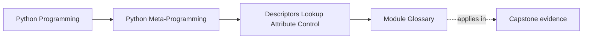

# Module Glossary

<!-- page-maps:start -->
## Page Maps

<!-- page-maps:end -->

This glossary belongs to **Module 07: Descriptors, Lookup, and Attribute Control** in
**Python Metaprogramming**. It keeps the language of this directory stable so the same
ideas keep the same names across lessons, practice, review, and capstone discussion.

## How to use this glossary

Use the glossary when descriptor discussions start to blur together protocol hooks,
precedence, method binding, field storage, and ownership decisions. Module 07 is meant to
keep those boundaries explicit.

If two reviewers use the same word but mean different lookup or owner stories, stop and
return here. This module gets weak quickly when terms like "descriptor," "shadowing,"
"storage," or "binding" stay fuzzy.

Use the glossary in both directions:

- When you read a lesson, use the definitions to decode the page precisely.
- When you explain your own design, use the repair tables below to catch wording that
  sounds confident but hides the real lookup or ownership story.

## Terms in this directory

| Term | Meaning in this directory |
| --- | --- |
| Attribute boundary | The point where a read, write, or delete crosses into descriptor-controlled behavior for one attribute. |
| Bound method | The object produced when a function descriptor binds an instance and exposes `__func__` plus `__self__`. |
| Data descriptor | A descriptor that defines `__set__`, `__delete__`, or both, and therefore wins over the instance dictionary for the same name. |
| Descriptor | Any object stored on a class that defines `__get__`, `__set__`, or `__delete__`. |
| Descriptor precedence | The lookup rule that gives data descriptors priority over the instance dictionary, and gives the instance dictionary priority over non-data descriptors. |
| Explicit storage owner | The place where descriptor-managed values actually live after assignment, such as `obj.__dict__` or a weak-key mapping. |
| External storage descriptor | A descriptor that keeps per-instance values outside `obj.__dict__`, often for slotted compatibility. |
| Field descriptor | A reusable descriptor that models one field rule such as validation, coercion, or normalization. |
| Honest descriptor claim | The strongest description a descriptor can make without implying broader system guarantees than its hooks and storage actually provide. |
| Method descriptor behavior | The non-data descriptor behavior by which plain functions on classes bind instances into bound methods. |
| Non-data descriptor | A descriptor that defines only `__get__` and can therefore be shadowed by an instance attribute of the same name. |
| Per-instance storage | The rule that descriptor-managed values belong to each instance, not on the shared descriptor object. |
| `property` | A built-in descriptor type that provides managed attribute access and is treated as a data descriptor. |
| Rejected lower-power owner | The simpler owner, such as a property or plain method, that a review considered and declined because real reuse pressure or boundary needs existed. |
| Rejected stronger owner | The more powerful mechanism, such as a wrapper, central `__setattr__`, or metaclass, that a review declined because the need did not justify it. |
| Shadowing | The case where an instance dictionary entry replaces the result of a non-data descriptor with the same public name. |
| `__delete__` | The descriptor hook that controls what `del obj.attr` means. |
| `__get__` | The descriptor hook that controls reads through `obj.attr` or `Class.attr`. |
| `__set__` | The descriptor hook that controls writes through `obj.attr = value`. |
| `__set_name__` | The class-creation hook that tells a descriptor which class and attribute name it was installed under. |
| Weak-reference storage | External storage using `WeakKeyDictionary` or a similar mechanism so descriptor-held mappings do not keep instances alive accidentally. |

## Terms that must trigger a proof step

Some words are not safe to leave as slogans. In this module, they should immediately
trigger a concrete check.

| If you use this term | You must also prove... |
| --- | --- |
| data descriptor | which hook made instance shadowing impossible |
| non-data descriptor | how instance state could replace the descriptor result |
| explicit storage owner | the exact object or mapping that keeps the value after assignment |
| bound method | what `__self__` and `__func__` point to on instance access |
| rejected lower-power owner | why a property, helper method, or plain attribute stopped being enough |
| rejected stronger owner | what broader boundary a wrapper, `__setattr__`, or metaclass would control unnecessarily |
| honest descriptor claim | which guarantee the descriptor can make now, and which larger guarantee it cannot truthfully claim |

## Confusing pairs to keep separate

These pairs sound close but should not collapse into each other:

| Do not confuse... | With... | Because... |
| --- | --- | --- |
| descriptor object | descriptor-managed value | one owns hooks and configuration; the other belongs to an instance or safe external storage |
| data descriptor | non-data descriptor | the first beats same-named instance state; the second can be shadowed |
| class access | instance access | they can trigger different descriptor outcomes |
| bound method | original function | one carries `__self__`; the other does not |
| reusable field descriptor | one-off property | reuse pressure is the key boundary between them |
| explicit storage owner | descriptor protocol hook | hooks govern access; storage decides where values live |

## Translation table for sloppy wording

Use this table when a sentence sounds familiar but does not yet tell the truth of the
design.

| Sloppy wording | Stronger wording for this module |
| --- | --- |
| "the descriptor stores the value" | "the descriptor routes access, and the value lives in `obj.__dict__` under `_name`" |
| "Python found the descriptor first" | "data-descriptor precedence beat the instance dictionary on this read" |
| "the instance method appears automatically" | "the function descriptor returned a bound method with `__self__` set to the instance" |
| "we needed something more advanced than a property" | "we needed one reusable field rule across multiple attributes and classes" |
| "external storage is cleaner" | "external storage avoids depending on `obj.__dict__` and can support slotted instances" |
| "a metaclass could do it too" | "a metaclass would own class-creation policy beyond this single attribute boundary" |

## Repair prompts for blurred language

When a term starts sounding too broad, use one of these prompts:

| If someone says... | Ask back... |
| --- | --- |
| "the descriptor stores the value" | where exactly: on the instance, in external storage, or incorrectly on the shared descriptor object? |
| "Python picked the descriptor" | which precedence step made it win? |
| "methods are just special" | what did `__get__` return on instance access? |
| "we need a descriptor here" | what repeated attribute boundary makes a property too weak? |
| "a metaclass or wrapper could also do it" | what boundary would those stronger tools own that the descriptor does not? |

## Fast review drills

If a learner can answer these quickly and precisely, the glossary is doing its job.

| Prompt | Short answer shape to expect |
| --- | --- |
| Why did the descriptor win this read? | name the precedence step, not just "Python chose it" |
| Where does the assigned value live now? | name the storage owner and key shape |
| Why is this still a non-data descriptor? | point to the absence of `__set__` and the possibility of shadowing |
| Why is a descriptor justified here instead of a property? | name the reuse pressure or shared field contract |
| Why is a metaclass too strong here? | name the broader boundary it would control beyond one attribute |

## Exit check for module vocabulary

Before leaving Module 07, make sure you can use these terms in plain language:

- explicit storage owner
- honest descriptor claim
- rejected lower-power owner
- rejected stronger owner
- shadowing
- bound method

If any of those terms still force you to gesture vaguely instead of naming hooks,
precedence steps, storage owners, or rejected alternatives, return to the module before
moving on.

## Keep the module connected

- Return to [Module 07 Overview](index.md) for the full learning route.
- Use [Exercises](exercises.md) and [Exercise Answers](exercise-answers.md) to pressure-test the descriptor vocabulary.
- Revisit the [Worked Example](worked-example-building-a-unit-aware-quantity-descriptor.md) when a reusable field starts to carry normalization or validation policy that needs review.
