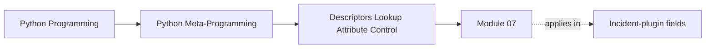
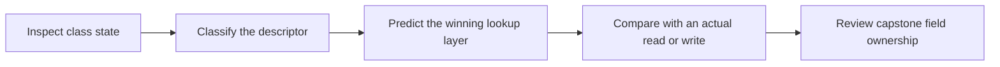

# Module 07: Descriptors, Lookup, and Attribute Control

<!-- page-maps:start -->
## Page Maps




<!-- page-maps:end -->

Module 06 introduced a small `TypedField` to show that runtime validation needs an
explicit owner. This module opens that owner and studies the machinery it relies on.
The goal is not to collect descriptor tricks. The goal is to predict ordinary attribute
behavior, prove where values live, and decide whether a reusable descriptor has earned
its abstraction cost.

## The learning problem

The statement “Python calls `__get__`” is not enough to review a descriptor-backed API.
A useful explanation must answer all six questions:

1. When does the hook run?
2. Which object owns the hook?
3. Is the class attribute a data descriptor, a non-data descriptor, or neither?
4. Which lookup layer wins for this exact public name?
5. Where does per-instance state live?
6. Why is a descriptor clearer than a property or a wider class mechanism?

The executable lab keeps those questions attached to observable evidence.

## Prerequisites

Before starting, you should be able to:

- distinguish class state from instance state
- use `vars(obj)` and `vars(type(obj))` without assuming they perform normal lookup
- explain why a property is a data descriptor
- describe what Module 06's `TypedField` enforces and what annotations alone do not

If the property-precedence example from Module 06 is still unclear, revisit it before
continuing. Module 07 generalizes that exact lookup rule.

## Run the module before reading deeply

From the Python Metaprogramming course directory:

```bash
make descriptor-lookup-lab
make descriptor-lookup-lab-test
```

The first command prints four stable evidence packets:

| Packet | Question it answers |
| --- | --- |
| `protocol` | does `__set_name__` make an object a descriptor? |
| `precedence` | which layer wins for data, non-data, and plain class attributes? |
| `method_binding` | what identities prove that a function became a bound method? |
| `quantity_field` | where does a reusable data descriptor keep canonical instance values? |

The second command tests the claims rather than merely reproducing the output.

Source route:

- `labs/descriptor_lookup/protocol.py`
- `labs/descriptor_lookup/precedence.py`
- `labs/descriptor_lookup/binding.py`
- `labs/descriptor_lookup/quantity.py`
- `labs/descriptor_lookup/evidence.py`
- `tests/test_*descriptor*.py`

## The ordinary lookup model

For an instance read such as `delivery.endpoint`, keep this order available:

```mermaid
flowchart TD
  start["delivery.endpoint"] --> class["Find endpoint through type(delivery).__mro__"]
  class --> data{"Class value has __set__ or __delete__?"}
  data -->|yes| datawin["Data descriptor wins"]
  data -->|no| instance{"endpoint in delivery.__dict__?"}
  instance -->|yes| instancewin["Instance dictionary wins"]
  instance -->|no| getter{"Class value has __get__?"}
  getter -->|yes| nondata["Non-data descriptor runs"]
  getter -->|no| plain["Plain class value wins, or lookup fails"]
```

This is a review model for ordinary lookup driven by `object.__getattribute__`. A class
that overrides `__getattribute__`, a metaclass that changes class lookup, or a fallback
through `__getattr__` adds more behavior. The lab states `ordinary_lookup_only: true`
instead of pretending to simulate every possible attribute engine.

## Core sequence

Follow the cores in order:

1. [Descriptor Protocol and `__set_name__`](descriptor-protocol-and-set-name.md) separates
   protocol status from class-creation naming.
2. [Data and Non-Data Descriptor Precedence](data-and-non-data-descriptor-precedence.md)
   predicts the winning lookup layer before executing it.
3. [Functions, Binding, and Method Descriptors](functions-binding-and-method-descriptors.md)
   proves method binding through `__func__` and `__self__`.
4. [Reusable Field Descriptors and Storage](reusable-field-descriptors-and-storage.md)
   separates shared descriptor configuration from per-instance values.
5. [Descriptor Boundaries and Attribute Ownership](descriptor-boundaries-and-attribute-ownership.md)
   decides when reuse pressure justifies the mechanism.
6. [Worked Example: Building a Unit-Aware Quantity Descriptor](worked-example-building-a-unit-aware-quantity-descriptor.md)
   traces the shipped `Quantity` implementation and its failures.
7. [Exercises](exercises.md) turns the lab and the incident-plugin fields into a design
   studio.
8. [Exercise Answers](exercise-answers.md) calibrates the evidence and the judgment.
9. [Module Glossary](glossary.md) keeps lookup, ownership, and storage terms precise
   during review.

## What changes in the learner's model

| Before this module | After this module |
| --- | --- |
| attribute access feels like dictionary lookup with exceptions | lookup is an ordered protocol with named winning layers |
| `__set_name__` feels like descriptor activation | it is class-creation configuration and does not establish descriptor status |
| methods “receive `self` automatically” | a function's non-data `__get__` returns a method whose identities can be inspected |
| the descriptor “stores the value” | descriptor configuration and instance value storage have different owners |
| reuse sounds sufficient to justify a descriptor | repeated attribute semantics and review cost are compared explicitly |

## Capstone transfer

The incident-plugin capstone uses `Field` as a data descriptor:

- `PluginMeta` collects the descriptor objects while creating plugin classes
- `Field.__set_name__` records public and private storage names
- generated initialization writes through `Field.__set__`
- configuration reads through `Field.__get__`
- values live in each plugin instance's `__dict__`

Run the capstone field contract now:

```bash
make capstone-field
```

After the capstone transfer is introduced later in this module, use
`make capstone-field-ownership` to inspect the descriptor without constructing or invoking
a plugin. The capstone is supporting evidence: the lab teaches the mechanism first, and
the application shows why a production field family accepts the complexity.

## Evidence standard

For every descriptor claim, leave behind:

- the static class value, found without invoking it
- the protocol hooks found on its type
- the predicted winner
- the actual result, when execution is safe and useful
- the exact instance storage key, if a value is retained
- one limitation or rejected owner

“It works” is not sufficient. “The data descriptor wins” is also incomplete unless the
reviewer can see the `__set__` or `__delete__` hook that establishes that category.

## Exit standard

Move to Module 08 only when you can:

- classify a class attribute from its actual hook set
- explain why `__set_name__` alone is not descriptor status
- predict data and non-data lookup with a same-named instance entry
- prove a bound method's function and receiver identities
- demonstrate independent instance storage for a reusable field
- defend or reject descriptor ownership against a property and a wider class hook
- connect those conclusions to the capstone `Field` surface

The next module can then focus on wider attribute hooks without treating the descriptor
engine underneath them as magic.
