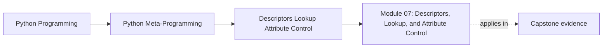

# Module 07: Descriptors, Lookup, and Attribute Control

<!-- page-maps:start -->
## Page Maps

<!-- page-maps:end -->

Module 07 is where attribute access stops feeling intuitive and starts becoming a visible
runtime protocol. The goal is not to memorize descriptor trivia. The goal is to
understand what actually happens when Python reads, writes, or deletes an attribute, and
to decide when a descriptor is the honest owner of that behavior.

This is also the point in the course where ordinary Python starts looking less magical if
you review it carefully. Properties, bound methods, and reusable field objects all become
clearer once the lookup engine stops feeling like folklore.

This module now uses the same ten-file learning surface as the deep-dive series so the
overview, five cores, worked example, practice set, answers, and glossary each have one
clear job.

The strongest habit to build here is disciplined explanation. Readers should be able to
say why lookup resolved a certain way without resorting to phrases like "Python just knows"
or "descriptor magic."

## What this module is for

By the end of Module 07, you should be able to explain five things clearly:

- what makes an object a descriptor and when Python invokes it
- why data descriptors and non-data descriptors have different precedence
- how plain functions become bound methods through descriptor behavior
- where reusable field descriptors should keep per-instance state
- when a descriptor is the right owner instead of a property, wrapper, or wider class hook

You should also be able to say what this module does not prove automatically:

- that every attribute rule deserves descriptor reuse
- that data-descriptor precedence is a design excuse for subtle APIs
- that annotation-driven field systems are automatically safe because they are class-level
- that lookup weirdness is acceptable just because the protocol can explain it afterward

## Weak answers to reject early

Do not let the module collapse into any of these:

| Weak answer | Why it fails |
| --- | --- |
| "Python just knows to call the descriptor." | the protocol and lookup order disappeared from the explanation |
| "the descriptor stores the value for the field." | storage ownership stays vague, which is where shared-state bugs begin |
| "properties and descriptors are basically the same thing." | one-attribute boundaries and real reuse pressure are being blurred together |
| "precedence explains it, so the design is fine." | mechanical lookup is not a defense for a subtle or hostile API |
| "a reusable field is automatically worth a descriptor." | reuse has to be real enough to justify the stronger owner |

## Keep these pages open

- [Mid-Course Map](../module-00-orientation/mid-course-map.md)
- [Pressure Routes](../guides/pressure-routes.md)
- [Topic Boundaries](../reference/topic-boundaries.md)
- [Capstone Map](../capstone/capstone-map.md)

## The review route through the module

Read the module in this order if you are studying without an instructor present:

| Read this page when you need to... | Review question to keep active |
| --- | --- |
| [Descriptor Protocol and `__set_name__`](descriptor-protocol-and-set-name.md) | which hooks actually participate in this attribute behavior? |
| [Data and Non-Data Descriptor Precedence](data-and-non-data-descriptor-precedence.md) | what wins lookup first, and why? |
| [Functions, Binding, and Method Descriptors](functions-binding-and-method-descriptors.md) | what exactly turns a class function into a bound method? |
| [Reusable Field Descriptors and Storage](reusable-field-descriptors-and-storage.md) | where does per-instance state live, and what storage bugs are being avoided? |
| [Descriptor Boundaries and Attribute Ownership](descriptor-boundaries-and-attribute-ownership.md) | does this rule truly belong to attribute access, or is a lower-power owner clearer? |
| [Worked Example: Building a Unit-Aware Quantity Descriptor](worked-example-building-a-unit-aware-quantity-descriptor.md) | what field semantics are owned here, and what broader system claim is refused? |
| [Exercises](exercises.md) | can I narrate lookup, storage, and ownership without mystical language? |
| [Exercise Answers](exercise-answers.md) | is my reasoning explicit about precedence, state ownership, and rejected stronger tools? |
| [Glossary](glossary.md) | am I using descriptor vocabulary consistently and precisely? |

## Session route for independent learners

Use this route if you are studying without live demos or instructor walkthroughs:

| Session block | What to produce before moving on |
| --- | --- |
| protocol hooks plus precedence | one lookup trace that names the winning step mechanically |
| method binding plus reusable field storage | one note separating binding behavior from storage ownership |
| ownership boundaries | one ladder judgment rejecting both a weaker and a stronger owner |
| worked example | one proof note naming the canonical storage surface and one refused broader claim |
| exercises plus answers | one descriptor-boundary packet another learner could inspect without reopening the full module |

## The ten files in this module

1. Overview (`index.md`)
2. [Descriptor Protocol and `__set_name__`](descriptor-protocol-and-set-name.md)
3. [Data and Non-Data Descriptor Precedence](data-and-non-data-descriptor-precedence.md)
4. [Functions, Binding, and Method Descriptors](functions-binding-and-method-descriptors.md)
5. [Reusable Field Descriptors and Storage](reusable-field-descriptors-and-storage.md)
6. [Descriptor Boundaries and Attribute Ownership](descriptor-boundaries-and-attribute-ownership.md)
7. [Worked Example: Building a Unit-Aware Quantity Descriptor](worked-example-building-a-unit-aware-quantity-descriptor.md)
8. [Exercises](exercises.md)
9. [Exercise Answers](exercise-answers.md)
10. [Glossary](glossary.md)

## How to use the file set

| If you need to... | Start here |
| --- | --- |
| understand the full descriptor protocol and the role of `__set_name__` | [Descriptor Protocol and `__set_name__`](descriptor-protocol-and-set-name.md) |
| make sense of shadowing and precedence during lookup | [Data and Non-Data Descriptor Precedence](data-and-non-data-descriptor-precedence.md) |
| explain how instance methods bind through function descriptors | [Functions, Binding, and Method Descriptors](functions-binding-and-method-descriptors.md) |
| build reusable validated fields without shared-state bugs | [Reusable Field Descriptors and Storage](reusable-field-descriptors-and-storage.md) |
| decide whether attribute behavior truly belongs to a descriptor | [Descriptor Boundaries and Attribute Ownership](descriptor-boundaries-and-attribute-ownership.md) |
| see those choices combined in one bounded field system | [Worked Example: Building a Unit-Aware Quantity Descriptor](worked-example-building-a-unit-aware-quantity-descriptor.md) |
| pressure-test your understanding before moving into framework-grade descriptor systems | [Exercises](exercises.md) |
| compare your reasoning against a reference answer | [Exercise Answers](exercise-answers.md) |
| stabilize the descriptor vocabulary used in this directory | [Glossary](glossary.md) |

## The running question

Carry this question through every page:

> What belongs to attribute access itself, and what would become more confusing if I hid it behind a wrapper or wider class hook?

Keep a second question beside it:

> what lower-power owner or stronger owner am I refusing here, and what missing condition would have to appear before that choice changed?

Strong Module 07 answers usually mention one or more of these:

- the descriptor protocol on class attributes
- precedence rules between descriptors and instance state
- method binding as non-data descriptor behavior
- per-instance storage that does not leak across objects
- a lower-power decision that rejects unnecessary class-wide machinery

Weak answers usually sound like one of these instead:

- "Python automatically handles methods" without naming `function.__get__`
- "the descriptor stores the value" without saying where
- "properties and descriptors are basically the same" without naming reuse pressure
- "the framework field is magic" without tracing the hooks or storage owner

## Evidence packet to build while you learn

Keep one packet beside the module as you work:

| Surface | What to record |
| --- | --- |
| protocol note | one minimal descriptor and the smallest honest hook set |
| precedence note | one traced comparison between data-descriptor and non-data-descriptor lookup |
| binding note | one inspected bound method with `__func__` and `__self__` |
| storage note | one explicit per-instance storage owner and one rejected broken storage pattern |
| ownership note | one sentence rejecting a descriptor in favor of a lower-power owner |

## Learning outcomes

By the end of this module, you should be able to:

- explain the descriptor protocol without treating it as exotic magic
- predict lookup precedence for data descriptors, non-data descriptors, instance dictionaries, and plain class attributes
- describe how bound methods are created and what `__func__` and `__self__` mean
- choose storage patterns for reusable descriptors that keep instance behavior independent
- reject descriptor use when a simpler attribute boundary would be clearer

## Mid-module warning signs

Pause and repair your understanding if you catch yourself doing any of these:

- describing descriptor behavior only as "magic" or "automatic"
- forgetting whether the object is a data descriptor or non-data descriptor
- storing field values on the shared descriptor object and calling it a shortcut
- using a descriptor where one property on one class would already be clearer
- appealing to precedence to defend a subtle API instead of simplifying the design

## Review packet standard

By the end of the module, your notes should let another learner answer all of these
without guessing:

- what exact attribute boundary is being owned
- which lookup step or hook decides the outcome
- where per-instance state actually lives
- which lower-power owner was rejected and why
- which stronger mechanism was also rejected because the need did not justify it

## Evidence packet to build while you learn

Leave yourself a review packet as you move through the module:

- one minimal descriptor with the smallest useful hook set
- one traced lookup comparison between a data descriptor and a non-data descriptor
- one inspected bound method showing `__func__` and `__self__`
- one reusable field descriptor with an explicit per-instance storage owner
- one sentence rejecting a descriptor in favor of a lower-power owner

If you can assemble those five artifacts, the module is becoming standalone instead of
lecture-dependent.

## Exit standard

Do not move on until all of these are true:

- you can explain what descriptor methods participate in reads, writes, and deletes
- you can say why data descriptors beat instance dictionaries while non-data descriptors can be shadowed
- you can trace ordinary method binding back to `function.__get__`
- you can place one field invariant honestly on the descriptor side of the power ladder
- you can name one rejected stronger mechanism and one rejected weaker mechanism for a descriptor design

When those feel ordinary, Module 07 has done its job and Module 08 can extend the same
ideas into larger descriptor systems.
