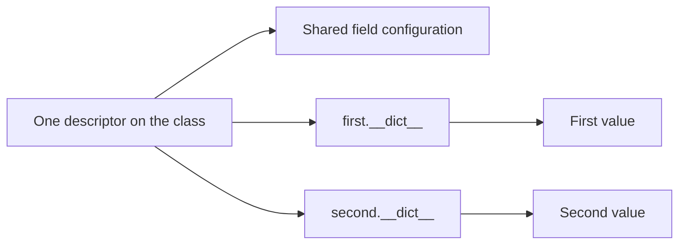
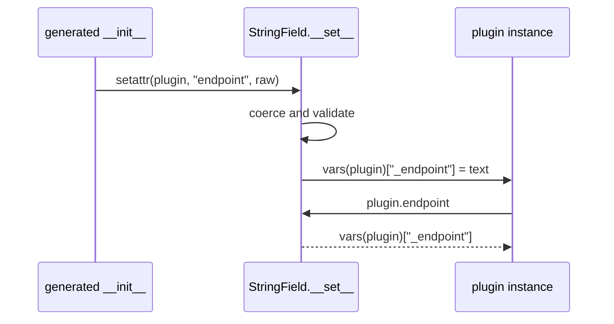

# Reusable Field Descriptors and Storage

<!-- page-maps:start -->
## Page Maps


<!-- page-maps:end -->

Descriptor reuse becomes useful only when the storage model remains honest. One
descriptor object usually serves many owner instances, so configuration may be shared
while managed values must remain independent.

## The ownership split

Use this table before writing a field:

| State | Normal owner |
| --- | --- |
| public field name | descriptor configuration |
| validation or conversion options | descriptor configuration |
| derived private storage name | descriptor configuration |
| one object's current value | owner instance or explicit external store |
| class-family collection of fields | wider class machinery |

The phrase “the descriptor stores the value” is too vague for review. Name the exact
container and key.

## Instance dictionary storage

`StoredField` derives a private key during class creation:

```python
def __set_name__(self, owner, name):
    self.public_name = name
    self.storage_name = f"_{name}"
```

Writes use the owner instance:

```python
def __set__(self, instance, value):
    vars(instance)[self.storage_name] = value
```

Reads use the same owner and key:

```python
def __get__(self, instance, owner=None):
    if instance is None:
        return self
    return vars(instance)[self.storage_name]
```

This shape is small, inspectable, and compatible with ordinary objects that have a
`__dict__`.

## The two-instance proof

A storage design is not proven by one successful object.

The lab asserts:

```python
first.endpoint = "https://one.test"
second.endpoint = "https://two.test"

assert vars(first) == {"_endpoint": "https://one.test"}
assert vars(second) == {"_endpoint": "https://two.test"}
```

The descriptor configuration is shared:

```python
assert Delivery.endpoint is vars(Delivery)["endpoint"]
```

The values are not. This is the central field-storage invariant.

## Failure: descriptor-held current values

Consider:

```python
class BrokenField:
    def __set__(self, instance, value):
        self.value = value

    def __get__(self, instance, owner=None):
        if instance is None:
            return self
        return self.value
```

After:

```python
first.endpoint = "one"
second.endpoint = "two"
```

both reads return `"two"`. The descriptor followed the access protocol but violated
instance ownership.

## Slotted owners change the storage choice

An owner with `__slots__` may not have a dictionary. That does not mean values should move
onto the descriptor.

Possible designs include:

- require a dedicated slot known to the descriptor
- use an external `WeakKeyDictionary`
- reject incompatible owners at class creation
- choose a different abstraction

Each has a cost:

| Storage | Benefit | Cost |
| --- | --- | --- |
| instance dictionary | simple and visible | unavailable on dictionary-free slots |
| dedicated slot | value remains on the owner | slot coordination must happen before class creation finishes |
| `WeakKeyDictionary` | external per-instance ownership without retaining owners | owners must support weak references and hashing |
| plain dictionary keyed by owner | straightforward external map | can keep owners alive |
| dictionary keyed by `id(owner)` | appears compact | stale entries and identity reuse make it unsafe |

Do not present weak-reference storage as a universal upgrade. It introduces its own owner
requirements and concurrency questions.

## Defaults are also storage policy

The capstone `Field` writes a default into each instance during generated initialization.
That is safe for its current immutable scalar defaults.

A mutable default would be a different contract:

```python
default=[]
```

Writing the same list object into every owner dictionary still shares state even though
the dictionary keys are independent. A production field system would need a default
factory or an explicit immutable-default restriction.

The descriptor protocol does not solve default identity.

## Validation and storage are separate decisions

A field can correctly store per-instance values and still apply a bad conversion:

```python
text = str(value).strip()
```

That may be appropriate for configuration input and inappropriate for strict domain
types. Review these independently:

1. Where is the value stored?
2. Which inputs are accepted?
3. Is conversion lossy?
4. When does failure occur?
5. Does reading mutate state?

The worked quantity descriptor will make all five visible.

## Capstone field trace

For `WebhookNotifier.endpoint`:



The metaclass generated the initializer, but the field descriptor owns coercion and
storage access. The plugin instance owns the resulting value.

## What the current proof establishes

The Module 07 tests establish:

- class access exposes shared descriptor configuration
- two instances retain different values
- public writes route into derived private keys
- unset reads fail as attributes rather than returning hidden sentinels
- the quantity example stores only canonical numeric values

They do not establish:

- thread safety for external storage
- support for dictionary-free slotted owners
- safe mutable defaults
- serialization compatibility
- cross-field validation

Those require additional owners and evidence.

## Storage review checklist

For every reusable field, record:

- how many descriptor objects exist
- how many owner instances may use each descriptor
- the exact per-instance key or external map
- whether reads mutate storage
- whether defaults are copied, constructed, or shared
- what owner shapes are rejected

## Focused proof

Run:

```bash
python3 -m unittest discover -s tests \
  -p "test_descriptor_protocol_lab.py" -v
python3 -m unittest discover -s tests \
  -p "test_quantity_descriptor_lab.py" -v
```

Then inspect two `vars(instance)` results. Do not infer storage from the public API alone.

## Continue through Module 07

- Previous: [Functions, Binding, and Method Descriptors](functions-binding-and-method-descriptors.md)
- Next: [Descriptor Boundaries and Attribute Ownership](descriptor-boundaries-and-attribute-ownership.md)
