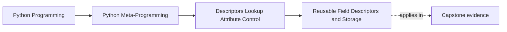

# Reusable Field Descriptors and Storage


<!-- page-maps:start -->
## Page Maps




<!-- page-maps:end -->

This core moves from understanding descriptor mechanics to using them as a repeatable
design tool.

The moment descriptors become truly useful is when one field rule needs to be reused
across many attributes or classes.

This page matters because descriptor knowledge stays shallow until storage ownership
becomes explicit. Reuse is the draw, but storage mistakes are where many first descriptor
designs actually fail.

## The sentence to keep

A reusable field descriptor is usually a data descriptor that learns its public name with
`__set_name__`, validates or coerces values in `__set__`, and keeps per-instance state out
of the descriptor object itself.

That last part is the one that prevents the most bugs.

Keep one more sentence beside it:

> descriptor configuration may live on the descriptor object; descriptor-managed values usually must not.

That second sentence prevents the most common beginner storage bug in the entire module.
If configuration and live field values blur together, reuse becomes untrustworthy fast.

## What a reusable field descriptor usually owns

In this module, a field descriptor is a small class that:

- takes configuration in `__init__`
- learns its installed attribute name in `__set_name__`
- intercepts reads and writes through `__get__` and `__set__`
- stores per-instance values in a safe place

That pattern is what turns descriptor protocol knowledge into something practical.

Use this separation card whenever field descriptors start looking elegant but suspicious:

| Question | Honest owner |
| --- | --- |
| what options configure the field rule? | descriptor object |
| what name was the field installed under? | `__set_name__` result |
| what value belongs to one instance only? | instance storage or safe external storage |
| what code enforces assignment behavior? | `__set__` |

## Which parts belong where

Use this table when a field descriptor starts blurring configuration and state:

| Concern | Honest owner |
| --- | --- |
| field options such as `max_length` | descriptor object |
| installed public name | learned through `__set_name__` |
| per-instance stored value | instance storage or safe external storage |
| read and write behavior | `__get__` and `__set__` |

## A small string field

```python
class StringField:
    def __init__(self, max_length=None):
        self.max_length = max_length

    def __set_name__(self, owner, name):
        self.public_name = name
        self.private_name = f"_{name}"

    def __get__(self, obj, owner=None):
        if obj is None:
            return self
        return obj.__dict__.get(self.private_name, "")

    def __set__(self, obj, value):
        text = str(value)
        if self.max_length is not None and len(text) > self.max_length:
            raise ValueError(f"{self.public_name} exceeds {self.max_length} characters")
        obj.__dict__[self.private_name] = text
```

This is the standard educational shape because every important part stays visible.

It is also strong because the public field declaration remains readable while the storage
rule stays local and explicit.

## A proof route for storage ownership

Use this route when a reusable field looks correct but you do not yet trust the storage:

1. locate the descriptor object on the class
2. locate where assignment writes the actual value
3. create or imagine two instances
4. ask whether changing one instance can leak into the other
5. if the answer depends on descriptor-held mutable state, the storage owner is wrong

## A positive integer field

```python
class PositiveInt:
    def __set_name__(self, owner, name):
        self.public_name = name
        self.private_name = f"_{name}"

    def __get__(self, obj, owner=None):
        if obj is None:
            return self
        return obj.__dict__.get(self.private_name, 0)

    def __set__(self, obj, value):
        number = int(value)
        if number < 0:
            raise ValueError(f"{self.public_name} must be non-negative")
        obj.__dict__[self.private_name] = number
```

This is where descriptors clearly outgrow a single property:

- the rule is reusable
- the attribute name is discovered automatically
- the field behavior is declarative at class definition time

That last point matters for education. A learner can inspect the class body and see a
field rule installed declaratively without needing copied property code everywhere.

Use this review card before accepting reuse:

| If the design pressure is... | Descriptor reuse earns itself? |
| --- | --- |
| one field on one class | usually no |
| the same field rule on several attributes | yes |
| the same field rule across several classes | yes |
| cross-field coordination | not by itself; a wider owner may be needed |

## The storage rule that matters most

The descriptor object usually lives once on the class.

So this is a bug:

```python
class BrokenField:
    def __init__(self):
        self.value = None

    def __get__(self, obj, owner=None):
        return self.value

    def __set__(self, obj, value):
        self.value = value
```

Every instance will share the same `self.value` because that state lives on the descriptor
object itself.

The safer pattern is:

```python
obj.__dict__[self.private_name] = value
```

or explicit external storage when `__dict__` is not available.

## Evidence route for storage reviews

Use this route whenever a descriptor seems to "store its own values":

| Evidence step | What it proves |
| --- | --- |
| the descriptor object lives on the class | descriptor instance is shared across all class instances |
| writes go to `self.value` on the descriptor | stored values will leak across instances |
| writes go to `obj.__dict__` or weak-key storage | values stay associated with individual instances |
| `__set_name__` derives a storage key | field names remain reusable without hard-coding |

## Slotted classes need a different storage owner

If a class uses `__slots__` and does not expose `__dict__`, ordinary instance-dictionary
storage is unavailable.

That is where external storage patterns become useful.

One common external-storage pattern is `WeakKeyDictionary`:

```python
from weakref import WeakKeyDictionary


class SlottedPositiveInt:
    def __init__(self):
        self._values = WeakKeyDictionary()

    def __get__(self, obj, owner=None):
        if obj is None:
            return self
        return self._values.get(obj, 0)

    def __set__(self, obj, value):
        number = int(value)
        if number < 0:
            raise ValueError("value must be non-negative")
        self._values[obj] = number
```

This pattern keeps per-instance values separate while still allowing instances to be
garbage-collected.

It also forces a useful design question: if a descriptor cannot rely on `__dict__`, what
is the narrowest external storage surface that still keeps ownership honest?

## Why `id(obj)` storage is a trap

Sometimes people try:

```python
storage[id(obj)] = value
```

That is a poor storage design because object ids can be reused after garbage collection,
and the mapping can easily leak stale state.

If external storage is needed, weak references are the safer direction.

## A quick storage decision chart

| Situation | Likely safest storage |
| --- | --- |
| ordinary instances with `__dict__` | `obj.__dict__[private_name]` |
| slotted instances without `__dict__` | `WeakKeyDictionary` or another explicit external store |
| tempting shortcut with `id(obj)` | reject unless you can prove lifecycle safety, which this module does not teach as a good default |

## Storage options compared

| Storage option | Good when | Main warning |
| --- | --- | --- |
| `obj.__dict__[private_name]` | instances expose `__dict__` and field ownership is local | requires a stable private-name convention |
| `WeakKeyDictionary` | slotted or external-storage cases need instance separation | adds indirection and requires hashable/weak-reference-compatible instances |
| `id(obj)` mapping | almost never | ids can be reused and stale state can leak |

## What reusable field descriptors are good at

Use them when:

- the same field rule repeats across many classes
- the rule truly belongs to assignment or access of that attribute
- class-level declaration makes the model easier to read

That is where descriptors start earning their complexity.

Reuse pressure is the real justification. Descriptor power without repetition often turns
into unnecessary abstraction.

## Evidence packet for reusable-field reviews

Leave this page with a small packet:

- one reusable field installed under two different names
- one trace showing where the live per-instance value lands
- one broken shared-state example and its repair
- one sentence explaining why reuse pressure is strong enough, or not strong enough, to justify a descriptor

## What they are not automatically good at

Descriptors are not automatically the right fit for:

- one one-off field rule on one class
- wide object-level invariants spanning many attributes
- full validation frameworks with cross-field coordination

Those cases may still belong to properties, explicit validators, or later-course
architectures.

## Common overclaims to reject

Reject these descriptions when they appear in review:

| Overclaim | Better replacement |
| --- | --- |
| "the descriptor stores the field" | "the descriptor manages access while the instance or external mapping stores the value" |
| "descriptor state is fine because the field object is small" | "shared descriptor state is still shared across instances" |
| "weak-key storage is just an optimization detail" | "weak-key storage is a storage-ownership choice for cases without instance dictionaries" |
| "reuse is always worth a descriptor" | "reuse must be real enough to justify a stronger owner" |

## Failure modes for reusable field design

These are the main ways a field descriptor can weaken:

| Failure mode | Why it weakens the design | Repair move |
| --- | --- | --- |
| storing values on the descriptor object | state leaks across instances | move value storage to the instance or weak-key mapping |
| hard-coding field names in the descriptor | reuse becomes brittle | derive names with `__set_name__` |
| using a descriptor for a one-off local rule | abstraction cost exceeds clarity gain | keep a property or plain method instead |
| using `id(obj)`-based storage | stale state and identity reuse risk accumulate | prefer `obj.__dict__` or weak references |

## A compact review checklist

When reviewing reusable field descriptors, ask:

- is the rule reusable enough to justify a descriptor?
- where does per-instance state live?
- is `__set_name__` removing hard-coded attribute names?
- does the descriptor clearly separate configuration from stored values?
- would one property still be clearer if the reuse pressure is low?
- can another reviewer identify exactly where instance state lives?

## Exit check for this page

Before moving on, make sure you can do all of these:

- explain why storing values on the descriptor object is usually wrong
- name one safe `__dict__`-based storage pattern and one safe external-storage pattern
- describe what `__set_name__` removes from the implementation
- say when reuse pressure is strong enough to justify a descriptor

## What to practice from this page

Try these before moving on:

1. Build one reusable validating field and install it on two attributes with different names.
2. Demonstrate the shared-state bug caused by storing values on the descriptor itself.
3. Sketch a slotted-compatible version and explain why weak-reference storage is safer than `id(obj)` storage.

If those feel ordinary, the next step is the design boundary page: when descriptor power
is truly the right owner and when it is more than the problem needs.

## Continue through Module 07

- Previous: [Functions, Binding, and Method Descriptors](functions-binding-and-method-descriptors.md)
- Next: [Descriptor Boundaries and Attribute Ownership](descriptor-boundaries-and-attribute-ownership.md)
- Return: [Overview](index.md)
- Terms: [Glossary](glossary.md)
