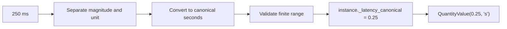
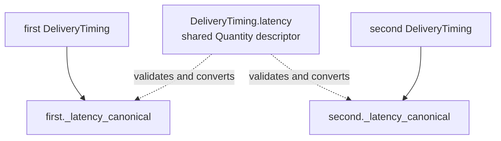

# Worked Example: Building a Unit-Aware Quantity Descriptor

<!-- page-maps:start -->
## Page Maps


<!-- page-maps:end -->

This worked example is shipped in `labs/descriptor_lookup/quantity.py` and tested in
`tests/test_quantity_descriptor_lab.py`. Read it with the implementation open.

One descriptor is shared, but each instance owns its canonical value:



## The design pressure

Several incident-delivery timing fields need the same contract:

- accept seconds directly
- accept milliseconds as an explicit pair
- reject unknown units
- reject non-finite or out-of-range values
- store one canonical representation per owner instance
- allow callers to request another display unit on read
- expose the field contract through class access

A property would be reasonable for one field. Repeated latency and timeout fields make a
descriptor an earned owner.

## Define the bounded public contract

Usage:

```python
class DeliveryTiming:
    latency = Quantity(
        "s",
        {"s": 1.0, "ms": 0.001},
        minimum=0.0,
        maximum=30.0,
    )
```

Supported writes:

```python
timing.latency = 2
timing.latency = (250, "ms")
```

Supported reads:

```python
timing.latency.canonical_value
timing.latency.in_unit("ms")
DeliveryTiming.latency.spec()
```

The descriptor does not parse strings such as `"250ms"`, perform dimensional algebra, or
choose display formatting. Those are deliberate non-goals.

## Validate descriptor configuration early

`Quantity.__init__` rejects incoherent field declarations:

- blank canonical unit
- canonical unit without factor `1.0`
- zero or negative conversion factors
- minimum greater than maximum

This failure happens while the class body evaluates the descriptor expression, before an
owner class can use the broken field.

For example:

```python
Quantity("s", {"s": 1000.0})
```

fails because a canonical value cannot have a non-identity factor.

## Derive the storage key

Class creation supplies the public name:

```python
def __set_name__(self, owner, name):
    self.public_name = name
    self.storage_name = f"_{name}_canonical"
```

The word `canonical` is part of the key because it records a durable invariant: values
under that name are already converted. A vague `_latency` key would not communicate that
boundary to a debugger.

## Trace a write

For:

```python
timing.latency = (250, "ms")
```

the descriptor:

1. separates `250` and `"ms"`
2. verifies that the magnitude is numeric but not `bool`
3. verifies that `"ms"` is accepted
4. multiplies by `0.001`
5. rejects non-finite results
6. checks the canonical range
7. writes `0.25` to `vars(timing)["_latency_canonical"]`

The original spelling and unit are intentionally discarded. The canonical value is the
stored truth.

## Trace a read

`timing.latency` invokes `Quantity.__get__`:

```python
return QuantityValue(
    canonical_value=float(value),
    canonical_unit=self.canonical_unit,
    conversion_factors=self.conversion_factors,
)
```

The returned value can convert for presentation:

```python
assert timing.latency.in_unit("ms") == 250.0
```

Conversion does not rewrite storage:

```python
assert vars(timing) == {"_latency_canonical": 0.25}
```

This separates canonical domain state from requested display units.

## Prove instance independence

The evidence route creates two owners:

```python
first.latency = (250, "ms")
second.latency = 2
```

The JSON packet contains:

```json
{
  "first": {
    "canonical_value": 0.25,
    "instance_dictionary": {"_latency_canonical": 0.25},
    "milliseconds": 250.0
  },
  "second": {
    "canonical_value": 2.0,
    "instance_dictionary": {"_latency_canonical": 2.0}
  }
}
```

The descriptor holds conversion configuration. Each owner holds its own canonical value.

## Failure routes

The tests cover distinct failures because they reveal distinct policy:

| Input or declaration | Failure | Owner |
| --- | --- | --- |
| `("fast", "s")` | magnitude must be numeric | descriptor write policy |
| `True` | magnitude must be numeric | descriptor write policy |
| `(1, "minutes")` | unit is unsupported | descriptor unit contract |
| `float("inf")` | value must be finite | canonical-value policy |
| `31` with maximum `30` | canonical range failure | descriptor bounds |
| factors with `"s": 1000.0` | incoherent declaration | descriptor configuration |
| read before assignment | `AttributeError` | attribute absence contract |

Rejecting `bool` matters because `bool` is a subclass of `int`. A naive numeric check
would silently accept `True` as one second.

## The data-descriptor consequence

`Quantity` defines `__set__`, so a public shadow entry cannot replace its read:

```python
vars(timing)["latency"] = "shadow"
assert timing.latency.canonical_value == 0.25
```

The descriptor reads `_latency_canonical`, and data-descriptor precedence runs before the
public instance entry.

This is predictable machinery, not a reason to encourage direct dictionary mutation.

## Limits and maintenance cost

The implementation intentionally does not promise:

- decimal-exact conversions
- compound units
- localization
- mutable conversion registries
- slotted-owner support
- cross-field rules such as `latency <= timeout`
- persistence schema compatibility

Adding one of those requirements may change the storage type, value object, or owner.
Cross-field validation in particular no longer belongs entirely to one attribute.

## Compare with the capstone

The capstone `Field` family uses the same descriptor shape but solves a different domain:

| Quantity lab | Incident-plugin capstone |
| --- | --- |
| converts explicit units | coerces configuration input |
| stores canonical numeric value | stores validated plugin configuration |
| exposes `QuantitySpec` | exposes `FieldSpec` |
| one reusable descriptor class | specialized string, integer, boolean, and choice fields |
| no class-family collection | `PluginMeta` collects inherited and declared fields |

The lab isolates the attribute mechanism. The capstone demonstrates why a field family
needs collection and constructor generation as supporting machinery.

## Run the proof

```bash
make descriptor-lookup-lab
python3 -m unittest discover -s tests \
  -p "test_quantity_descriptor_lab.py" -v
```

Review the JSON before the test names. Predict which dictionary keys and failure messages
the tests should assert.

## Exit review

Write a review note that answers:

- what is canonicalized
- when conversion occurs
- where values live
- why `Quantity` is a data descriptor
- why a property was rejected
- which first new requirement would force a wider owner

## Continue through Module 07

- Previous: [Descriptor Boundaries and Attribute Ownership](descriptor-boundaries-and-attribute-ownership.md)
- Next: [Exercises](exercises.md)
