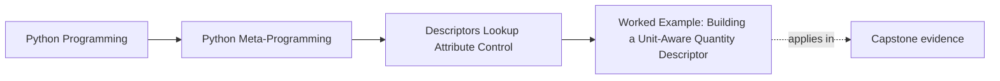

# Worked Example: Building a Unit-Aware Quantity Descriptor


<!-- page-maps:start -->
## Page Maps




<!-- page-maps:end -->

The five core lessons in Module 07 become easier to trust when they meet one field design
that is useful, realistic, and easy to overstate.

A bounded quantity descriptor is exactly that kind of example.

Treat this page as a review packet, not as a production-ready units library. Its main job
is to show where a descriptor owns field semantics honestly, where its boundaries stay
narrow on purpose, and what evidence a reviewer should demand before believing the design.

It combines:

- descriptor protocol hooks
- field-level validation and coercion
- per-instance storage
- a clear boundary between attribute semantics and broader unit-system ambitions

That makes it the right worked example for the module.

## Review questions for the page

Keep two questions active while reading:

1. what exact attribute behavior does this descriptor own?
2. what broader unit-system claim must it refuse?

## The incident

Assume a team wants length-like fields that can accept:

- plain numbers interpreted as metres
- strings such as `"2 km"`
- existing quantity values

They also want reads to return a small helper object that can:

- preserve a display unit
- convert to other supported units
- support a small amount of scalar arithmetic

Those are reasonable design goals. The mistake would be pretending this is now a full
units framework.

That sentence is the real incident. The syntax and demo behavior can look impressive
quickly, so the important work is keeping the field owner narrow enough that learners do
not mistake a bounded descriptor for a full domain model.

## The first design rule: keep the scope bounded

This worked example is intentionally narrow.

It supports:

- length-like units only
- canonical storage in metres
- scalar multiplication and division

It does not claim:

- full dimensional analysis
- arbitrary unit algebra
- production-grade parsing

That refusal is part of what makes the example honest.

## Non-goals to keep visible

This worked example is intentionally not trying to deliver:

- multi-dimension unit algebra
- domain-wide compatibility rules across unrelated quantities
- preservation of the original input string as authoritative state
- framework-grade parsing, localization, or formatting policy
- object-wide coordination across many fields

If the design needs those guarantees, the descriptor is already under pressure from a
broader owner than this module is trying to teach.

## Step 1: keep canonical storage separate from display

The descriptor should store one internal representation.

For this example, that representation is metres.

That means:

- numbers are treated as metres
- string inputs are parsed and converted to metres
- display preference is a presentation concern, not the storage format

This separation is the backbone of the design.

It also gives the reviewer a clean owner story:

- assignment owns normalization into metres
- stored state owns one canonical numeric value
- the read surface owns presentation and lightweight conversion

## Step 2: let `__set_name__` derive storage keys

Like the reusable field descriptors from the fourth core, `Quantity` should learn its name
when the owning class is created.

That allows it to derive a private per-instance storage key such as:

```python
_length_metres
```

without hard-coding field names into the descriptor implementation.

That matters because hard-coded field names would make the descriptor look reusable while
quietly tying it to one installation surface.

## Step 3: return a helper object on reads

The descriptor does not have to return a raw float.

Returning a small value object is useful here because it can hold:

- the canonical metres value
- the display unit
- convenience conversion methods

That makes reads more expressive while still keeping storage normalized underneath.

Use this read/write split to keep the contract honest:

| Operation | What the descriptor owns |
| --- | --- |
| write `obj.length = "2 km"` | parse supported input and normalize to canonical metres |
| read `obj.length` | return a shaped helper object with a chosen display unit |
| store internal value | keep one canonical float in metres under a derived storage name |

## A bounded implementation

```python
import re


CONVERSIONS = {
    "mm": 0.001,
    "cm": 0.01,
    "m": 1.0,
    "km": 1000.0,
}

UNIT_PATTERN = re.compile(r"^\s*(\d*\.?\d+)\s*([a-zA-Z]+)\s*$")


class QuantityValue:
    __slots__ = ("_metres", "_display_unit")

    def __init__(self, metres, display_unit):
        self._metres = float(metres)
        self._display_unit = display_unit

    def to(self, unit):
        try:
            factor = CONVERSIONS[unit]
        except KeyError:
            raise ValueError(f"unknown unit {unit!r}") from None
        return self._metres / factor

    @property
    def in_metres(self):
        return self._metres

    def __mul__(self, scalar):
        return QuantityValue(self._metres * scalar, self._display_unit)

    __rmul__ = __mul__

    def __truediv__(self, scalar):
        return QuantityValue(self._metres / scalar, self._display_unit)

    def __repr__(self):
        return f"{self.to(self._display_unit):.3f} {self._display_unit}"


class Quantity:
    def __init__(self, display_unit="m"):
        if display_unit not in CONVERSIONS:
            raise ValueError(f"unsupported display unit {display_unit!r}")
        self.display_unit = display_unit

    def __set_name__(self, owner, name):
        self.public_name = name
        self.storage_name = f"_{name}_metres"

    def __get__(self, obj, owner=None):
        if obj is None:
            return self
        metres = obj.__dict__.get(self.storage_name, 0.0)
        return QuantityValue(metres, self.display_unit)

    def __set__(self, obj, value):
        if isinstance(value, QuantityValue):
            metres = value.in_metres
        elif isinstance(value, (int, float)):
            metres = float(value)
        elif isinstance(value, str):
            match = UNIT_PATTERN.match(value)
            if not match:
                raise ValueError(f"cannot parse quantity string {value!r}")
            scalar_text, unit = match.groups()
            try:
                factor = CONVERSIONS[unit]
            except KeyError:
                raise ValueError(f"unknown unit {unit!r}") from None
            metres = float(scalar_text) * factor
        else:
            raise TypeError(
                f"{self.public_name} does not support values of type {type(value).__name__}"
            )
        obj.__dict__[self.storage_name] = metres


class Distance:
    length = Quantity("m")


distance = Distance()
distance.length = "2 km"
print(distance.length)           # 2000.000 m
print(distance.length.to("cm"))  # 200000.0
print(distance.length.in_metres) # 2000.0
```

## What this implementation proves and what it does not

Use the code block as evidence, not as marketing:

| Claim | Supported by this implementation? | Why |
| --- | --- | --- |
| field assignment normalizes supported inputs to metres | yes | `__set__` parses numbers, strings, and existing quantity values |
| reads expose a richer helper than the stored float | yes | `__get__` returns `QuantityValue` |
| per-instance state stays off the descriptor object | yes | storage goes into `obj.__dict__[self.storage_name]` |
| the descriptor is a data descriptor | yes | it defines `__set__` |
| the design is a full units framework | no | parsing, dimensions, and algebra stay deliberately narrow |
| the descriptor preserves every input detail exactly | no | canonical storage intentionally discards some input-surface details |

## Why this is useful for review

This example keeps the important choices visible:

- `Quantity` is a data descriptor because it owns assignment
- `__set_name__` derives the storage name automatically
- per-instance state lives in the instance dictionary, not on the descriptor object
- the read surface is richer than the stored representation

That makes the example reviewable instead of magical.

## Failure surfaces a reviewer should inspect

Even this bounded design has pressure points:

| Failure surface | Why it matters |
| --- | --- |
| string parsing | the supported input language is deliberately small and easy to overclaim |
| canonical storage choice | reviewers must know what information is kept and what is discarded |
| helper-object arithmetic | convenience operations can look like a broader algebra than the code really supports |
| display-unit configuration | field-level presentation choices should not be confused with domain-wide unit policy |

## Where the boundary shows up

This example is still intentionally limited.

For example, this is not supported:

- adding incompatible dimensions
- preserving the exact original textual unit from assignment
- checking real-world unit compatibility beyond the declared conversion table

Those limitations are not defects. They are part of the module's honesty.

Use this limitations table when a review starts inflating the design:

| Missing behavior | Why refusing it is honest here |
| --- | --- |
| arbitrary unit algebra | broader than one field descriptor should claim |
| dimension compatibility across unrelated quantities | wants a stronger domain model than one attribute owner |
| round-tripping the exact original input string | not necessary for the canonical storage lesson |

## Why this belongs to a descriptor

The field behavior here belongs to attribute access itself:

- writes should normalize values
- reads should produce a shaped quantity object
- each installed field should keep the same behavior across instances

That is a strong descriptor case.

If the example instead needed:

- object-wide coordination across many fields
- schema registration at class-creation time
- full measurement-system architecture

then the ownership would be broader than one reusable descriptor.

## Evidence packet to leave behind

If you adapt this example, leave behind a packet another reviewer can inspect quickly:

- the supported input shapes
- the canonical stored representation
- one example of behavior returned on read
- one explicit limitation the descriptor refuses
- one sentence explaining why the design still belongs to attribute access rather than a wider units system

## What this example makes clear about Module 07

This worked example ties the module together:

- the descriptor protocol becomes concrete
- precedence matters because this is a data descriptor
- `__set_name__` removes hard-coded field names
- per-instance storage choices stay visible
- descriptor power is useful only because the ownership boundary is honest

That is the durable takeaway. The point is not to build a perfect unit system. The point
is to make descriptor ownership visible in one coherent field design.

## Exit check for this page

Before leaving the worked example, make sure you can do all of these:

- explain what the descriptor owns on write versus on read
- name the canonical stored representation
- identify one broader units feature the example deliberately refuses
- say what missing condition would justify a wider owner than this descriptor

## Continue through Module 07

- Previous: [Descriptor Boundaries and Attribute Ownership](descriptor-boundaries-and-attribute-ownership.md)
- Next: [Exercises](exercises.md)
- Reference: [Exercise Answers](exercise-answers.md)
- Terms: [Glossary](glossary.md)
