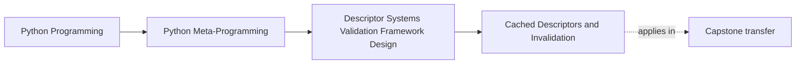
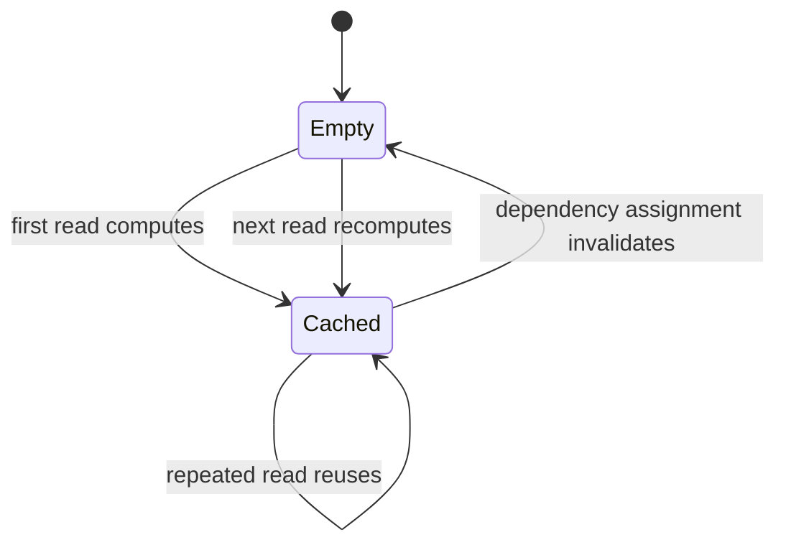
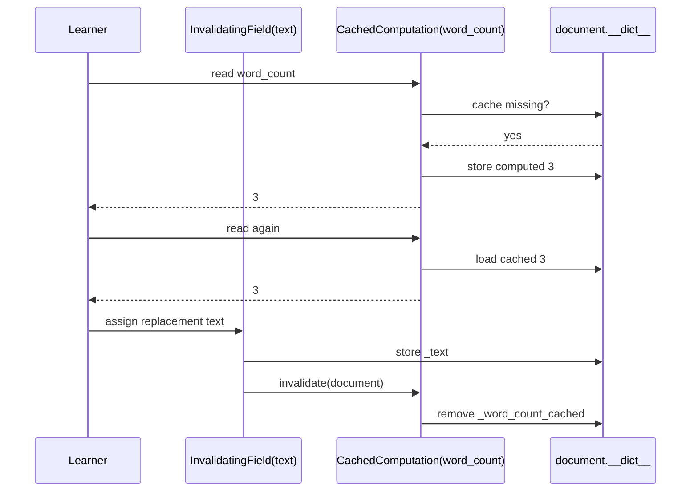

# Cached Descriptors and Invalidation

<!-- page-maps:start -->
## Page Maps




<!-- page-maps:end -->

A cached descriptor changes the meaning of a read. The first read computes; later reads
reuse state. That optimization creates a correctness obligation:

> every dependency that can make the value stale needs an observable invalidation owner.

Without that owner, the descriptor does not merely risk poor performance. It can return a
wrong answer while looking like ordinary attribute access.

## Starting pressure

Suppose `Document.word_count` derives from `Document.text`.

Three designs are possible:

| Design | Read behavior | Freshness responsibility |
| --- | --- | --- |
| compute every time | always calls the derivation | no retained value can go stale |
| cache with caller refresh | reuses a retained value | every caller must remember hidden protocol |
| cache with named dependency | source assignment invalidates the derivation | the field system owns the local relationship |

The lab chooses the third design. It is stronger than one isolated descriptor because
`text` and `word_count` coordinate, but the dependency remains explicit in the class
declaration.

## Read the shipped implementation

Open `labs/descriptor_systems/cache.py`.

The declaration is intentionally compact:

```python
class Document:
    text = InvalidatingField(invalidates=("word_count",))
    word_count = CachedComputation(
        lambda document: len(document.text.split()),
        depends_on=("text",),
    )
```

Two descriptors have different jobs:

- `CachedComputation` owns computation, one per-instance cache slot, and cache removal.
- `InvalidatingField` owns source assignment and names the cached fields made stale by
  that assignment.

Neither descriptor claims distributed freshness, cross-instance coordination, or
protection from arbitrary mutation.

## Trace one lifecycle

Run:

```bash
python3 -m unittest tests/test_descriptor_system_cache.py -v
make descriptor-system-lab
```

Inspect `cache_invalidation` in the JSON. The meaningful transition is:

| Moment | `cached` | `computations` | Observed value |
| --- | ---: | ---: | ---: |
| after first and second read | `true` | `1` | `3` |
| immediately after assigning `text` | `false` | `1` | not read yet |
| after the next read | `true` | `2` | `5` |

The second read does not recompute. Assigning the dependency removes
`_word_count_cached`. The next read computes once and stores the replacement.



## Why the cache lives on the instance

`CachedComputation` is one class-owned descriptor shared by every `Document`. Putting the
computed value on that descriptor would mix instance state.

The lab stores:

```text
document.__dict__["_word_count_cached"]
```

That makes the cache:

- isolated per document
- visible during debugging
- removable without replacing the descriptor
- governed by ordinary instance lifetime

The evidence packet publishes `storage_owner: "instance.__dict__"` so this ownership is
not inferred from prose.

## Why dependency naming appears twice

The source field declares what it invalidates:

```python
text = InvalidatingField(invalidates=("word_count",))
```

The cache declares what it depends on:

```python
CachedComputation(..., depends_on=("text",))
```

This lab does not automatically reconcile those declarations. That duplication is
deliberate evidence of a system-level pressure: once many dependencies exist, validating
the graph may require class-level coordination. Module 09 will address when class
creation should own that work.

For this bounded example, the two declarations let a reviewer inspect both directions:

- from source mutation to invalidated cache
- from cached value to its named source

## Failure route: bypassing the owner

This mutation bypasses `InvalidatingField.__set__`:

```python
document.__dict__["_text"] = "untracked replacement"
```

The cached `word_count` can now remain stale. The evidence packet names that limit:

```json
{
  "bypass_limit": "direct instance-dictionary mutation bypasses invalidation",
  "cross_instance_coherence": false
}
```

The lesson is not to make bypass impossible at any cost. The lesson is to state which
mutation path owns freshness and what happens outside it.

## What the tests prove

`tests/test_descriptor_system_cache.py` proves:

- repeated reads reuse one computation
- dependency assignment invalidates before the next read
- cache state is independent per instance
- a declared invalidation target must actually be a `CachedComputation`
- a cached computation must name at least one dependency
- the learner evidence names both the owner and the bypass

It does not prove:

- thread-safe first computation
- atomic dependency updates
- cross-process coherence
- immunity from direct state mutation
- bounded memory for long-lived instances

## Capstone transfer

The incident-plugin capstone does **not** cache derived field values. Its fields validate
and store configuration directly on each plugin instance. Adding cache invalidation there
would introduce coordination without a current application pressure.

That rejection matters: Module 08 teaches how cached descriptors work so you can also
recognize when a real system should not use them.

## Learner work

Before continuing, produce a cache contract with five entries:

1. cached attribute
2. complete dependency set
3. cache storage slot
4. invalidation owner
5. bypass or wider-coherence limit

Then change one dependency in a focused test and prove the state sequence
`cached -> invalidated -> recomputed`.

Move on when you can explain why “it recomputes when needed” is not a contract until
“needed” has a concrete owner and trigger.

## Continue

- Previous: [Module Overview](index.md)
- Next: [External Storage Descriptors](external-storage-descriptors.md)
- Practice: [Descriptor System Review Lab](exercises.md)
