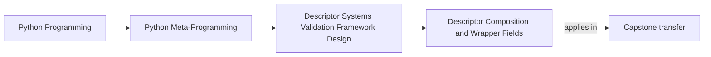
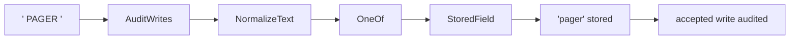
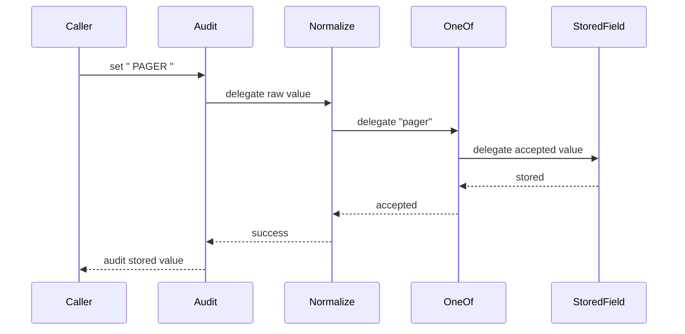

# Descriptor Composition and Wrapper Fields

<!-- page-maps:start -->
## Page Maps




<!-- page-maps:end -->

Composition can prevent a subclass explosion, but it does not make complexity disappear.
It moves complexity into a delegation chain.

The review standard is therefore:

> one layer owns one concern, every protocol hook reaches the correct inner owner, and a
> complete read or write can still be narrated in order.

If a wrapper exists only “for flexibility,” or if its place in the trace cannot be
explained, it has not earned its cost.

## Starting pressure

A delivery channel field needs four behaviors:

1. normalize input text
2. accept only `email` or `pager`
3. store the accepted value
4. record successful writes

Inheritance could create a specialized class for this exact combination. More
combinations would multiply subclasses. The lab instead wraps one field contract:

```python
class DeliveryPolicy:
    channel = AuditWrites(
        NormalizeText(
            OneOf(
                StoredField(),
                choices=("email", "pager"),
            )
        )
    )
```

Read the declaration from outside to inside. Trace assignment in that same direction
until storage succeeds, then return outward to record the audit.

## Inspect the layer ledger

Open `labs/descriptor_systems/composition.py` and run:

```bash
python3 -m unittest tests/test_descriptor_system_composition.py -v
make descriptor-system-lab
```

The `composition.layers` packet reports:

| Layer | Owned concern | `__set_name__` calls |
| --- | --- | ---: |
| `AuditWrites` | record an accepted write after storage | 1 |
| `NormalizeText` | strip whitespace and normalize case | 1 |
| `OneOf` | enforce an explicit choice set | 1 |
| `StoredField` | store one accepted value on the instance | 1 |

Class access keeps the outer descriptor visible:

```python
DeliveryPolicy.channel
```

returns `AuditWrites`, whose `.inner` chain remains inspectable. No instance is required
to discover the policy stack.

## Protocol forwarding

`FieldWrapper` forwards all three hooks required by this lab:

```python
def __set_name__(self, owner, name):
    self.inner.__set_name__(owner, name)

def __get__(self, obj, owner=None):
    if obj is None:
        return self
    return self.inner.__get__(obj, owner)

def __set__(self, obj, value):
    self.inner.__set__(obj, value)
```

The outermost descriptor is the only object Python calls automatically for the class
attribute. Every inner binding happens because a wrapper explicitly delegates it.

Missing `__set_name__` forwarding would leave `StoredField.storage_name` empty. Duplicate
forwarding would bind inner layers more than once. The focused test asserts a binding
count of exactly one for every layer.

## Accepted write trace

Assigning `" PAGER "` produces this evidence:

```text
NormalizeText: " PAGER " -> "pager"
OneOf: "pager" accepted
StoredField: "pager" stored
AuditWrites: accepted write recorded
```

The order encodes policy:

- normalization must precede choice validation
- validation must precede storage
- audit must follow successful storage

Changing wrapper order changes behavior. Composition is not an unordered collection of
features.



## Rejected write trace

Assigning `"console"` produces only:

```text
NormalizeText: "console" -> "console"
OneOf: "console" rejected
```

The evidence also reports:

```json
{
  "audit_created": false,
  "stored": false
}
```

This proves that failure stops before both mutation and success audit. An audit recorded
before delegation would incorrectly claim that a rejected assignment succeeded.

## Wrapper budget

The lab intentionally uses three visible wrappers to make the full pattern observable.
That is an educational upper edge, not a recommendation to keep stacking.

For a real review:

- one wrapper is usually cheap to narrate
- two wrappers need a written order and owner ledger
- three or more require strong evidence that a dedicated field type or explicit service
  would not be clearer

The relevant cost is not runtime call depth alone. It is how many files and transformations
a maintainer must traverse to explain one assignment.

## When composition is the wrong owner

Move away from wrappers when:

- multiple layers coordinate different attributes
- order changes according to runtime context
- failure requires rollback across writes
- the stack needs shared lifecycle state
- class-wide policy must be generated from every field

Those are system or framework concerns. More delegation cannot make their broader
ownership disappear.

## What the tests prove

`tests/test_descriptor_system_composition.py` proves:

- the accepted trace runs normalize, validate, store, then audit
- a rejected value reaches neither storage nor audit
- every layer receives name binding exactly once
- class access exposes the complete outer-to-inner chain
- wrappers reject an inner object missing required descriptor hooks
- the evidence names one responsibility per layer

It does not prove:

- arbitrary wrapper orders are valid
- deep stacks remain maintainable
- cross-field coordination
- rollback across side effects
- compatibility with every descriptor protocol variation

## Capstone transfer

The incident-plugin capstone uses explicit `StringField`, `IntegerField`,
`BooleanField`, and `ChoiceField` subclasses. It does not use wrapper stacks.

That choice fits its current scale:

- each field type has one visible coercion contract
- class inspection immediately reveals the concrete field kind
- no cross-cutting field concern currently justifies delegation layers

The lab teaches composition as an available mechanism. The capstone demonstrates a
reasonable rejection of that mechanism.

## Learner work

Take one composed field and submit:

1. its class-access layer ledger
2. one successful write trace
3. one rejected write trace
4. the exact point where mutation occurs
5. the exact point where success audit occurs
6. one wrapper you would remove first and the behavior lost
7. the condition that would force the design into a wider owner

Move on when you can explain wrapper order as executable policy rather than as nested
syntax.

## Continue

- Previous: [External Storage Descriptors](external-storage-descriptors.md)
- Next: [Hint-Driven Validation and Coercion](hint-driven-validation-and-coercion.md)
- Practice: [Descriptor System Review Lab](exercises.md)
