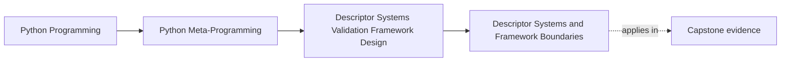

# Descriptor Systems and Framework Boundaries


<!-- page-maps:start -->
## Page Maps




<!-- page-maps:end -->

This final core is the design page for Module 08.

The mechanics are already on the table:

- caching
- invalidation
- external storage
- composition
- hint-driven validation

The remaining question is the important one:

when is this still a descriptor system, and when has it become framework architecture?

This page matters because Module 08 stops being about "can descriptors do this?" and
becomes about "should descriptors own this at all?" A learner studying alone needs a
decision ladder for choosing the smallest honest owner and for rejecting both weaker
shortcuts and overpowered architecture when they are not justified.

## The sentence to keep

Descriptor systems stay honest when they still own one attribute contract at a time; once
they start coordinating identity, transactions, query planning, object graphs, or broader
lifecycle behavior, the design has crossed into framework architecture.

That is the boundary the module keeps visible.

Keep one more sentence beside it:

> the right question is not whether a descriptor can hide the mechanism, but whether the mechanism still belongs to one attribute contract.

For self-study, rewrite that sentence as a forced decision:

- if I describe this behavior without mentioning the rest of the model, does the explanation still make sense?
- if not, which broader owner is already being pulled in silently?

## Why this boundary matters

Descriptor systems are seductive because they can make rich behavior appear simple:

- `obj.field`
- `obj.related`
- `obj.title = "..."`.

But that surface can hide a lot:

- remote storage
- cache invalidation
- coercion policy
- relationship loading
- persistence rules

If those concerns pile up without a broader design boundary, the descriptor starts looking
more powerful than it really is.

Use this decision table before trusting a field-shaped design:

| Pressure | Smallest honest owner to test first | Stronger owner to escalate to when needed |
| --- | --- | --- |
| normalize or validate one attribute | one descriptor | no stronger owner unless multiple fields must coordinate |
| cache one derived attribute | one descriptor with explicit invalidation | service or model infrastructure if coherence widens |
| read one value from backend storage | backend-backed descriptor | repository, session, or model infrastructure if lifecycle widens |
| coordinate identity or transactions | not a descriptor | explicit service, session, or framework layer |
| generate class-wide model behavior | not a single field | class-level or metaclass orchestration |

## The framework pressure ladder

A useful review ladder for this module is:

```text
single field descriptor
  -> wrapped or composed field descriptor
  -> coordinated descriptor system
  -> explicit framework services and model architecture
  -> metaclass or class-creation orchestration when model-wide generation is required
```

This is not a “more advanced is better” ladder. It is a blast-radius ladder.

Use one more translation:

- field-level power asks "what does this one attribute mean?"
- framework-level power asks "how do multiple objects, writes, or lifecycle phases stay coordinated?"

## Evidence route for boundary reviews

Use this route whenever a design feels clever enough to hide ownership:

| Evidence step | What it proves |
| --- | --- |
| state the contract in one sentence | tells you whether the design still sounds like one attribute |
| list all moving parts touched by one read or write | tells you whether the blast radius already exceeds a field |
| name the smallest honest owner | tells you whether a descriptor still fits |
| name one refused lower-power owner | tells you what would be too weak to carry the contract |
| name one refused stronger owner | tells you whether wider architecture would currently be overkill |

## Boundary diagnosis worksheet

Fill this out before accepting a design as "still just descriptors":

| Behavior under review | Smallest owner that might fit | Why that owner may be enough | First sign it no longer is enough | Better escalated owner |
| --- | --- | --- | --- | --- |
| cache one derived field | descriptor | one attribute owns the dependency and invalidation story | cross-instance coherence or shared invalidation appears | service or model infrastructure |
| load one backend-backed field | descriptor | one field maps one durable slot | transactions, record identity, or relationship policy appear | repository, session, or model layer |
| your own case | fill this in | fill this in | fill this in | fill this in |

## What still belongs to one attribute

Strong descriptor cases in this module still sound like:

- normalize this one field on assignment
- cache this one computed attribute with explicit invalidation
- read this one field through a backend-backed descriptor
- attach one validator layer around one inner field

Those are all still field-level ownership stories.

Strong answers here sound precise:

- this one field normalizes and stores one value
- this one field caches one derivation and names its invalidation owner
- this one field maps one backend slot without claiming transactions or identity

## What starts to exceed one attribute

The design is moving beyond one descriptor when it needs:

- identity maps across many records
- transaction or unit-of-work coordination
- relationship loading strategy across collections
- schema evolution and migrations
- global model registries with lifecycle behavior

At that point, the descriptor is no longer the whole story. It is one component inside a
larger framework.

Use this escalation table when the boundary feels ambiguous:

| Responsibility | Why one field is too small | Better owner |
| --- | --- | --- |
| identity map | many records must share one lifecycle view | session or model infrastructure |
| transaction coordination | multiple writes must succeed or fail together | unit-of-work or persistence service |
| relationship loading policy across collections | many records and access paths must coordinate | repository or ORM-like model layer |
| schema evolution | version drift exceeds one attribute contract | migration and storage architecture |
| lifecycle-wide hooks | behavior spans class, record, and persistence phases | framework or class-creation owner |

## Why hidden architecture is risky

One of the easiest mistakes in metaprogramming is hiding architecture inside “smart field”
objects.

That can make code look elegant while making it harder to answer basic questions such as:

- where does persistence actually happen?
- who invalidates related objects?
- what guarantees object identity?
- how are writes coordinated?

If the answer is “the field sort of handles it,” the design boundary is already blurry.

## Common overclaims to reject

Reject these descriptions when they appear in review:

| Overclaim | Better replacement |
| --- | --- |
| "the descriptor handles persistence" | "the descriptor participates in one field-shaped persistence path" |
| "the field keeps records synchronized" | "cross-record synchronization needs a wider owner" |
| "the model layer is just smart descriptors" | "descriptors may be one layer inside a wider model architecture" |
| "we do not need services because the field already knows enough" | "services become necessary when coordination exceeds one attribute" |

## Weak answers to reject early

| Weak answer | Why it fails |
| --- | --- |
| "descriptors are powerful enough" | power does not answer ownership |
| "the framework part is small" | small architecture is still architecture |
| "we can keep it in the field for convenience" | convenience does not justify hidden blast radius |
| "services would be overengineering" | that may be true, but only after the rejected stronger owner is named concretely |

## Descriptors versus explicit services

A strong rule of thumb is:

- keep per-field semantics in descriptors
- move cross-field or cross-record orchestration into explicit services, sessions, or framework objects

That split keeps the descriptor layer narrow enough to inspect while still allowing the
overall system to grow.

This is why real frameworks do not stop at descriptors. They build surrounding
architecture.

That surrounding architecture is not a failure of descriptors. It is the consequence of
honest blast-radius control.

## Descriptors versus metaclasses

Module 08 is still mostly about field behavior.

But once the system wants:

- generated constructors
- automatic registries
- class-level field collection
- model-wide signatures or save hooks

the design is starting to ask class-creation questions as well.

That is the bridge into Module 09.

Descriptors can participate in those systems, but they do not replace the need for
class-level orchestration.

## Failure modes for framework-boundary decisions

These are the mistakes this page is trying to prevent:

| Failure mode | Why it weakens the design | Repair move |
| --- | --- | --- |
| choosing descriptors because the syntax looks elegant | ownership becomes hidden behind pretty access | restate the contract and reselect the smallest honest owner |
| keeping cross-record coordination in one field | blast radius exceeds field semantics | move coordination to explicit framework services |
| escalating too early to broad architecture | the system becomes heavier than the contract requires | re-test whether one field or one service is enough |
| failing to name rejected alternatives | review cannot see why one owner was chosen over another | record one refused weaker owner and one refused stronger owner |
| treating metaprogramming power as a goal in itself | the lesson becomes mechanism-first instead of ownership-first | keep design choices anchored to reviewable responsibilities |

## What strong Module 08 design notes sound like

Good review notes in this module usually sound like:

- "this cache policy still belongs to one field"
- "this relationship-loading logic is now bigger than one descriptor"
- "this coercion layer is fine, but identity mapping needs a wider owner"
- "this is no longer only a field abstraction; it wants explicit session or model infrastructure"

That tone is what keeps powerful descriptor systems from sounding magical.

Add one more quality test:

- a strong note names both the present owner and the first condition that would force escalation

Add this sentence to your own review notes when needed:

"the mechanism is interesting, but the owner choice is the real design decision."

## Review rules for framework boundaries

When reviewing a framework-shaped descriptor design, keep these questions close:

- does this behavior still belong to one attribute contract?
- what responsibilities are now shared across multiple fields or records?
- is the descriptor hiding architecture that deserves an explicit owner?
- is class-level orchestration starting to appear?
- would explicit framework services make the system more honest than increasingly smart fields?
- what weaker owner did you reject, and what stronger owner did you reject, before choosing this one?

## Exit check for this page

Before moving on, make sure you can do all of these:

- classify one design as field-level, coordinated field system, or broader framework architecture
- name the smallest honest owner for one behavior
- name one refused weaker owner and one refused stronger owner
- explain why blast radius, not cleverness, controls the decision
- say when class-level orchestration begins to matter

## What to practice from this page

Try these before moving on:

1. Take one field system idea and split its responsibilities into field-level versus framework-level owners.
2. Write one short review note saying why identity mapping is not “just another descriptor feature.”
3. Reject one design that hides transactions or relationship loading entirely behind attribute syntax.

If those feel ordinary, the worked example can now combine the module's mechanisms inside
one intentionally bounded educational model layer.

## Continue through Module 08

- Previous: [Hint-Driven Validation and Coercion](hint-driven-validation-and-coercion.md)
- Next: [Worked Example: Building an Educational Mini Relational Model](worked-example-building-an-educational-mini-relational-model.md)
- Return: [Overview](index.md)
- Terms: [Glossary](glossary.md)
