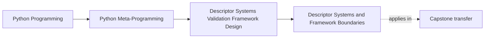
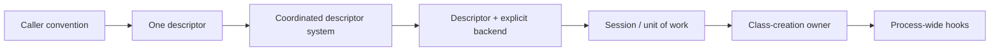
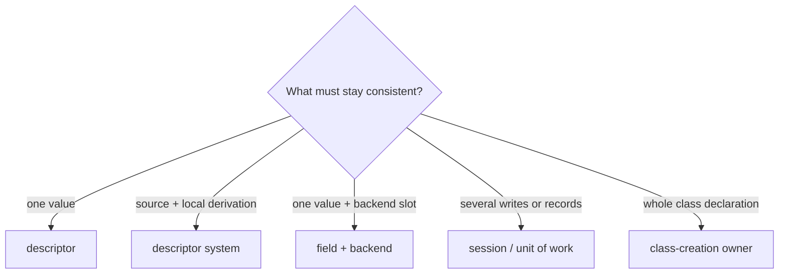

# Descriptor Systems and Framework Boundaries

<!-- page-maps:start -->
## Page Maps




<!-- page-maps:end -->

Descriptors can participate in large systems. Participation does not mean ownership.

The boundary rule for this module is:

> choose the smallest owner that can see the complete invariant.

A lower-power owner is wrong when it cannot observe enough state. A stronger owner is
wrong when it expands blast radius without a present requirement.

## Make the decision executable

Open `labs/descriptor_systems/boundaries.py`.

The lab names five concrete pressures instead of asking whether descriptors are
“powerful enough”:

| Pressure | Selected owner |
| --- | --- |
| normalize one attribute | descriptor |
| invalidate one local derivation | coordinated descriptor system |
| load one authoritative backend field | backend-backed descriptor plus explicit store |
| coordinate record writes | session or unit of work |
| generate a class-wide model contract | explicit class-creation owner |

Run:

```bash
python3 -m unittest tests/test_descriptor_system_boundaries.py -v
make descriptor-system-lab
```

Inspect `architecture_boundary.decisions`. Every decision includes:

- the reason this owner sees the invariant
- a weaker owner that cannot carry it
- a stronger owner that is currently unnecessary
- the signal that would force escalation

This turns “use the least magic” into a reviewable decision rather than a slogan.

## Decision 1: one assignment boundary

Pressure:

```text
normalize-one-attribute
```

Selected owner:

```text
descriptor
```

Caller convention is too weak because every assignment path would need to remember the
rule. A model framework is too strong because no multi-field lifecycle exists.

Escalate when validation starts coordinating multiple attributes.

## Decision 2: one local dependency

Pressure:

```text
invalidate-local-derivation
```

Selected owner:

```text
coordinated descriptor system
```

Manual caller refresh is too weak. A shared cache service is too strong while dependency
and cached state remain inside one instance.

Escalate when freshness must coordinate across instances or processes.

This is where the cache core sits: it has moved beyond one isolated field, but not into
distributed cache architecture.

## Decision 3: one backend slot

Pressure:

```text
load-one-backend-field
```

Selected owner:

```text
backend-backed descriptor plus explicit store
```

The instance dictionary cannot be authoritative because another instance must observe
the same record. A session and unit of work are unnecessary while only one field-shaped
read/write path exists.

Escalate when transactions or object identity span records.

## Decision 4: coordinated writes

Pressure:

```text
coordinate-record-writes
```

Selected owner:

```text
session or unit of work
```

A “smart field” cannot see every write that must succeed or roll back together.
Class-creation machinery is also the wrong owner: generating a class does not coordinate
a runtime transaction.

Escalate toward class creation only when the problem changes—when declarations,
registries, or model-wide APIs must exist as the class is created.

## Decision 5: class-wide generation

Pressure:

```text
generate-class-wide-model
```

Selected owner:

```text
explicit class-creation owner
```

An individual descriptor sees one declaration, not the complete class contract.
Process-wide hooks are stronger than required while ownership remains within a class
family.

This decision is the bridge to Module 09.

## Diagnose hidden architecture

Count the objects and lifecycle phases one access must coordinate:



Warning signs that a field no longer sees the whole invariant:

- it updates or invalidates other records
- it promises atomic changes across fields
- it loads relationships under shared identity rules
- it plans queries
- it coordinates schema versions
- it registers or generates class-wide behavior

At that point, keeping the entry point as `obj.field` may still be reasonable, but the
descriptor is only an adapter into broader architecture.

## Avoid the opposite mistake

Boundary discipline also rejects premature frameworks.

Do not add a session, metaclass, or process-wide registry merely because a descriptor
system might grow later. The current invariant must pay for the stronger owner now.

Use this review sentence:

```text
The selected owner is ___ because it can see ___.
___ is too weak because ___.
___ is stronger than the current invariant requires because ___.
Escalation becomes justified when ___.
```

If any blank remains vague, the design decision is unfinished.

## What the tests prove

`tests/test_descriptor_system_boundaries.py` proves:

- one-attribute normalization remains descriptor-owned
- local invalidation names its cross-instance escalation signal
- coordinated writes move to a session or unit of work
- every published decision includes both refusals and an escalation signal

The tests do not prove that this table decides every architecture. They prove the
course’s named cases are internally coherent and reviewable.

Real systems may have additional pressures such as security boundaries, latency,
concurrency, ownership across teams, or compatibility requirements. Those facts can
change the selected owner.

## Capstone transfer

The incident-plugin capstone uses three ownership levels:

| Responsibility | Owner |
| --- | --- |
| coercion and validation of one configuration value | explicit field descriptor subclass |
| constructor generation and field collection | `PluginMeta` class-creation owner |
| action execution and history | plugin instance and action wrapper |

It rejects:

- external persistence in field access
- cached derived fields
- field-wrapper stacks
- annotation-inferred field policy
- transaction or identity-map claims

That split is the capstone lesson for Module 08: fields stay narrow, and the one
class-wide concern has an explicit class-creation owner.

## Learner work

Choose one proposed “smart field” and produce an owner decision:

1. state the invariant without naming a mechanism
2. list every attribute, object, backend, and lifecycle phase involved
3. choose the smallest owner that can see all of them
4. reject one weaker owner with a concrete blind spot
5. reject one stronger owner with a concrete unnecessary cost
6. name the first condition that would change the decision
7. identify the smallest public proof route

Move on when your owner choice still makes sense after removing words such as
“convenient,” “automatic,” “flexible,” and “advanced.”

## Continue

- Previous: [Hint-Driven Validation and Coercion](hint-driven-validation-and-coercion.md)
- Next: [Worked Example: Building an Educational Mini Relational Model](worked-example-building-an-educational-mini-relational-model.md)
- Practice: [Descriptor System Review Lab](exercises.md)
